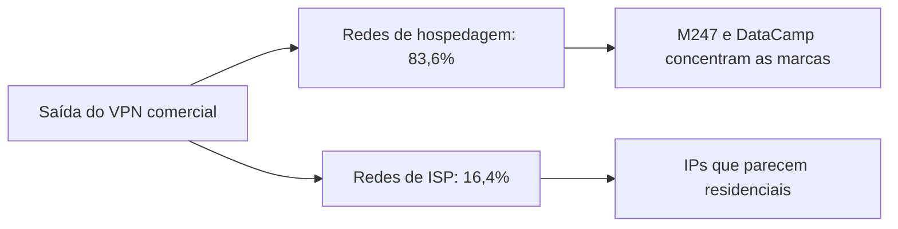
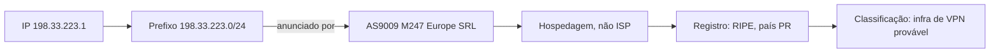

Na [parte 1](/artigos/2026-10-09-ip-pais-asn-bgp/) montamos a cadeia: um IP cai em um prefixo, o prefixo é anunciado por um ASN, o ASN está associado a uma organização, e o registro guarda o país. "Pertence" virou três perguntas separadas, registro, rota e localização.

Agora a pergunta que fecha o ciclo: como um site, um banco ou uma plataforma de streaming sabe que **você** está usando VPN? Spoiler honesto: ninguém tem bala de prata. Mas a indústria inteira repousa sobre uma descoberta empírica que vale entender com números.

## Onde a infraestrutura de VPN mora de verdade

A análise da IPinfo sobre 370.616 IPs de VPN comercial chegou a um número que organiza todo o resto: 83,6% do tráfego de VPN comercial corre em redes de hospedagem, data centers. Os 16,4% restantes usam infraestrutura de provedores de acesso, ISPs, e essa minoria é o ponto cego clássico: IPs que parecem residenciais mas são VPN.

Dentro dos 83,6%, a concentração é impressionante. Estudos independentes que mapearam 50 marcas de VPN consumidor encontraram M247 e DataCamp/CDN77 hospedando servidores de 41 delas, com o diretório do Netify confirmando M247 como a provedora mais prevalente entre as top 50. A estrutura de capital das marcas é outra história: a investigação que originou esses dados atribui a PacketHub S.A. (AS136787, Panamá) a infraestrutura própria do grupo Nord Security, e a CyberZone S.A. (AS209854) a Surfshark. Ou seja, a marca que você instala tem um nome; a rede que o seu tráfego usa costuma ter outro.



## Por que o ASN nunca é o nome da sua VPN

Quase nenhuma VPN consumidor mantém rede global própria. O modelo econômico é alugar: a marca compra capacidade em provedores de hospedagem espalhados pelo mundo e roteia os seus pacotes para sair por lá. O resultado é que o ASN que anuncia o prefixo da sua saída é o ASN do dono do data center, não o da marca do aplicativo.

O nosso laboratório da parte 1, aplicado a um IP real de M247, mostra a discrepância completa:

```bash
whois -h whois.cymru.com " -v 198.33.223.1"
```

```
9009    | 198.33.223.1     | 198.33.223.0/24     | PR | ripencc  | 1992-12-23 | M247 - M247 Europe SRL, RO
```

Três camadas de identidade, três respostas diferentes. O ASN é o 9009, de M247 Europe SRL, nome romeno. O código de país da alocação é PR, Porto Rico, um legado de 1992 que sobreviveu a todas as mudanças de dono. E a rede opera data centers em dezenas de países. Nenhuma dessas três camadas é a marca que está no seu telefone; e a marca, por sua vez, é invisível no BGP.

## Os sinais que os sistemas realmente usam

A detecção empilha evidências independentes, cada uma com custo e qualidade próprios:

1. **Registro e rota.** O whois e o RDAP mostram a organização do bloco; o RIPEstat mostra quem origina. Provedores de hospedagem se deixam reconhecer: AS9009 é M247, AS212238 é CDNEXT, operada pela DataCamp, AS24940 é Hetzner, AS16276 é OVH. A internet tem um punhado de ASNs que são, estatisticamente, infraestrutura de saída de VPN.

2. **Listas de hosting.** Bancos públicos e comerciais catalogam faixas de data center, como a lista de datacenter do X4BNet, com 42.291 faixas IPv4. Marcar um IP como "hosting" é o primeiro degrau, e o mais barato.

3. **Atribuição direta.** As empresas de IP intelligence conectam-se à infraestrutura das VPNs comerciais, mapeiam os pools de saída e mantêm listas por marca. É trabalho manual em escala, e cobre uma fração do universo, mas é a única fonte que responde "qual VPN?".

4. **DNS reverso.** Nomes como `dns.google.` ou padrões de hospedagem (`static`, `dedicated`, códigos de rack) dão contexto barato. Às vezes o reverso vem vazio, e a ausência também é informação.

5. **A lista oficial do Tor.** O projeto Tor publica os endereços de saída em tempo real, um arquivo público e verificável. No dia em que este artigo foi escrito, eram 2.726 endereços ativos:

```bash
curl -s "https://check.torproject.org/exit-addresses" | head -4
```

```
ExitNode 64D74AAA74F30DC2CFB36343CE5D4451B9A4DBA8
Published 2026-10-09 04:05:00
LastStatus 2026-10-09 17:00:00
ExitAddress 171.25.193.25 2026-10-09 17:29:09
```

Tor é o caso fácil: a infraestrutura se declara. VPN comercial é o caso difícil, porque o negócio da marca é parecer comum.

## O ponto cego que nenhum ASN resolve

Lembra dos 16,4%? São IPs de VPN rodando em redes de provedores de acesso residenciais, incluídos aí os nós voluntários de projetos como o VPNGate. Para a detecção, esse tráfego é indistinguível de usuário de casa, por design. A análise da IPinfo identificou 129 provedores de VPN comercial usando essa camuflagem, com a VPNGate sozinha respondendo por 23.810 IPs.

Do outro lado do balanço, os falsos positivos: funcionários de empresas com proxy corporativo, usuários atrás de CGNAT de operadora móvel, CDNs. As listas de datacenter incluem Cloudflare e Akamai entre as maiores redes, mas essas são CDNs, não VPNs. Um sistema que bloqueia tudo o que é "hosting" bloqueia metade da web empresarial junto.



## Laboratório: a classificação em três comandos

O exemplo completo acima sai destes três comandos, todos nativos ou gratuitos:

```bash
# 1. A rota observada: qual ASN origina este prefixo?
curl -s "https://stat.ripe.net/data/network-info/data.json?resource=198.33.223.1"

# 2. Quem é o ASN e como a indústria o reconhece?
curl -s "https://stat.ripe.net/data/as-overview/data.json?resource=AS9009"

# 3. O cadastro do bloco, com a data e o país do legado
whois -h whois.cymru.com " -v 198.33.223.1"
```

O comando 1 devolve `{"asns":["9009"],"prefix":"198.33.223.0/24"}`. O comando 2 devolve o holder `M247 M247 Europe SRL`. O comando 3 devolve a linha que já vimos: bloco registrado na RIPE, país PR, 1992. A engrenagem da detecção é exatamente a da cadeia da parte 1: registro, rota, contexto, reputação. A diferença é que, em vez de perguntar "onde está?", a detecção pergunta "isso é comum ou é infraestrutura?".

## O que a detecção pode e o que não pode

Pode, com boa margem: separar hosting de residencial, apontar ASNs de saída de VPN conhecidos, listar exit nodes do Tor, atribuir marcas mapeadas diretamente.

Não pode, de jeito nenhum: garantir que um IP de hosting seja VPN, prometer cobertura total (os 16,4% escapam por desenho), ou sobreviver sozinha à indústria de proxies residenciais, que aluga IPs de casa de gente real justamente para parecer com você. Detecção de VPN é uma disputa contínua de assimetria de informação, não uma base de dados que uma vez instalada, fica pronta.

E a cadeia da parte 1 continua sendo o mapa de tudo: quando um sistema classifica um IP, ele está consultando o registro, a rota e a reputação, nesta ordem, exatamente como você acabou de aprender a fazer à mão.

## Links oficiais

- Estudo da IPinfo sobre infraestrutura de VPN em ISPs: [IPinfo blog](https://ipinfo.io/blog/vpns-isp-based-ip-infrastructure)
- Diretório de hosts de VPN com as top 50 provedoras: [Netify](https://www.netify.ai/resources/vpns)
- Lista oficial e atual de exit nodes do Tor: [Tor Project](https://check.torproject.org/exit-addresses)
- Listas públicas de faixas de VPN e datacenter: [X4BNet](https://github.com/X4BNet/lists_vpn)
- Estudo independente que mapeou 50 marcas de VPN até as suas redes: [Codamail](https://www.codamail.com/articles/vpn_exposed.html)
- API pública do RIPEstat: [stat.ripe.net](https://stat.ripe.net)
- Parte 1 da série, a cadeia registro → rota → localização: [kb.alicino.me](/artigos/2026-10-09-ip-pais-asn-bgp/)
