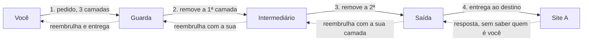
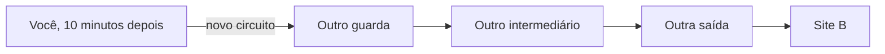
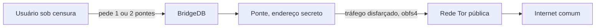

Você aperta "conectar" no Tor Browser e, em alguns segundos, a sua conexão sai do outro lado do mundo atravessada por três computadores de estranhos voluntários. Nenhuma empresa controla esses computadores, nenhum governo os cadastra, e mesmo assim milhares deles funcionam em rede há duas décadas.

A rede Tor é uma das engenharias mais elegantes da internet, e também uma das mais mal compreendidas. Este artigo desmonta o relógio: como a cebola funciona, quem sabe o quê em cada salto, por que existem pontes secretas, e o que acontece no único ponto onde a identidade fica exposta.

Em uma frase: o Tor esconde de quem você está falando, esconde dos outros quem você é, e consegue isso dividindo a confiança entre três estranhos que nunca se encontram.

## A ideia da cebola

O nome é literal. A proposta do artigo original, "Tor: The Second-Generation Onion Router", de Dingledine, Mathewson e Syverson, de 2004, é empilhar camadas de criptografia como as camadas de uma cebola: cada nó da rota recebe a mensagem embrulhada em camadas que só ele consegue remover, uma por vez.

Na prática, o Tor Browser cria três camadas de criptografia em cima do seu tráfego e o entrega a três nós sucessivos. O primeiro remove a camada externa e descobre para onde encaminhar, mas não consegue abrir o restante. O segundo repete o processo. O terceiro remove a última camada e entrega a requisição ao destino. Cada nó vê só a sua fatia: de onde veio e para onde vai, nunca as duas coisas completas ao mesmo tempo.

É essa separação que produz a propriedade central do sistema. Nenhum nó individual conhece a identidade de quem envia e o destino juntos; só o caminho inteiro conhece as duas pontas, e ele nunca existe completo dentro de um único computador.

## O circuito de três saltos

O seu Tor Browser escolhe três relays, computadores que rodam o protocolo Tor, o conjunto de regras que faz máquinas de donos diferentes conversarem no mesmo idioma, e monta o que se chama de circuito:



As funções são assimétricas e cada uma tem um nome próprio:

1. **O nó de entrada, ou guarda.** É o primeiro a ver o seu IP real. A rede mantém um nó de guarda fixo por longos períodos, semanas a meses, porque trocar de guarda a cada conexão tornaria o rastreamento por estatística mais fácil. É o único nó que conhece você.
2. **O nó intermediário.** Existe apenas para quebrar o vínculo. Ele conhece o nó de entrada e o nó de saída, mas nunca você nem o destino.
3. **O nó de saída.** O único que fala com o destino. Ele vê o site que você acessa e, se o tráfego não tiver criptografia própria, o conteúdo em texto plano. É o ponto mais sensível da arquitetura, e volta ao assunto mais adiante.

E a volta? Pelo mesmo caminho, no sentido inverso. O site responde para a saída sem saber quem você é, e cada relay reembrulha a resposta com a sua camada de criptografia, até ela chegar ao seu navegador coberta pelas três camadas de novo, pronta para ser aberta só por você.

Uma pergunta que o diagrama costuma provocar: tudo bem, a volta usa os mesmos três nós, mas e o nó do meio? Ele também. O circuito é fixo durante a vida dele: os três relays são escolhidos uma vez e servem para as duas direções. O que muda é a chave. Quando o circuito é construído, o seu navegador negocia com cada relay duas chaves, uma para a ida e outra para a volta. Cada relay vira um porteiro com duas fechaduras: na ida, abre a sua camada; na volta, fecha a sua camada sobre o pacote que passa. O nó do meio repete o papel nas duas direções: conhece o relay vizinho de cada lado, mas nunca a sua origem nem o seu destino. E é por isso que a resposta nunca volta por outro caminho: as chaves de volta existem somente naqueles três relays.

Circuitos não são para sempre: por padrão, o navegador troca de circuito a cada dez minutos de atividade, com o guarda persistindo entre os circuitos. Cada site tende a receber um circuito diferente, o que impede que dois acessos, um ao seu banco e outro ao fórum, compartilhem o mesmo caminho. Dez minutos depois, a mesma viagem acontece com elenco novo:



## O dicionário do Tor

Cinco palavras cobrem quase toda a conversa sobre a rede. Vale voltar aqui quando alguma delas reaparecer:

1. **Relay.** Um computador que roda o Tor e retransmite tráfego. Os relays públicos formam o esqueleto da rede.
2. **Circuito.** O caminho de três relays que o seu navegador monta para uma sessão de navegação.
3. **Guarda.** O primeiro relay do circuito, o único que conhece o seu IP real.
4. **Ponte.** Um relay de entrada que não aparece em lista alguma, feito para lugares onde o acesso ao Tor está bloqueado.
5. **Saída.** O último relay do circuito, aquele que entrega o pedido ao site de destino.

## Quem roda os nós: uma rede de voluntários auditável

A Tor não é uma empresa nem uma infraestrutura alugada. Os relays são computadores de voluntários, instituições, bibliotecas, universidades e entusiastas, espalhados pelo mundo. E tudo é público: a rede publica, a cada hora, um documento de consenso que lista os relays ativos. Ele funciona como a lista telefônica da rede, revisada a cada hora e assinada por um conjunto de autoridades de diretório independentes; se uma delas tentar mentir sobre a lista, as assinaturas das outras denunciam a fraude.

Os números ao vivo no dia da escrita deste artigo, direto do [Onionoo](https://onionoo.torproject.org), o serviço de dados do projeto Tor:

```text
Relays ativos:   10.130
Pontes ativas:    3.434
```

Todo o inventário é consultável por qualquer pessoa, com endereço IP, nome, capacidade e país de cada relay. Essa transparência é uma escolha de segurança: quanto mais fácil auditar a rede, mais difícil para um atacante disfarçar a sua presença nela.

## Pontes: quando listar tudo é um problema

E aqui a transparência vira vulnerabilidade. Se um governo bloquear todos os IPs da lista de relays, o Tor morre no país inteiro. Para os operadores autoritários, o documento de consenso é uma lista de alvos pronta.

A resposta do projeto foi criar um segundo tipo de nó, a ponte, que não é listada em lugar nenhum. Pontes não publicam endereço no consenso; servem como porta de entrada secreta para quem vive sob censura. O próprio protocolo de dados reflete a distinção: nas respostas do Onionoo, o fingerprint de um relay aparece completo (o fingerprint é o identificador criptográfico do nó, a impressão digital que distingue um relay de outro), enquanto o das pontes aparece com hash, porque o endereço delas deve permanecer secreto por design.

Como o usuário censurado descobre uma ponte se ninguém pode listar as pontes? O [BridgeDB](https://bridges.torproject.org) distribui em pequenos lotes, por e-mail, por site ou dentro do Tor Browser, e ninguém recebe o conjunto todo. Para o tráfego não ser reconhecido nem como Tor já na conexão com a ponte, existem os transportes plugáveis, que disfarçam o tráfego Tor: o obfs4 o torna ruído indistinguível, o Snowflake o encaminha por voluntários com a mesma tecnologia das videochamadas (WebRTC), e o meek o disfarça como tráfego de CDNs, as empresas que entregam sites pelo mundo.



## Serviços onion: quando o destino também se esconde

A cebola funciona nos dois sentidos. Num serviço onion, o destino, aquele endereço terminado em `.onion`, também não revela a localização: a conexão é construída a partir de pontos de encontro voluntários dentro da rede, e o endereço do serviço é, na verdade, a chave pública dele. Você não consulta um servidor na posição X; você prova um segredo criptográfico que só aquele serviço possui.

É por isso que um endereço `.onion` não pode ser falsificado e não depende do DNS, o catálogo de nomes da internet: o nome e a identidade são a mesma coisa. E é por isso que tanto jornalistas quanto redes sociais sérias mantêm espelhos onion: o serviço fica acessível em locais censurados sem revelar onde os seus servidores estão.

## O nó de saída: o ponto onde você aparece

Todo o desenho anterior protege o seu anonimato até a porta de saída. Nela, a requisição sai para a internet comum com o IP do relay de saída, e o que acontece ali depende do protocolo que você usou:

1. **Tráfego TLS, o HTTPS do cadeado do navegador, hoje a esmagadora maioria da web:** o nó de saída transporta a sessão criptografada de ponta a ponta entre você e o destino. Ele vê o domínio, não o conteúdo.
2. **Tráfego em texto plano:** o nó de saída vê tudo, inclusive senhas. Por isso navegadores atuais avisam e o próprio Tor Browser bloqueia protocolos antigos inseguros.

Esse é o ponto em que a rede troca anonimato por responsabilidade: para quem recebe, o visitante é o relay de saída. Se alguém usa o circuito de outro para cometer abuso, o IP acusado é do operador do nó. Operar um nó de saída é um ato com consequências legais reais, documentadas em processos e apreensões de equipamentos ao longo dos anos, e o projeto Tor mantém um guia de recursos comunitários e jurídicos para quem se candidata a isso.

## O que o Tor protege e o que não protege

Para quem está começando, esta lista vale mais do que qualquer diagrama.

O que o Tor protege bem:

1. **A sua localização e o seu IP**, invisíveis para os sites que você visita
2. **O que você navega contra observadores locais**, como o provedor de internet: ele enxerga que você usa o Tor, mas não o quê
3. **A confidencialidade em sites com HTTPS**, que segue criptografada de ponta a ponta

O que o Tor não protege:

1. **Contas com o seu nome.** Se você fizer login com identidade real dentro do Tor, o site sabe exatamente quem é você
2. **Arquivos.** Abrir um documento baixado entrega o seu computador ao programa que o abre, fora da proteção do navegador
3. **Malware e golpes.** O Tor anonimiza a conexão, não vacina contra conteúdo perigoso
4. **O que você mesmo revela.** Escrever quem você é num fórum desmonta o circuito mais perfeito

## Tor não é uma VPN

Uma expectativa honesta: Tor não é VPN. A VPN cifra o seu caminho até o provedor e troca o seu IP; a rede Tor adiciona anonimato por separação de confiança, nenhuma parte isolada conhece o quadro completo. O preço é latência, o atraso que a sua conexão sente: três saltos e três camadas custam em tempo de resposta, e a velocidade raramente compete com uma conexão direta. O Tor Browser também impõe disciplina, bloqueando scripts e recursos que poderiam desanonimizar, e sites antifraude frequentemente o tratam com suspeita, tema que já conhecemos pela [parte 2 da série](/artigos/2026-10-10-deteccao-vpn-hosting-asn/).

Para a detecção, o Tor é o caso transparente: as saídas estão numa lista oficial, pública, e atualizada em tempo real. No dia da escrita, eram 2.743 endereços de saída ativos, subindo e caindo conforme operadores ligam e desligam os seus relays.

## Laboratório: a rede ao vivo, sem instalar nada

Três comandos, todos com fontes oficiais do projeto Tor:

```bash
# 1. Quantos relays e pontes existem agora?
curl -s "https://onionoo.torproject.org/summary?type=relay" | grep -c '"f"'
curl -s "https://onionoo.torproject.org/summary?type=bridge" | grep -c '"h"'

# 2. Quais endereços estão saindo para a internet agora?
curl -s "https://check.torproject.org/exit-addresses" | head -4

# 3. Quantas saídas ativas neste momento?
curl -s "https://check.torproject.org/exit-addresses" | grep -c "^ExitAddress"
```

Repare no detalhe dos comandos 1: o campo do relay é `"f"`, de fingerprint completo, e o da ponte é `"h"`, um hash, resumo matemático irreversível que confirma a identidade sem revelar o endereço. A diferença está na resposta da API porque está na arquitetura: relay se lista, ponte se esconde.

## Links oficiais

- Documentação e visão geral: [Tor Project](https://www.torproject.org)
- Especificações do protocolo: [spec.torproject.org](https://spec.torproject.org)
- Estatísticas e número de relays: [metrics.torproject.org](https://metrics.torproject.org)
- API de dados da rede: [onionoo.torproject.org](https://onionoo.torproject.org)
- Lista de saídas em tempo real: [check.torproject.org/exit-addresses](https://check.torproject.org/exit-addresses)
- Pedir pontes: [bridges.torproject.org](https://bridges.torproject.org)
- Recursos para operadores de relays, incluindo jurídicos: [community.torproject.org](https://community.torproject.org/relay/community-resources/)
- Detecção de VPN e infraestrutura de saída, parte 2 da série: [kb.alicino.me](/artigos/2026-10-10-deteccao-vpn-hosting-asn/)

## Conclusão

A rede Tor resolve um problema que VPN não resolve: anonimato por design, com confiança distribuída em vez de confiança transferida. Nenhum nó conhece o quadro completo, o inventário é público e auditável, e até o mecanismo de sobrevivência contra censura, as pontes, é uma lição de design: a parte mais valiosa do sistema é a que ele se recusa a listar.

O próximo passo natural da série é a pergunta que a parte 2 deixou no ar: quando o anonimato e o roteamento são assinados criptograficamente, o que muda na detecção? É o território do RPKI, assunto para um artigo futuro.
