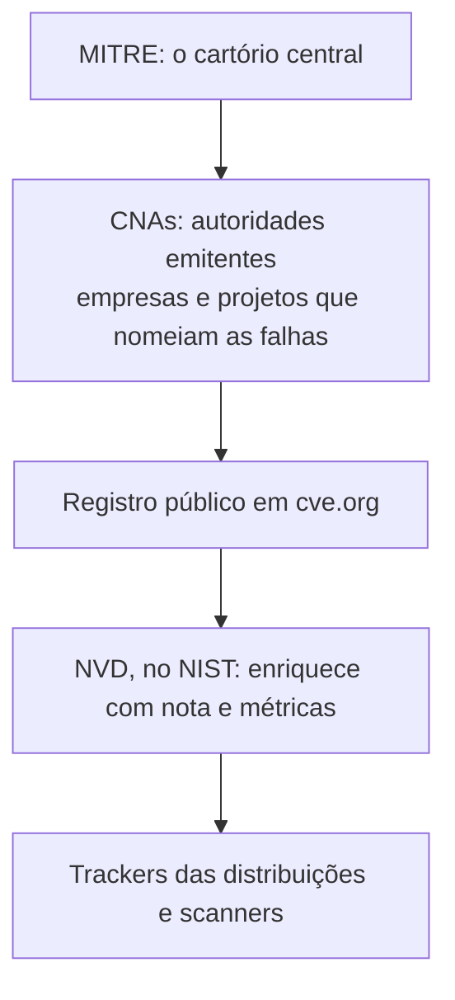
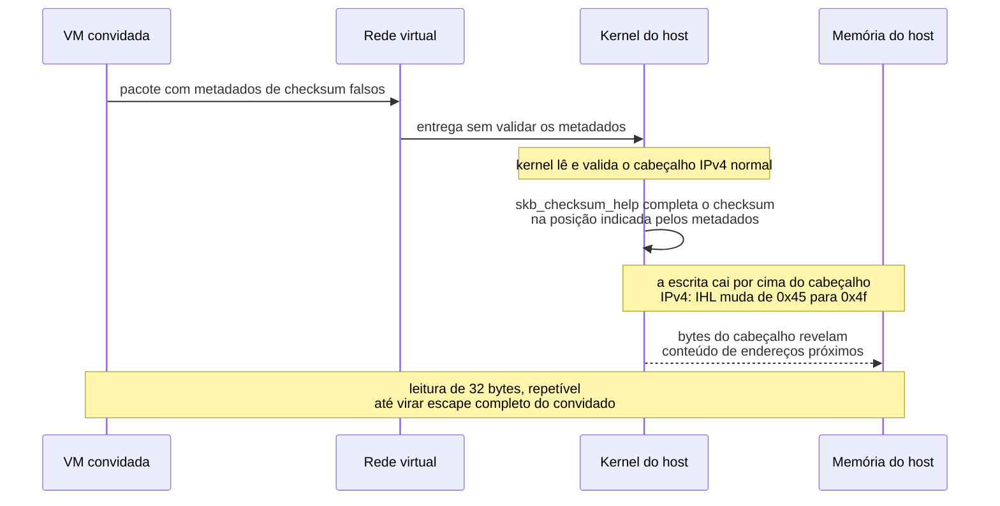

Em agosto de 2026, a Vercel ofereceu até um milhão de dólares para quem escapasse do seu sandbox, o ambiente isolado que executa código de clientes na nuvem. Em três dias, um pesquisador achou o que viria a ser a única falha crítica do desafio. E o mais interessante: a falha nem estava na Vercel. Estava no kernel Linux, no código de rede que o mundo inteiro usa. O registro dela ganhou o nome CVE-2026-99999 e o apelido PwnEscape.

Este artigo começa pela palavra CVE, que aparece em toda notícia de segurança e quase nunca é explicada. Depois entra no caso em si: o que a falha causa, como foi descoberta, o que o conserto faz, como aplicar e como acompanhar a correção na sua distribuição.

## O que é um CVE: o RG das vulnerabilidades

CVE significa Common Vulnerabilities and Exposures, algo como vulnerabilidades e exposições comuns. É um número único dado a cada falha de segurança já identificada e confirmada em algum software do mundo. O formato é simples: as letras CVE, o ano da descoberta e um número de série, como CVE-2026-99999.

A analogia que fica: o CVE é o RG de uma falha. Antes dele existir, a mesma vulnerabilidade podia ganhar nomes diferentes em cada empresa, cada blog e cada ferramenta de segurança, e ninguém conseguia saber se estavam falando da mesma coisa. Com o número, a conversa global fica em uma linha: patches, bases de dados, scanners e notícias usam o mesmo identificador.

Vale desfazer um mal-entendido comum: o número não mede gravidade e não diz que você está em perigo. Ele só identifica a falha. A gravidade é um número separado, o CVSS, que veremos adiante.

## Quem gerencia o sistema

Três peças dividem o trabalho:



1. **MITRE**, uma organização americana de pesquisa, mantém o programa CVE desde 1999, com patrocínio do governo dos Estados Unidos através da CISA, a agência de segurança cibernética do país
2. **CNAs**, as CVE Numbering Authorities, são as autoridades emitentes: mais de 400 empresas e projetos autorizados a dar números às falhas que descobrem, no próprio território delas. O kernel Linux tem o seu, o CNA do kernel.org, que desde 2024 é quem registra as vulnerabilidades do kernel, inclusive a deste artigo
3. **NVD**, o National Vulnerability Database, operado pelo NIST, recebe cada registro e o enriquece: analisa os detalhes, classifica o impacto e publica a nota CVSS, de 0 a 10, padronizada pela organização FIRST

A ponta final da cadeia são os rastreadores das distribuições, que anotam para cada CVE o estado do pacote em cada ramificação: afetado, consertado, ou pendente. É para esses rastreadores que apontamos no fim do artigo.

## O desafio de US$ 1 milhão

A Vercel, empresa de nuvem que hospeda aplicações web, rodou em agosto de 2026 um desafio público de duas semanas: quem conseguisse escapar do sandbox deles levava até um milhão de dólares em prêmios somados. O sandbox é a camada que executa o código de um cliente separado do código dos outros, como apartamentos em um prédio compartilhado.

O resultado oficial: 1.285 relatórios, 242 mil dólares pagos, prêmio máximo de 50 mil por relatório, e um único achado classificado como crítico. Foi o trabalho de Paulos Yibelo, da PWNAI Research, publicado com o título PwnEscape. A pergunta da pesquisa, nas palavras do autor: quanto um convidado não confiável pode influenciar o kernel do hospedeiro sem explorar o KVM em si?

A resposta assustou pela elegância: a falha não estava no hypervisor, o software que gerencia as máquinas virtuais, e sim na pilha de rede do Linux. Isso significa que o problema alcança muito além da Vercel: qualquer plataforma de nuvem, sandbox ou hospedagem de VMs que rode kernels vulneráveis estava exposta. A Vercel, pelo relato do pesquisador, agiu rápido: protegeu os clientes, rodou pesquisa própria, avisou outros provedores de hypervisor e coordenou a correção com a comunidade do kernel.

## A falha: o que o CVE-2026-99999 causa

O coração do problema é um conceito antigo de rede: o checksum, a soma de conferência que todo pacote carrega para permitir a verificação de integridade. No kernel Linux, cada pacote vive dentro de uma estrutura chamada sk_buff, o envelope que viaja pela pilha de rede, e o envelope guarda metadados sobre onde está o checksum do pacote, o csum_start.

O detalhe decisivo: quando o pacote vem de uma máquina virtual, esses metadados são controlados pelo convidado. E a rotina que completa o checksum, a skb_checksum_help, escreve o resultado no lugar que os metadados apontam. Se o convidado mente sobre o lugar, a escrita cai onde não deveria: por cima do cabeçalho IPv4 que o kernel já tinha lido e validado.

A sequência completa do ataque, do convidado até a memória do hospedeiro:



O byte que dá o formato ao vazamento é o IHL, o campo do IPv4 que diz o tamanho do cabeçalho. Num pacote normal ele vale 0x45, que significa cinco palavras de 32 bits, ou 20 bytes. Com a escrita fora de lugar, ele vira 0x4f: quinze palavras, 60 bytes. O kernel passa a ler 40 bytes a mais do que o pacote tem, e esses bytes são memória do hospedeiro, entregues de presente ao convidado. A leitura é repetível e ajustável, e os pesquisadores a transformaram em um escape completo, do convidado para o hospedeiro, no KVM e em muitos outros ambientes de virtualização.

O quadro de gravidade da CVE, no padrão CVSS 3.1, dá nota 9.3, crítica: ataque local, de baixa complexidade, sem exigir privilégios prévios nem interação do usuário, e com escopo alterado, o S:C que indica que a falha quebra a fronteira entre sistemas. C, I e A, confidencialidade, integridade e disponibilidade, todas em alto.

## Por que um ataque local assusta

A nota diz que o atacante precisa já estar executando código dentro de uma máquina virtual. Ninguém consegue explorar isso enviando pacotes pela internet aberta. Pode parecer consolo, e não é.

A razão é a multi-tenancy, a separação de clientes na mesma máquina física que sustenta a nuvem moderna. Quando você contrata um VPS ou roda um container num sandbox de uma plataforma, seu vizinho de hardware pode ser qualquer um. Uma falha de escape é justamente a ferramenta que transforma um ataque contra o vizinho em ataque contra o hospedeiro que os abriga a todos. É o cenário que [o artigo sobre QEMU/KVM](/artigos/2026-09-25-qemu-kvm-vms-linux/) descreve do ponto de vista da arquitetura, e o PwnEscape mostra a face prática do risco.

Dois alívios honestos: na data da escrita, não há sinal de uso da falha em ataques reais, e a falha não aparece no catálogo de exploração ativa da CISA. O conserto já está no kernel principal, e a divulgação foi coordenada.

## O conserto

O remendo tem uma linha de raciocínio simples, escrita por Michael S. Tsirkin, da Red Hat: antes de completar o checksum, verifique se a posição de escrita está depois do cabeçalho IPv4 já validado. O código acrescentado à include/net/ip.h define o guardião:

```c
static inline int ip_check_csum_start(const struct sk_buff *skb)
{
	if (unlikely(skb->csum_start < skb->network_header + ip_hdrlen(skb)))
		return -EINVAL;
	return 0;
}
```

A condição diz: o início do checksum precisa estar a partir do fim do cabeçalho IP. Se os metadados apontarem para dentro do cabeçalho, a rotina recusa e o caminho falha de forma controlada, em vez de escrever em cima de dados que o kernel já confia.

O commit 6785011f8b16 foi aceito no ramo de rede do kernel em 8 de outubro de 2026 e entrou na árvore principal de Linus em 14 de outubro. Ele aplica a verificação em cinco pontos da pilha IPv4, em seis arquivos, e a mensagem do commit é honesta sobre o alcance: é uma medida de defesa em profundidade, e a validação completa na entrada dos pacotes ainda vem por aí, com mais trabalho. A lição que fica para quem desenvolve: confiança em metadados deve ser proporcional à origem deles, e um metadado que atravessa uma fronteira de confiança, como a do convidado para o hospedeiro, precisa ser revalidado do outro lado.

## Como resolver

A regra de ouro: quem conserta é o **kernel do hospedeiro**. Atualizar o kernel da sua máquina virtual não muda nada, porque a falha está fora dela. O passo a passo:

1. **Descubra o kernel do seu host** com `uname -r`
2. **Compare com as versões corrigidas** do registro: 5.10.272, 5.15.223, 6.1.190, 6.6.159, 6.12.113, 6.18.57 e 7.2.11 são as primeiras versões consertadas de cada ramo estável
3. **Atualize pela distribuição** do host, que distribui o remendo em versões equivalentes, e reinicie no kernel novo
4. **Se você é cliente de uma nuvem**, a correção é do provedor: a pergunta certa para o suporte é qual versão de kernel do host eles estão rodando, e se já inclui o commit 6785011

Para quem mantém hipervisores próprios, com [QEMU/KVM](/artigos/2026-09-25-qemu-kvm-vms-linux/) ou qualquer outra plataforma, a ordem é a mesma: host primeiro, reboot, e só então considerar o assunto encerrado.

## Como acompanhar

Os rastreadores oficiais de cada distribuição anotam o estado do pacote ramificação por ramificação, e foram todos verificados na data da escrita:

1. **Debian**: [security-tracker.debian.org/tracker/CVE-2026-99999](https://security-tracker.debian.org/tracker/CVE-2026-99999), com o estado de bookworm, trixie e sid. Na consulta desta semana, parte das ramificações já aparecia corrigida e outra ainda vulnerável, retrato ao vivo de uma semana de correção
2. **Ubuntu**: [ubuntu.com/security/CVE-2026-99999](https://ubuntu.com/security/CVE-2026-99999), com versões afetadas e as atualizações publicadas
3. **Red Hat**: [access.redhat.com/security/cve/CVE-2026-99999](https://access.redhat.com/security/cve/CVE-2026-99999), com os avisos de segurança e os pacotes corrigidos
4. **SUSE**: [suse.com/support/security/cve/CVE-2026-99999.html](https://www.suse.com/support/security/cve/CVE-2026-99999.html)
5. **NVD**: [nvd.nist.gov/vuln/detail/CVE-2026-99999](https://nvd.nist.gov/vuln/detail/CVE-2026-99999), o registro enriquecido pelo NIST
6. **O registro original**: [cve.org/CVERecord?id=CVE-2026-99999](https://www.cve.org/CVERecord?id=CVE-2026-99999)
7. **O conserto no kernel**: [commit 6785011f8b16](https://git.kernel.org/pub/scm/linux/kernel/git/torvalds/linux.git/commit/?id=6785011f8b16abf40b1e9d8b2e332232b3e68822), na árvore de Linus
8. **Os anúncios oficiais do kernel**: [lore.kernel.org/linux-cve-announce](https://lore.kernel.org/linux-cve-announce/), a lista onde cada CVE do kernel é anunciado
9. **A divulgação técnica completa**: [oss-security](https://www.openwall.com/lists/oss-security/2026/10/15/5), com a análise do pesquisador e do remendo

## Conclusão

O sistema de CVEs é o vocabulário comum da segurança: um número que faz um achado em um sandbox de nuvem virar aviso global, remendo em cada distribuição e decisão de atualização em cada hospedeiro do planeta, tudo em uma semana. O PwnEscape conta essa máquina funcionando de ponta a ponta: a descoberta no desafio da Vercel, o registro pelo CNA do kernel, o conserto na árvore principal e o backport para cada ramo estável.

E deixa a lição de engenharia: o isolamento entre máquina virtual e hospedeiro é feito de software, e software tem defeitos. A fronteira de confiança não é uma linha no diagrama; é uma promessa que o kernel precisa cumprir em cada metadado que chega do lado de lá. Desta vez, era um checksum. Da próxima, pode ser outro campo que ninguém revalidou.
