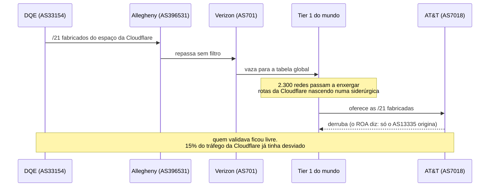
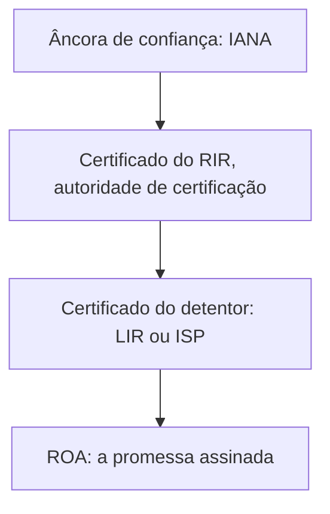
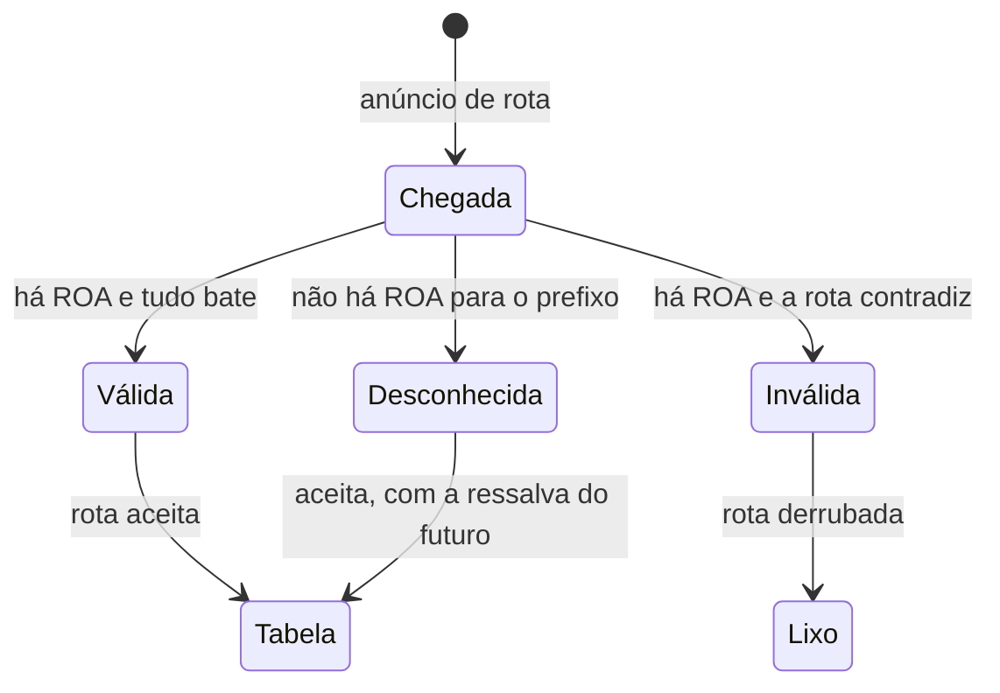
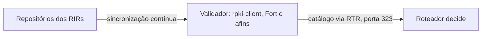

Na manhã de 24 de junho de 2019, o tráfego de milhares de sites, entre eles o da própria Cloudflare, começou a passar por uma fabricante de metais na Pensilvânia. Ninguém hackeou nada. Nenhum malware, nenhum ataque. A internet fez exatamente o que o seu protocolo de roteamento manda fazer: acreditar no anúncio mais específico que encontrou.

O problema não era um defeito de máquina. Era um defeito de confiança: o BGP, o sistema que move o tráfego entre as redes do mundo, aceita a palavra de qualquer um. A resposta da comunidade técnica a essa fragilidade se chama RPKI, e é o assunto deste artigo, o próximo degrau da série que já percorreu [registro](/artigos/2026-10-09-ip-pais-asn-bgp/), [detecção](/artigos/2026-10-10-deteccao-vpn-hosting-asn/) e [Tor](/artigos/2026-10-16-como-funciona-a-rede-tor/).

## O problema: BGP acredita em tudo

Recapitulando a [parte 1 da série](/artigos/2026-10-09-ip-pais-asn-bgp/): as redes se anunciam entre si por BGP, e cada ASN declara os prefixos que sabe alcançar. O desenho original do protocolo não tem verificação de nada. Qualquer ASN pode anunciar qualquer prefixo, incluindo faixas que pertencem a outra pessoa.

Quando isso acontece de propósito, chama-se sequestro de rota. Quando acontece por acidente, chama-se desconfiguração, e o efeito para o usuário é o mesmo: o tráfego vai para o lugar errado. Pior: a regra do caminho mais específico, o prefixo mais longo vence, transforma um anúncio pequeno e falso no preferido por toda a internet. Anunciar um /24 falso dentro do /20 de alguém é a forma mais barata de roubar o tráfego de um endereço.

## O caso de 24 de junho de 2019

A sequência completa do incidente, com os papéis reais, cabe numa linha do tempo:



O otimizador de tráfego da DQE, um provedor regional da Pensilvânia, fabricou prefixos mais específicos do espaço da Cloudflare para "otimizar" as suas próprias rotas. Eles escorreram para a cliente vizinha, a Allegheny, que não é provedora: é uma fabricante de aço. Da Allegheny para a Verizon, e da Verizon, num vazamento clássico, para os grandes provedores de trânsito do mundo.

Um detalhe salvou parte da internet: a AT&T rejeita rotas que falham na verificação de origem. Como a Cloudflare tinha ROAs publicados para os seus blocos, as /21 fabricadas chegavam à AT&T com o rótulo de inválidas e morriam ali, automaticamente, sem ligação de madrugada. As redes que não verificavam aceitaram tudo. O post-mortem da Cloudflare documentou o caminho completo, ASN por ASN.

## A resposta: RPKI, o cartório da internet

A fragilidade do BGP é a ausência de um cartório: ninguém exige documento na porta. O RPKI (Resource Public Key Infrastructure) cria exatamente esse cartório, aproveitando a estrutura que já conhecemos da [parte 1](/artigos/2026-10-09-ip-pais-asn-bgp/).

A ideia usa o mesmo padrão de certificados dos sites seguros, o X.509, o formato por trás do cadeado do navegador. A diferença é o conteúdo: em vez de provar que um site pertence a uma empresa, o certificado RPKI prova que uma organização tem direito de usar uma faixa de IPs. E a hierarquia dos certificados espelha a hierarquia dos números:



Cada um dos cinco RIRs opera a sua autoridade certificadora, derivando a confiança da âncora da IANA. Um provedor brasileiro recebe certificados da LACNIC, que derivam da mesma raiz. Quem quiser conferir a cadeia inteira pode, porque tudo é público e verificável por qualquer um, como no espírito transparente do Tor.

## ROA: a promessa assinada

Dentro dessa infraestrutura vive o documento que muda o jogo: o ROA (Route Origin Authorization), a Autorização de Origem de Rota. Um ROA é uma declaração assinada digitalmente com três campos, e vale a pena ler os três com atenção:

1. **O prefixo.** A faixa de IPs que está sendo protegida, como `1.1.1.0/24`
2. **O ASN autorizado.** O único sistema autônomo que pode originar esse prefixo
3. **O maxLength.** O comprimento máximo de prefixo que esse ASN pode anunciar dentro da faixa

A analogia que fica: um ROA é a autorização de transporte emitida no cartório, dizendo "apenas o caminhão 13335 pode fazer entregas no endereço 1.1.1.0/24, e nenhuma entrega menor que /24". Se um caminhão de outra empresa aparecer com uma encomenda menor, como as /21 fabricadas pela DQE no caso de 2019, o documento desmente na hora.

Cada combinação válida de prefixo e ASN, depois de validada, vira uma linha num catálogo global: o VRP (Validated ROA Payload). No dia da escrita deste artigo, o cartório mundial tinha exatamente 1.037.816 dessas promessas assinadas, e é possível baixar o cadastro completo de graça, como veremos no laboratório.

## Os três veredictos

Quando um anúncio de rota chega num roteador que valida origem, a comparação entre o anúncio e o catálogo de ROAs termina num dos três veredictos, definidos no RFC 6811:



O terceiro veredicto é a sutileza que mais engana iniciantes. Desconhecido não é inválido: é o anúncio de um prefixo que simplesmente não tem ROA. A internet não pode punir quem não assinou, porque metade do mundo ainda está aprendendo. Inválida é a rota que **contradiz** um documento existente: o ASN errado originando, ou um comprimento além do autorizado. Desconhecida é apenas ausência de papelada. O roteador que valida derruba a inválida e mantém a desconhecida, e essa escolha prudente é o que permite a adoção gradual sem partir a internet.

## Como o roteador descobre tudo isso

Nenhum roteador fala com o cartório diretamente. Entre os repositórios públicos e a decisão de encaminhamento existe uma esteira de três etapas:



O validador, um software dedicado como o rpki-client ou o Fort, coleta e verifica todos os certificados e ROAs dos cinco RIRs, confere as assinaturas da cadeia inteira e entrega ao roteador apenas o resultado limpo, o catálogo de VRPs, por um protocolo próprio chamado RTR. O roteador consulta o catálogo local a cada anúncio e aplica o veredicto. O ciclo se repete a cada poucos minutos, porque promessas expiram e novas aparecem.

## Por que funciona: a rota inválida morre sozinha

Adoção sem efeito seria burocracia. Os números provam o efeito. No levantamento da IPinfo de setembro de 2026, 70,3% das rotas IPv4 anunciadas na tabela global eram válidas, subindo de 54% em apenas um ano. O detalhe que fica na memória está na visibilidade: uma rota válida típica aparece nos 596 pontos de medição que alimentam as tabelas globais; uma rota inválida aparece em 2. Ela nasce e morre praticamente sozinha, porque as redes grandes rejeitam na fronteira.

O marco histórico veio em 1º de maio de 2024, quando a maioria das rotas IPv4 da tabela global passou a ter ROAs pela primeira vez, segundo o monitor do NIST. O IPv6, sempre adiantado nessa corrida, está na frente: 79% contra 68% das rotas IPv4. E um único país moveu o mundo no último ano: a China passou de 3,7% para 83% das suas rotas assinadas, responsável por quase 60% do ganho global.

## LACNIC: a pioneira

A América Latina entrou antes de todo mundo. A LACNIC colocou o seu RPKI em produção em 1º de janeiro de 2011, a primeira região do planeta a oferecer certificação de recursos aos seus membros, com o sistema posteriormente adotado pelos outros RIRs. Hoje a região mantém 69% das suas rotas IPv4 com ROAs, conforme o relatório do Hurricane Electric, no pelotão da frente, atrás apenas das regiões da APNIC e da RIPE NCC.

Para o leitor brasileiro, o detalhe é relevante: os ROAs do seu provedor provavelmente saem da LACNIC, e verificar a assinatura das rotas que chegam até você é uma consulta de segundos, como a do laboratório abaixo.

## O que o RPKI não resolve

A honestidade técnica evita decepções. O RPKI protege uma única coisa: **a origem do anúncio**, o vínculo entre prefixo e ASN. Todo o resto do perigo continua de pé:

1. **Manipulação do caminho.** Um roteador malicioso no meio do caminho pode alterar a lista de ASNs sem quebrar a validação de origem
2. **O sequestro pelo próprio dono.** Se o detentor do ROA decide anunciar de má-fé, o documento está do lado dele
3. **A armadilha do maxLength.** Configurar o comprimento errado derruba anúncios legítimos: se o ROA autoriza até /24 e o dono precisa anunciar um /23, o mundo trata o próprio anúncio como falso
4. **Promessas esquecidas.** ROAs vencidos ou desatualizados viram armadilhas silenciosas que desligam tráfego legítimo

O próximo degrau depois de assinar a origem é assinar o caminho inteiro, e a comunidade já trabalha nisso com propostas como a ASPA. Por ora, a origem assinada já quebrou o modelo mais barato de sequestro.

## Laboratório: um milhão de promessas assinadas

O cartório completo do mundo é público e baixa em um comando. São cerca de cem megabytes de JSON com todos os VRPs vivos:

```bash
# 1. Baixar o cadastro mundial (aproximadamente 100 MB)
curl -s "https://console.rpki-client.org/vrps.json" -o vrps.json

# 2. Procurar o ROA do resolvedor 1.1.1.1, visto na parte 1
grep '"prefix": "1.1.1.0/24"' vrps.json

# 3. Quantas promessas existem neste momento?
grep -c '"prefix"' vrps.json
```

O comando 2 devolve a linha real do cartório, capturada no dia da escrita:

```json
{ "asn": 13335, "prefix": "1.1.1.0/24", "maxLength": 24, "ta": "apnic", "expires": 1792937860 }
```

Leia como: a APNIC, a autoridade da região do bloco, atesta que o ASN 13335 é o único autorizado a originar o 1.1.1.0/24, com validade com data marcada. É a mesma promessa que a AT&T cobrou na porta em 2019. Para checar o veredicto de qualquer prefixo da internet, o [bgp.tools](https://bgp.tools) mostra o status de validação na página de cada rota, junto de quem a origina.

## Links oficiais

- Arquitetura do RPKI: [RFC 6480](https://www.rfc-editor.org/rfc/rfc6480)
- O formato do ROA: [RFC 6482](https://www.rfc-editor.org/rfc/rfc6482)
- Os três veredictos da validação: [RFC 6811](https://www.rfc-editor.org/rfc/rfc6811)
- Cadastro mundial de VRPs, atualizado continuamente: [console.rpki-client.org](https://console.rpki-client.org)
- Monitor global do NIST: [rpki-monitor.antd.nist.gov](https://rpki-monitor.antd.nist.gov)
- Painel de adoção da Cloudflare: [RPKI Radar](https://rpki.cloudflare.com)
- Análise do marco de adoção: [APNIC Blog](https://blog.apnic.net/2024/05/08/rpki-rov-deployment-reaches-major-milestone/)
- Levantamento atual das rotas válidas: [IPinfo](https://ipinfo.io/blog/rpki-protects-70-internet-routes)
- O post-mortem do caso de 2019: [Cloudflare Blog](https://blog.cloudflare.com/the-deep-dive-into-how-verizon-and-a-bgp-optimizer-knocked-large-parts-of-the-internet-offline-monday/)
- A pioneira da ideia: [LACNIC Blog](https://blog.lacnic.net/en/lacnic-has-started-providing-resource-certification-services-rpki/)

## Conclusão

A série chegou ao ponto em que o cadastro vira compromisso. A parte 1 mostrou quem registra os números; a parte 2 mostrou como a detecção lê esses registros; o artigo do Tor mostrou o anonimato por separação de confiança; e o RPKI fecha o ciclo de um jeito elegante: transformar o registro público em promessa assinada que os roteadores cobram na porta.

O caso de 2019 é o melhor argumento do artigo: a mesma internet, com a mesma falha de confiança, comportou-se de dois jeitos diferentes, e a diferença estava num documento assinado que metade das redes nem sabia que existia. A internet está aprendendo a assinar as suas rotas, um milhão de promessas por vez.
