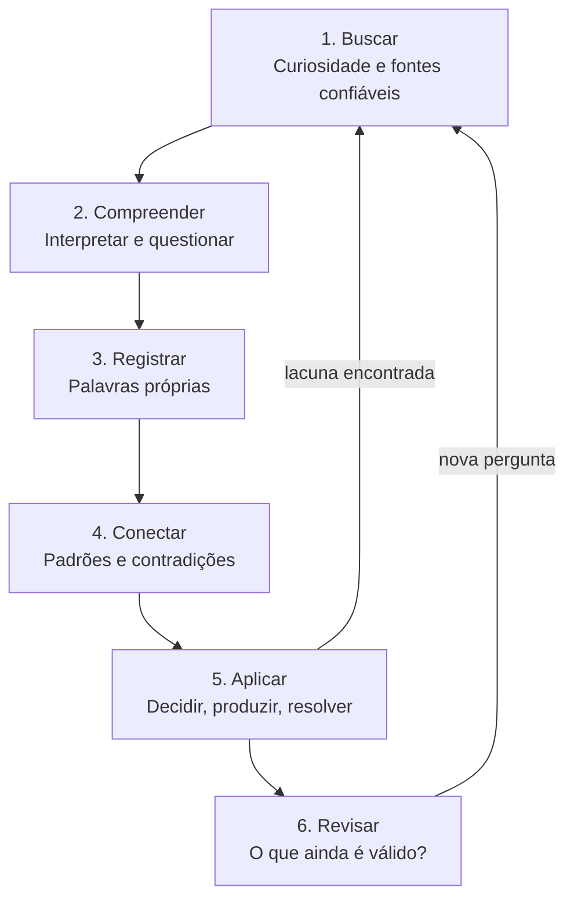
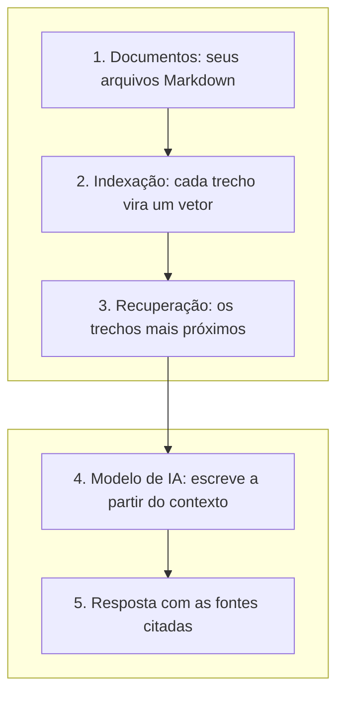

Na [Parte 1](/artigos/2026-08-31-segundo-cerebro-com-ia-guia-completo/) deste guia, a pergunta era prática: como montar um Segundo Cérebro e quais ferramentas usar. Vimos o método CODE de Tiago Forte, a organização por acionabilidade do PARA, o Obsidian como substrato durável e as três formas de colocar uma camada de IA sobre as notas.

Agora suponha que você já tenha tudo isso funcionando. O acervo existe, a busca semântica responde, o sistema está montado. Surge então uma pergunta menos técnica e bem mais difícil:

**O que mantém um Segundo Cérebro realmente útil ao longo dos anos?**

Essa é a pergunta deste artigo. E a resposta não está em nenhuma ferramenta.

## Ter informações não significa possuir conhecimento

**Informação** é o dado bruto: um artigo salvo, um trecho de documentação, um vídeo marcado como "assistir depois". É externa a você, existe no arquivo e não na sua cabeça.

**Conhecimento** é a informação que passou por você. Você entendeu o conceito, sabe explicá-lo com palavras próprias, reconhece quando ele se aplica e quando não. Mora na sua capacidade de raciocinar, não no seu disco.

**Sabedoria** é um passo além: saber quando usar o que você conhece, quando desconfiar do que parece certo e quando admitir que ainda não sabe. Envolve julgamento, e julgamento não se armazena.

A diferença entre os três é a diferença entre ter uma biblioteca e saber pensar.

Pense numa pessoa que salvou centenas de artigos, livros e vídeos sobre gestão de projetos. Cada arquivo está lá, catalogado, com tags impecáveis, e a busca semântica devolve dez trechos sobre gestão de riscos em dois segundos.

Agora pergunte se essa pessoa sabe gerir riscos.

Ela construiu um Segundo Cérebro, ou uma biblioteca digital sofisticada com uma interface de busca muito boa? A resposta depende do que ela fez depois de salvar, e é esse "depois" que ocupa as próximas seções.

## O Segundo Cérebro como organismo vivo

A analogia mais útil para um acervo de conhecimento não é a de um arquivo, é a de um organismo. Um arquivo é passivo: não perde nada com o tempo e, por isso mesmo, não ganha nada.

Um organismo é diferente. Precisa ser alimentado, mas também digerido, exercitado e descansado. Um que só come e nunca se move adoece, mesmo bem nutrido. Um Segundo Cérebro funciona do mesmo jeito: precisa receber informação, mas também ser organizado, revisado e usado. E aqui vale uma ressalva, porque analogias biológicas costumam ser levadas longe demais:

**Um repositório que para de receber informação nova não perde o valor automaticamente.** Conhecimento consolidado continua útil por muitos anos: um bom artigo sobre o protocolo TCP escrito em 1990 continua correto hoje, porque o protocolo não mudou na parte que aquele texto explica. O problema não é a falta de entradas novas. É quando informação desatualizada, contraditória ou desconectada passa a ser tratada como verdade permanente, sem que ninguém tenha olhado para ela.

Compare três situações.

**1. Cresce em quantidade, mas não em compreensão.** O acervo ganha centenas de notas por mês e o dono não conseguiria explicar nenhuma delas sem abrir o arquivo. Cada nota é uma cópia de algo lido, não uma elaboração própria. O sistema parece saudável quando medido por volume, e é essa métrica que o torna inútil: buscar em 3.000 trechos copiados devolve 3.000 trechos copiados, sem hierarquia e sem opinião.

**2. Organizado, porém abandonado e sem revisão.** O acervo é pequeno, bem estruturado, e ninguém o abre há dois anos. A organização virou uma tarefa em si: renomear arquivos, ajustar tags, reorganizar pastas. Nada disso produz compreensão. É a versão elegante do problema anterior, e mais perigosa, porque a manutenção dá a sensação de progresso.

**3. Usado continuamente para estudar, refletir, decidir e produzir.** O acervo pode ser modesto. O que o distingue é ser consultado e modificado o tempo todo: a nota de dois anos atrás entra numa decisão de hoje, a decisão de hoje gera uma dúvida nova, a dúvida volta para o acervo como nota incompleta. Nada é arquivado como definitivo.

O terceiro caso é o objetivo, e ele não depende de nenhuma ferramenta específica.

## O ciclo contínuo do conhecimento

Se o objetivo é o terceiro caso, a pergunta seguinte é operacional: o que exatamente se faz, na prática, para chegar lá?

A resposta é um ciclo de sete etapas. Ele não é uma sequência rígida que se executa uma vez e se conclui, e essa é a parte mais importante: o ciclo não termina, ele se alimenta.



**Buscar.** Tudo começa com curiosidade, e curiosidade é uma habilidade que se treina. Não se trata de ler tudo sobre um assunto, e sim de formular perguntas boas e identificar quem responde a elas com credibilidade. Uma fonte confiável tem nome, data e rastro: você consegue verificar quem escreveu, quando, e com base em quê. Isso não significa descartar blogs e vídeos, mas saber o que eles são: ponto de entrada para um assunto, não a autoridade final sobre ele.

**Compreender.** Compreender é mais difícil do que parece, porque a sensação de entendimento chega antes do entendimento. Ler um texto claro produz uma impressão de domínio que se desfaz na primeira tentativa de explicá-lo para outra pessoa. O teste prático é este: feche a fonte e escreva o conceito com suas palavras. Onde você travar, ali está a lacuna.

**Registrar.** Só depois de compreender vale a pena registrar, e o registro precisa ser seu. Copiar e colar não registra conhecimento, arquiva texto de outra pessoa. O que se registra é a sua explicação do conceito, as suas dúvidas, e junto a referência de onde veio. **Conectar.** Ideias isoladas são frágeis. Conectar é relacionar a nota nova com o que já existe: isso contradiz o que eu li em março? Confirma? Complementa? A conexão mais valiosa costuma ser a contradição, porque é ali que a compreensão anterior precisa ser corrigida. Aqui o Segundo Cérebro ganha algo que a memória biológica não dá: comparar o que você pensava há um ano com o que pensa hoje, lado a lado, no mesmo arquivo.

**Aplicar.** Conhecimento que nunca é usado apodrece sem que você perceba, porque a única prova real de compreensão é o uso. Aplicar significa usar o que foi registrado para resolver um problema concreto, tomar uma decisão ou produzir algo: um texto, uma apresentação, um script, uma conversa com o time. **Revisar.** Revisar não é reler. É checar se as conclusões continuam válidas: a ferramenta mudou de versão? A norma foi atualizada? A minha conclusão de maio ainda se sustenta diante do que aprendi em setembro? Revisar inclui corrigir erros e marcar explicitamente o que está desatualizado, em vez de apagar, porque o erro antigo mostra onde o seu raciocínio falhava.

**E então buscar de novo.** A aplicação revela uma lacuna que você não sabia que tinha, e a lacuna vira pergunta. Ou a revisão invalida uma conclusão antiga, e a conclusão invalida vira pergunta. Nos dois casos você volta à etapa 1 com uma pergunta melhor do que aquela com que começou.

Esse retorno é o que separa o ciclo de um checklist. Uma lista de tarefas termina; um ciclo de conhecimento fica mais preciso a cada volta.

## O papel da inteligência artificial: assistente, não substituta

Com o ciclo estabelecido, dá para dizer onde a IA é útil e onde ela atrapalha.

A IA é boa no que dá trabalho e exige pouca compreensão. É ruim no que exige julgamento. Quase todo erro de uso de IA em Segundo Cérebro vem de confundir as duas coisas.

**O que ela faz bem, etapa por etapa:**

- **Buscar:** sugerir perguntas que você não pensou em fazer, apontar autores e termos que você não conhecia, indicar por onde começar num assunto novo.
- **Compreender:** explicar um trecho difícil por outro ângulo, oferecer uma analogia, apontar o que um argumento assume sem dizer.
- **Registrar:** organizar referências, padronizar formato, transformar um rascunho confuso em algo legível. É trabalho mecânico, a categoria em que a IA acerta mais.
- **Conectar:** encontrar relações entre notas escritas em meses diferentes e sinalizar contradições. É o maior ganho, porque comparar centenas de notas manualmente é inviável.
- **Aplicar:** recuperar decisões anteriores e o contexto em que foram tomadas, evitando refazer uma análise já feita.
- **Revisar:** elaborar perguntas de revisão a partir das suas notas e apontar lacunas: "você registrou a conclusão, mas nunca registrou como chegou nela".

**O que ela não faz:** saber o que você não entendeu. Ela não tem acesso à sua compreensão, só aos seus arquivos. Pode escrever uma explicação impecável sobre um tema que você continua sem entender, e a explicação vai parecer que resolveu o problema.

### A diferença entre dois tipos de uso

Existe um uso que fortalece e um que enfraquece, e a diferença não está na ferramenta.

O uso que enfraquece pede a resposta pronta: "resuma este artigo para mim", "quais são os pontos principais deste livro", "escreva uma nota sobre segurança de aplicações". A resposta chega boa, é colada na nota, e nada passou pela cabeça de quem pediu. O acervo cresce e o entendimento não. É o risco que a Parte 1 já apontou como erro comum: entregar o controle a um sistema que pode errar.

O uso que fortalece pede o questionamento: "quais premissas este texto assume e não justifica?", "me faça perguntas sobre este conceito para eu testar se entendi", "compare o que escrevi em março com o que escrevi em setembro e aponte onde mudei de ideia". O resultado não é uma resposta para guardar, é uma pergunta para perseguir.

A regra prática: **se o resultado da interação pode ser copiado direto para o acervo, é sinal de que você não passou por ali.** O bom uso da IA termina com você escrevendo algo que ela não escreveu.

### O risco da dependência cognitiva

O problema da dependência cognitiva é sutil porque o resultado de curto prazo é excelente: você produz mais rápido, com menos esforço e aparentemente com mais qualidade. O que se perde não é a produtividade, é o treino.

Compreender algo difícil é um exercício, e exercício tem custo. Quando você terceiriza todo o esforço de interpretação, o músculo não se desenvolve, e a habilidade de avaliar a resposta também não, porque avaliar exige ter feito o caminho pelo menos uma vez. Quem nunca interpretou um texto sozinho não tem como julgar se a interpretação da IA está correta. Só tem como confiar.

E confiar não é boa política, porque modelos de linguagem erram de um jeito convincente. Produzem afirmações falsas com a mesma fluência e o mesmo tom seguro com que produzem afirmações verdadeiras. Isso é uma propriedade de como funcionam, não um defeito que uma atualização vai corrigir.

Na prática, os erros mais comuns são atribuir uma ideia ao autor errado, misturar dois conceitos parecidos, citar uma fonte que não diz o que foi citado, inventar um número ou uma norma, e ler um documento com desatualização embutida, porque o conhecimento do modelo tem data de corte.

Nada disso torna a IA inútil. Torna obrigatório um hábito: **toda afirmação factual que vai virar decisão precisa ser conferida na fonte.** É a mesma regra que se aplica a qualquer fonte secundária. Vale registrar isso na própria nota, no campo de fonte, para que a próxima pessoa a ler o arquivo seja você mesmo, seis meses mais velho e sem memória do que conferiu.

## Transformando informação em conhecimento pessoal

**Etapa inicial: acumular.** Ele salva artigos sobre OWASP, a documentação da linguagem que usa, vídeos de conferência e um PDF sobre modelagem de ameaças. É o começo natural, mas o acervo ainda não é conhecimento: são arquivos de outras pessoas.

**Etapa intermediária: estudar e registrar.** Ele para de salvar e começa a ler. Depois de ler sobre injeção de SQL, escreve com as próprias palavras o que o ataque faz e por que a consulta parametrizada resolve, e anota as referências. É aqui que a pasta passa a ter valor.

**Etapa avançada: conectar e aplicar.** Ele liga os conceitos às experiências dele: "o bug de produção de março era isto", "aqui eu discordei do padrão do time e este é o porquê". Registra problemas resolvidos, não só conceitos, e revisa decisões antigas: aquela escolha de concatenar string em 2023 continua defensável?

### Como as notas ficam na prática

O registro funciona melhor com campos simples, e vale reforçar: eles servem ao aprendizado, não o contrário. Um modelo de nota que vira obrigação administrativa é abandonado em três semanas.

```markdown
---
título: "Injeção de SQL e consultas parametrizadas"
criada: 2026-10-21
assunto: Segurança de aplicações
fonte: "OWASP — SQL Injection Prevention Cheat Sheet"
revisar: 2027-04-21
---

## Resumo pessoal

O ataque acontece quando a entrada do usuário é concatenada
na string da consulta e o banco não distingue dado de comando.
A consulta parametrizada resolve porque o comando é fixado
antes e o valor entra como dado, nunca como sintaxe.

## Conceitos aprendidos

- Separação entre código e dado é o mecanismo, não o filtro
- Escapar caracteres é paliativo: cobre os casos conhecidos
- ORM não é garantia se a consulta crua for usada direto

## Dúvidas pendentes

- Qual o custo real de prepared statements sob carga alta?
- Como isso se aplica ao banco que usamos internamente?

## Relações

- [[2026-07-14-code-review-decisoes-de-acesso]]
- [[2026-03-02-bug-producao-consulta-lenta]]

## Por que revisar em abril

A norma do projeto pode mudar até lá; conferir se o padrão
interno continua alinhado ao que registrei aqui.
```

Três observações sobre esse formato.

O campo de dúvidas pendentes é o mais valioso e o mais negligenciado. Uma nota sem dúvidas é uma nota terminada, e notas terminadas param de gerar perguntas. A condição de revisão é mais útil que a data: "revisar em abril" é arbitrário, "revisar quando o padrão interno mudar" tem gatilho. E o campo de relações é o que transforma arquivos em rede, porque a ligação é o que torna a nota recuperável por contexto em vez de por palavra-chave.

## Construindo uma rotina sustentável de aprendizagem

Existe uma tentação comum em projetos de conhecimento pessoal: esperar o fim de semana para uma sessão longa e compensar a semana inteira. Isso funciona mal, e não por falta de disciplina de quem tenta. Conhecimento consolidado é o resultado de repetição espaçada ao longo do tempo, não de volume concentrado. A referência clássica é a curva do esquecimento de Hermann Ebbinghaus, publicada em 1885 e replicada em 2015 por Jaap Murre e Joeri Dros, da Universidade de Amsterdã. No experimento original, a retenção medida por economia de tempo de reaprendizado cai de 58% (após 20 minutos) para 34% (após 1 dia) e 21% (após 31 dias); na replicação, 47%, 32% e 9%.

Um ponto importante, porque esse dado é muito citado de forma errada: ele mede retenção de sílabas sem sentido, aprendidas até a reprodução perfeita por um único sujeito. Não é uma lei sobre a sua memória de conceitos, e o "50% em 24 horas" que circula por aí não é o que o estudo mostra. O que interrompe a degradação é voltar ao material, não estudar mais na primeira vez. Por isso a consistência vale mais que a intensidade.

### Uma rotina de 15 a 20 minutos

- **5 minutos para recuperar e revisar uma anotação.** Não é reler: é fechar a nota e tentar reconstruir o que ela diz, depois abrir e comparar. A diferença é a sua lacuna.
- **10 minutos para estudar ou refletir.** Ler uma seção de um texto, ou pensar sobre um problema real usando o que já está no acervo.
- **5 minutos para registrar uma conclusão, uma dúvida ou uma conexão.** Uma nota curta, escrita por você, com a fonte. Se a dúvida for o único produto do dia, o dia valeu.

**Uma revisão semanal de 30 minutos**: marcar as notas incompletas, identificar as dúvidas que apareceram mais de uma vez (essas são prioridade, porque a repetição indica que o assunto importa) e escolher um tema que merece aprofundamento.

### Capturar com propósito

A diferença entre capturar e colecionar é o critério. Captura indiscriminada tem uma lógica sedutora: "pode ser útil um dia". O problema é que todo arquivo salvo cria uma obrigação futura de avaliar, e o acervo cresce mais rápido do que a capacidade de avaliá-lo. O resultado é o caso 1 da seção anterior, com busca semântica eficiente sobre material que ninguém leu.

Uma pergunta resolve a maior parte dos casos: **isso responde a alguma pergunta que eu já tenho, ou ajuda a resolver algo que está na minha frente?** Se sim, capture e registre por quê. Se não, deixe passar. Você vai encontrar de novo quando precisar, e com uma pergunta melhor.

## Quando a IA começa a dialogar com o conhecimento acumulado

Até aqui falamos de IA como assistente de etapas isoladas. O salto acontece quando ela opera sobre o acervo inteiro, e isso é feito por RAG (sigla em inglês para Geração Aumentada por Recuperação), que a Parte 1 já explicou em detalhe. O ponto aqui é outro: o que muda no seu trabalho quando o acervo entra na conversa.

Considere uma pergunta que nenhum arquivo responde sozinho:

> "Quais decisões sobre segurança de aplicações eu tomei nos últimos seis meses, e quais delas precisam ser revisadas?"

Nenhuma nota contém essa resposta. Ela existe na relação entre quinze notas escritas em datas diferentes: notas de decisão, notas de revisão de código, uma nota de bug em produção, duas dúvidas que nunca foram fechadas. Um bom sistema localiza esses documentos, monta uma síntese e, principalmente, **indica de qual arquivo veio cada afirmação**. Sem a fonte, a síntese é inútil: você não sabe se ela reflete o que você registrou ou o que o modelo achou plausível.

E existe uma terceira exigência, a mais rara: quando a informação não está no acervo, o sistema precisa dizer que não está. "Não encontrei nenhuma decisão registrada sobre autenticação entre abril e junho" é uma resposta valiosa, porque revela uma lacuna. Um sistema que preenche esse silêncio com uma suposição plausível é pior do que inútil, porque a suposição vai parecer uma memória sua.

### A arquitetura por baixo

O caminho da pergunta até a resposta tem cinco passos:



Os **documentos** são os seus arquivos Markdown. São a fonte de verdade: legíveis por qualquer editor, versionáveis, seus. O **índice** é uma estrutura derivada, feita de vetores numéricos que representam o significado dos trechos, e existe apenas para permitir a busca por sentido em vez de por palavra-chave. O índice não substitui os documentos e pode ser reconstruído a partir deles a qualquer momento.

A consequência prática: quando o índice e o documento discordarem, o documento está certo. Um índice desatualizado devolve trechos de uma versão que você já corrigiu, e o problema não está no modelo, está na indexação que não rodou de novo.

Por isso a fonte de verdade deve continuar sendo o conteúdo registrado por você, em formato que você controla. A IA opera sobre o acervo; ela não é o acervo. É uma distinção que parece óbvia na teoria e que se perde na prática quando a conveniência da resposta pronta começa a substituir a consulta ao original.

## Os riscos de um Segundo Cérebro mal cultivado

**1. Acúmulo excessivo sem compreensão.** A busca devolve mais resultados e cada resultado é menos confiável, porque o sistema não distingue o que você elaborou do que você copiou. O efeito final é uma base que ninguém consulta, porque consultar dá mais trabalho que perguntar de novo. *Preventiva:* registrar com palavras próprias e deixar dúvidas explícitas nas notas. Se você não consegue resumir a nota de cabeça, ela não é sua.

**2. Conhecimento desatualizado ou sem contexto.** Uma nota de 2022 sobre a versão antiga de uma ferramenta continua sendo lida como atual, e a decisão de hoje se apoia num mundo que não existe mais. *Preventiva:* registrar a data e a versão a que a nota se refere, e usar gatilhos ligados a eventos ("revisar quando a norma mudar") além de datas.

**3. Confiança excessiva nas respostas da IA.** O erro chega com a mesma fluência da resposta correta, e a síntese sobre quinze notas é convincente mesmo quando cita uma nota que diz o contrário. *Preventiva:* exigir fontes em toda resposta que vira decisão e conferir o arquivo citado antes de agir.

**4. Perda de autonomia intelectual.** O sintoma não é usar a IA, é não conseguir mais interpretar um texto difícil sem ela. A habilidade de avaliar respostas se atrofia junto com a de produzi-las, porque as duas são a mesma habilidade. *Preventiva:* manter prática regular de leitura e escrita sem assistência.

**5. Dependência de ferramentas proprietárias.** O acervo vive num aplicativo que decide o formato, o preço e o acesso, e a saída da plataforma leva anos de notas. *Preventiva:* guardar tudo em texto simples (Markdown) em arquivos que qualquer editor abre. Foi esse o argumento que popularizou o Obsidian, e ele vale independentemente de qual aplicativo você usa hoje.

### Privacidade, backup e portabilidade

Três cuidados que valem mais que qualquer configuração avançada.

**Privacidade.** Um Segundo Cérebro pessoal acumula o que você leu, decidiu, errou e duvidou, e isso é mais sensível do que parece. Antes de jogar o acervo num serviço de nuvem, decida conscientemente o que pode sair do seu computador. Modelos locais, como o Ollama apresentado na Parte 1, existem para o caso em que nada deve sair. Em ambientes corporativos a regra é mais rígida: notas com dados de clientes ou de sistemas internos não pertencem a um índice externo.

**Backup.** É o risco mais concreto da lista e o mais fácil de resolver: um repositório Git privado cobre backup, histórico e sincronização entre máquinas de uma vez. Se este computador morrer agora, quanto do acervo eu perco?

Nada disso é alarmismo. O ponto é que um Segundo Cérebro é um investimento de anos, e onde ele mora é uma decisão mais estruturante que qual aplicativo usar para escrever nele.

## Um exercício prático de sete dias

**Dia 1 — Escolha um assunto que você quer compreender melhor.** Não um assunto interessante em geral, mas um que está na sua frente agora: algo que você precisa decidir, resolver ou explicar para alguém. Escreva a pergunta central em uma frase. Ela será o critério de tudo o que vem depois.

**Dia 2 — Selecione duas ou três fontes confiáveis.** Não dez. Documentação oficial, norma técnica, artigo revisado ou livro de referência. Anote de cada uma quem escreveu, quando, e por que você confia nela.

**Dia 3 — Registre o que compreendeu com suas palavras.** Feche as fontes antes de escrever. O que você explicar sem consultar é o que entendeu; o resto é a sua lista de lacunas.

**Dia 4 — Formule três perguntas que você ainda não consegue responder.** Deixe-as explícitas na nota e não corra para respondê-las. Perguntas bem formuladas valem mais que respostas rápidas.

**Dia 5 — Conecte com um conhecimento ou experiência anterior.** Um problema que você já resolveu, uma decisão que já tomou, um erro que já cometeu. Escreva o que a conexão revela: o que você faria diferente hoje?

**Dia 6 — Use uma IA para questionar suas conclusões.** Peça para ela apontar premissas que você não justificou, lacunas no raciocínio e pontos que merecem aprofundamento. Depois, **verifique cada sugestão nas fontes do dia 2.** As que se confirmarem entram na nota; as que não se confirmarem são tão interessantes quanto, porque mostram onde o seu texto foi ambíguo ou onde a IA errou.

**Dia 7 — Revise e registre o que mudou.** Releia a pergunta do dia 1 e a nota inteira. O que mudou na sua compreensão? A pergunta inicial continua sendo a certa, ou era a errada desde o começo? Escreva a resposta em um parágrafo. Esse parágrafo é o produto da semana, mais que qualquer nota individual.

Ao final dos sete dias você tem uma pergunta melhor formulada, uma nota escrita por você, três dúvidas abertas, uma conexão registrada e um registro honesto do que mudou. É pouco em volume e bastante em substância. Uma semana dessas por mês, ao longo de um ano, muda o que você é capaz de fazer.

## O conhecimento não pode ser terceirizado

Voltemos à pessoa do começo, a que salvou centenas de artigos e nunca os estudou.

Ela construiu um Segundo Cérebro? Depende de uma coisa só, e não é a ferramenta, nem o tamanho do acervo, nem a qualidade das tags: depende de ela ter passado por aquelas informações ou apenas por perto delas.

Armazenar milhões de informações é barato, e um disco de alguns terabytes faz isso melhor que qualquer pessoa. Compreender uma fração delas é caro: exige tempo, atenção e a disposição desconfortável de descobrir que você estava errado.

É aí que está a contribuição real de um Segundo Cérebro, e ela não é a que costuma ser anunciada. O ganho não está em lembrar mais, está em **preservar o contexto do aprendizado**: o que você pensava, quando, com base em quê, e o que mudou desde então. É essa camada que permite que um conhecimento antigo contribua para uma reflexão nova, em vez de ser apenas um arquivo mais velho. Sem contexto você tem arquivos; com contexto você tem um interlocutor que é você mesmo, anos atrás.

A IA tem um papel nisso, e é um papel bom desde que bem delimitado. Ela organiza, recupera, compara e questiona: faz o trabalho mecânico que consumia as suas horas e devolve essas horas para o que só você pode fazer. O que ela não faz, e nenhuma atualização de modelo vai fazer, é assumir a responsabilidade intelectual pelo que você sabe.

Por isso vale tratar curiosidade, disciplina e humildade intelectual como as três competências centrais do assunto. Curiosidade para continuar perguntando quando já existe uma resposta razoável. Disciplina para registrar e revisar mesmo sem resultado visível naquele dia. Humildade para escrever "ainda não entendo isso" numa nota e deixá-la aberta, em vez de preenchê-la com uma resposta não examinada.

A frase que resume tudo:

**O Segundo Cérebro não deve pensar em nosso lugar. Ele deve nos ajudar a pensar melhor.**

Na Parte 3, essa ideia vira implementação. Saímos da metodologia e entramos na técnica: como conectar um acervo de notas a agentes de IA que trabalham sobre ele, como montar um pipeline de RAG sobre arquivos Markdown, como rodar isso com modelos locais sem depender de nuvem, e como automatizar a parte mecânica da rotina de revisão. Se a Parte 2 foi sobre cultivar, a Parte 3 é sobre a irrigação.

Até lá, escolha um assunto que está na sua frente agora e escreva a pergunta em uma frase. É o único passo que nenhuma ferramenta faz por você.