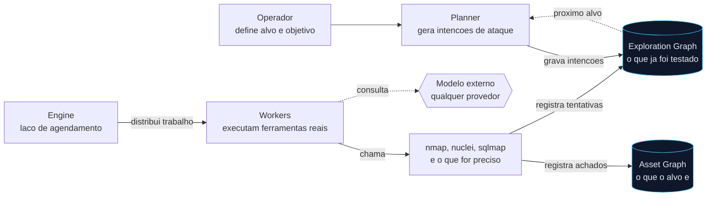
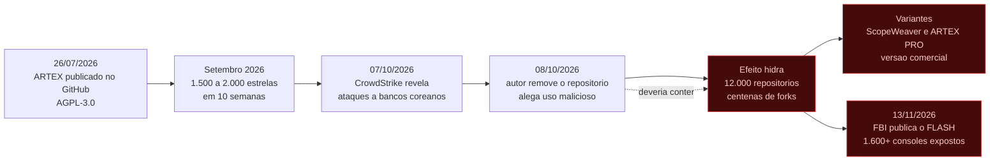
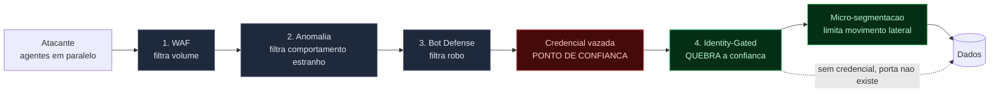

Em 13 de novembro de 2026, a Cloudflare publicou um post que merece ser lido devagar: [Adapting to AI penetration testing orchestrators](https://blog.cloudflare.com/adapting-to-ai-penetration-testing-orchestrators). O número de abertura é o tipo de coisa que a gente lê duas vezes.

Em três dias, **mais de 50 famílias** de frameworks de pentest com LLM tentaram escanear clientes da Cloudflare. O número de IPs rodando esses frameworks passou de milhares e crescia todo dia. As requisições diárias dessas ferramentas subiram **30 vezes** desde 1º de outubro.

E tem uma frase no meio do texto que resume o problema melhor do que qualquer número:

> defenders are struggling to keep up with the volumetric nature of these autonomously guided attacks
>
> (quem defende está tendo dificuldade de acompanhar a natureza volumétrica destes ataques guiados de forma autônoma)

Este texto é a minha leitura do caso. Não é resumo do post da Cloudflare: onde eu discordo, eu digo, e onde as fontes acrescentam algo que a Cloudflare não cobre, eu trago. As sete fontes estão no fim.

## O que é o ARTEX, afinal

Antes de mais nada, porque o nome circula sem explicação.

O **ARTEX** é um sistema de pentest autônomo: você informa o alvo e o objetivo em linguagem natural, e ele planeja e executa os passos do ataque sozinho, com pouquíssima intervenção humana.

**Não é malware.** É uma ferramenta de teste de segurança legítima, usada para achar falhas antes que alguém as explore, que passou a ser usada para ataque de verdade. Essa distinção importa, porque é exatamente o mesmo caminho que o Metasploit e o Cobalt Strike já percorreram.

A ficha técnica, conforme o Google Threat Intelligence Group descreveu:

1. **Autor**: o desenvolvedor chinês "Autumn-27"
2. **Lançamento**: 26 de julho de 2026, no GitHub, com licença AGPL-3.0
3. **Construção**: backend em Go com console web em Next.js, empacotado como **binário único**
4. **Armazenamento**: PostgreSQL
5. **Modelo próprio**: nenhum, e este é o ponto central

O **binário único** explica a adoção rápida: instala com um comando, sem montar infraestrutura. Qualquer pessoa com um servidor e uma chave de API de modelo tem um orquestrador de ataque rodando.

### Como ele pensa

A arquitetura tem três peças:

1. **Planner**: quebra o objetivo em tarefas
2. **Workers**: pegam as tarefas e as executam chamando ferramentas de segurança reais
3. **Engine**: o laço que mantém tudo andando até o objetivo ser atingido

A ideia que faz o resto funcionar é de **grafo duplo**. São dois registros separados:

1. **Asset Graph**: o que o alvo *é*. Máquinas, serviços, credenciais
2. **Exploration Graph**: o que já foi *testado*. Tentativas, achados, becos sem saída

Essa separação é o truque que faltava, e vale entender por quê. Um pentester humano mantém tudo isso na cabeça, e é por isso que ele não escala: chega um ponto em que ele não lembra mais o que já tentou onde. Com o estado persistido em grafo, **dezenas de agentes trabalham em paralelo sem se atropelar** e o sistema sabe precisamente o que ainda não testou.

O resultado é um ciclo que se fecha sozinho: explorar, decidir, executar, gravar de volta.

O detalhe que muda a conversa: **o ARTEX não tem modelo próprio.** Ele orquestra modelos externos. A escolha de qual modelo usar é do operador, e é aí que chegamos na parte que quase ninguém comenta.

## O modelo não é a barreira

Aqui eu preciso apontar uma lacuna no post da Cloudflare. Ele fala de "LLM" o tempo todo e **não nomeia um único modelo**. Zero menções a DeepSeek, GLM, Kimi ou Grok. E o que as outras fontes mostram é que a escolha do modelo é decisiva, por um motivo que contraria a intuição.

O aviso do FBI, o [FLASH-20261113-001](https://www.ic3.gov/CSA/2026/261113.pdf), é direto sobre isso:

> Analysis of attacker-controlled ARTEX instances shows Chinese models are most prevalent, with DeepSeek Flash family models dominating usage due to their balance of capabilities, relatively low cost, and lack of observable guardrails when framed for penetration testing.
>
> (A análise de instâncias do ARTEX controladas por atacantes mostra que modelos chineses são os mais prevalentes, com modelos da família DeepSeek Flash dominando o uso, por seu equilíbrio de capacidades, custo relativamente baixo e ausência de guardrails observáveis quando o contexto é enquadrado como teste de penetração)

São três razões, e a terceira é a que deveria incomodar. Não é que o modelo não tenha salvaguardas. É que elas **não disparam quando o pedido se parece com trabalho legítimo de segurança**. Enquadrar um pedido como "pentest autorizado" é suficiente para atravessar uma defesa que depende de julgamento do próprio modelo.

E vale uma precisão, porque é fácil tirar a conclusão errada: isso não é um defeito exclusivo de modelos chineses. O ARTEX aceita modelos de fronteira também, e o FBI lista Claude e GPT como integrações disponíveis. O que o FBI constata é **prevalência de uso**, não superioridade de um país. Guardrail que depende de o modelo julgar a intenção é contornável em qualquer lugar.

### A conta que muda tudo

A Check Point documentou um operador real, de 14 a 29 de outubro de 2026, com a contabilidade completa. Vale ver os números lado a lado:

1. **Modelos**: DeepSeek v4.1 Flash e Kimi K3.1 Pro
2. **Estrutura**: dois consoles ARTEX rodando em paralelo, por cerca de duas semanas
3. **Tokens**: 36 bilhões no total, sendo 2,13 bi de entrada sem cache, 33,79 bi de entrada com cache e 473,9 milhões de saída
4. **Custo total**: entre US$ 700 e US$ 1.500
5. **Alvos**: 10 lojas de assinatura de código, com o objetivo de roubar certificados `.p12` e suas senhas para revenda

Duas semanas de operação contra 10 alvos organizados, por menos de mil dólares. Repare também na proporção dos tokens: **33,79 de 36 bilhões foram cache hit**. O agente reenvia o mesmo contexto a cada passo, e o cache derruba o custo de cada repetição. É o uso de modelo barato levado a sério, com engenharia em volta.

A implicação é o que interessa: se o custo de rodar um ataque autônomo é da ordem de **algumas centenas de dólares**, o dinheiro deixou de ser o gargalo. Também não é mais a habilidade técnica, porque o framework entrega o raciocínio pronto e o modelo faz o planejamento.

O que sobra como barreira é a **sua postura**. Credencial que vazou, sistema sem patch, porta de administração exposta. O ARTEX não explora nenhuma falha nova, e isso vale repetir: ele usa credenciais comprometidas e sistemas desatualizados, exatamente o que já existia. O que é novo é a **automação do raciocínio**, não a técnica.

Um exemplo do Google mostra bem essa diferença. Em uma operação, o ARTEX gerou **27 eventos em 23 segundos** sondando permissões da AWS em grupos de segurança diferentes. Em outra, ao preparar scripts de exfiltração, ele errou com "script too large", **cortou o script e relançou sozinho**, concluindo em cerca de 10 segundos. É essa a mudança real: ele se corrige sem chamar ninguém.

## O efeito hidra, ou como matar o projeto o multiplicou

Esta é a parte do caso que eu acho mais instrutiva, e ela começa com uma tentativa honesta de fazer a coisa certa.

Depois que o CrowdStrike revelou, em 7 de outubro de 2026, o uso do ARTEX contra instituições financeiras sul-coreanas, o autor tirou o repositório do ar em 8 de outubro. A declaração dele foi clara sobre a intenção original, e a tradução que circulou é esta:

> o uso malicioso desta ferramenta corre inteiramente contra a sua intenção original

O que aconteceu em seguida é que merece atenção:

1. **1º de outubro**: linha de base do tráfego
2. **8 de outubro**: repositório original removido
3. **Depois disso**: tráfego **dez vezes maior** que antes da remoção, e **30 vezes maior** que em 1º de outubro
4. **Início de novembro**: mais de **1.600 instâncias** de console ARTEX expostas publicamente
5. **13 de novembro**: o FBI publica o aviso oficial, e o framework já existe em **12.000 repositórios**, com centenas de forks carregando linhagem do original

A Cloudflare deu um nome a isso: **efeito hidra**. Corta-se uma cabeça, e nascem outras. Na mitologia grega, a Hidra de Lerna crescia duas cabeças para cada uma que era cortada, e a única forma de vencer era cauterizar o coto antes que a nova crescesse. A analogia é boa justamente porque a solução não era cortar mais rápido: era impedir o crescimento.

Tem uma lição aqui que vale mais que o episódio, e ela é desconfortável: **remover o obstáculo não remove a capacidade.** O conhecimento já estava distribuído, o código já era software livre, e centenas de pessoas já tinham cópia. O takedown mudou o endereço do download, não a capacidade de atacar.

Para quem defende, a consequência prática é direta: se a sua estratégia de segurança dependia de *uma* coisa difícil de fazer para o atacante, o mundo em que essa coisa desaparece já chegou. A barreira precisa ser algo que continue valendo mesmo quando todas as ferramentas estão disponíveis para todo mundo.

## Por que a defesa em profundidade cedeu

A Cloudflare afirma que a velocidade "efetivamente vaporiza os modelos legados de segurança". Eu acho que a frase está certa quanto ao resultado, e errada quanto à causa. A velocidade não é o problema. A velocidade **expôs** o problema.

Minha leitura é esta: **a defesa em profundidade nunca validou nada.** Cada camada confiou que a camada anterior tinha feito o seu trabalho.

1. O firewall confiou que a aplicação estava corrigida
2. A aplicação confiou que a identidade apresentada era legítima
3. A identidade confiou que a credencial não tinha vazado
4. A rede confiou que ninguém já estava dentro

Enquanto o atacante era humano e tinha tempo limitado, as camadas pareciam funcionar. Ele batia na porta, desistia, tentava amanhã. A confiança implícita nunca foi testada no ponto em que ela quebra.

Um agente autônomo não desiste nesse ponto. Ele percorre a mesma pilha em rajadas de **2 a 25 segundos**, sem cansar, sem perder a paciência, sem passar para outra tarefa. E como ele registra o que já tentou no grafo, ele não repete: ele testa exaustivamente o que ainda falta.

Some os números e o quadro fica claro:

1. Menos de **3 horas** do alvo inicial ao acesso privilegiado, segundo o FBI
2. Cerca de **23 horas** por projeto até atingir o objetivo, segundo a Elastic
3. Em um caso acompanhado pela Wiz, do primeiro acesso comprometido ao acesso profundo em **4 horas**, e em um caso específico em **15 minutos**

Nada disso depende de uma falha nova. Depende de a camada de cima ter confiado na de baixo.

## Os seis pilares, e onde cada um falha sozinho

A Cloudflare propõe o que chama de **Modern Security Model**, com seis pilares. Eles são bons, e eu vou traduzir mantendo a ordem dela, mas com uma ressalva que o post original não faz: cada pilar sozinho não resolve, e o valor está em quebrar a cadeia de confiança implícita.

1. **Reforce o portão da frente**: WAF com regras avançadas, incluindo limites de taxa. A defesa é contra flood volumétrico de camadas 3 e 4 e sondagem direta de IP
2. **Posto de segurança no saguão**: detecção de anomalia em todas as aplicações web que seus clientes acessam
3. **Identifique visitantes falsos**: Bot Defense. Agentes autônomos e ferramentas de reconhecimento não se comportam como pessoas: cadência mecânica, sem pausas, sem "piscar"
4. **Remova a porta dos fundos**: Identity-Gated Access para toda aplicação web externa e interna de risco alto
5. **Inspecione as entregas**: valide esquemas e controles explícitos. O pilar cita validação de esquema OpenAPI, mTLS e postura de negação por padrão
6. **Vigilância do bairro**: threat intelligence, para enxergar o ataque antes que ele chegue na sua rua

Aqui está a minha crítica aos seis, e é por isso que eu quis escrever sobre isso em vez de só republicar. O pilar 4 é o único que **quebra** a confiança implícita. Ele faz a porta dos fundos deixar de existir para quem olha de fora, e micro-segmentação impede que uma credencial roubada atravesse de produção para desenvolvimento. Os outros cinco **filtram**. E filtrar é exatamente o tipo de defesa que o efeito hidra mostrou ser contornável.

O caso da ConnectWise é a prova. O comprometimento não veio de uma ferramenta de ataque exótica: veio de **tokens estáticos sem expiração** rodando dentro de pipelines de CI/CD, com acesso amplo entre ambientes. O FBI diz que o ARTEX foi usado em seguida, mas o acesso inicial foi dado de mão beijada por higiene de credencial.

Um exemplo que a Cloudflare documentou em investigação própria reforça o mesmo ponto: um token de API de conta, usado por CI/CD, **sem restrição de IP e sem limite de taxa**. Em cima disso, o ARTEX criou dezenas de scripts Worker com nomes como `artex-*`, `artex-pgrecon-*` e `artex-do-*`, e gerou atividade acima de **69 requisições por minuto** com **400 pedidos de dump de banco em uma hora**.

## O que eu faria primeiro

Se você lê isso e precisa decidir onde começar, a minha ordem não segue a da Cloudflare.

**Primeiro, credencial e identidade.** Inventarie o que não expira: tokens estáticos em CI/CD, chaves de API sem restrição de IP, contas de serviço com acesso amplo. Isso aparece no caso da ConnectWise, no caso da Cloudflare e no da Cairn. Não é coincidência: é o ponto onde as três investigações acabaram chegando.

**Segundo, tire o painel de administração da internet.** É o pilar 4, e é o que mais reduz superfície de uma vez. O FBI aponta explicitamente que o ARTEX se destaca em alvos periféricos: portais de parceiros, backends móveis, aplicações de funcionários, serviços legados. Ninguém está olhando para eles.

**Terceiro, micro-segmente, com foco em tornar o movimento lateral barulhento.** O objetivo não é impedir tudo, é gerar eventos que você consiga correlacionar.

**Quarto, detecção por comportamento, não por assinatura.** A Elastic foi precisa nisso e vale repetir: nada que ancorar em endereço de origem, User-Agent ou impressão digital do framework sobrevive, porque eles mudam mais rápido que as assinaturas. O que não muda é o que o ataque **faz** no seu ambiente: processos novos, chamadas de API, logins. Ancore aí.

**E a pergunta que eu faria a mim mesmo, antes de qualquer ferramenta:** qual das minhas camadas está confiando implicitamente na anterior? Enquanto essa resposta não estiver clara, adicionar o sétimo pilar não resolve o problema do primeiro.

## Fontes e links

1. [Adapting to AI penetration testing orchestrators: The Modern Security Model](https://blog.cloudflare.com/adapting-to-ai-penetration-testing-orchestrators), Cloudflare Blog, 13 de novembro de 2026. É o texto de partida: os números de frameworks, o efeito hidra e os seis pilares do Modern Security Model
2. [Threat Overview of ARTEX Autonomous Penetration Testing Framework](https://www.ic3.gov/CSA/2026/261113.pdf), FBI, FLASH-20261113-001, 13 de novembro de 2026. A fonte de maior peso: TTPs, IOCs, os setores atingidos, o dado das 3 horas e a análise de qual modelo os atacantes usam
3. [ARTEX and Friends: Enter Agentic Offensive Frameworks](https://cloud.google.com/blog/topics/threat-intelligence/artex-and-friends-enter-agentic-offensive-frameworks), Google Threat Intelligence Group, 30 de outubro de 2026. A descrição técnica do ARTEX: os seis sub-agentes, o grafo duplo e as rajadas de 2 a 25 segundos
4. [Hacking on Autopilot: Inside ARTEX Cybercrime Campaigns](https://research.checkpoint.com/2026/hacking-on-autopilot-inside-artex-cybercrime-campaigns/), Check Point Research. A contabilidade do operador real: 36 bilhões de tokens, dois modelos baratos e o custo entre US$ 700 e US$ 1.500
5. [Attackers Use Autonomous AI to Target Semiconductor, Defense and Civil Society Sectors](https://unit42.paloaltonetworks.com/cairn-framework-ai-autonomous-attacks/), Unit 42, Palo Alto Networks. A campanha CL-STA-1238 com o framework Cairn: 25 operações contra pelo menos 19 organizações
6. [Inside the loop: Five AI attack frameworks that never ask permission](https://www.elastic.co/security-labs/threat-command/agentic-offensive-frameworks-detection-artex), Elastic Security Labs, 13 de novembro de 2026. O que chega na telemetria e por que detectar por comportamento dura mais que detectar por assinatura
7. [ARTEX AI Pentesting Tool Used in Data Theft Attacks on South Korean Financial Firms](https://thehackernews.com/2026/10/artex-ai-pentesting-tool-used-in-data.html), The Hacker News, 8 de outubro de 2026. O caso que iniciou a cronologia: os ataques aos bancos sul-coreanos e a decisão do autor de fechar o código
