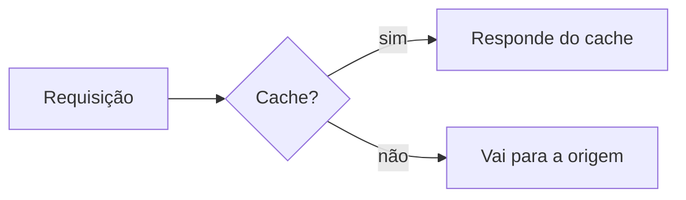

## Duas decisões da Cloudflare, nove meses de distância

Em fevereiro de 2026 a Cloudflare anunciou o **Markdown for Agents**. O título diz o essencial: se um programa pedir uma página com o cabeçalho `Accept: text/markdown`, a rede da Cloudflare pega o HTML da origem, converte na hora e devolve Markdown.

Nove meses depois, em novembro, veio o **Search for Agents**. Este é mais ambicioso e admite um problema que o primeiro não resolvia: converter página por página ainda obriga o agente a rastrear o site inteiro para achar o que precisa.

O primeiro entrega o documento. O segundo entrega como achar o documento. **O formato comum aos dois é Markdown.**

Isso não é preferência de gosto. É uma decisão de arquitetura, com número atrás.

## Por que Markdown, e não HTML

O argumento de custo é fácil de entender se você já pagou por leitura de documento.

Um agente que lê seu site paga por token, do mesmo jeito que você paga por minuto de telefone. E aqui acontece o seguinte: **a página que você publica foi feita para um navegador desenhar, não para uma máquina entender.** Ela carrega menu de navegação, rodapé, aviso de cookies, banner, script de analytics. Nada disso é o seu texto. Tudo isso é cobrado.

A Cloudflare resumiu numa frase que vale guardar: alimentar HTML bruto para uma IA é como pagar por palavra para ler a embalagem em vez da carta.

E mediu o próprio post: **16.180 tokens em HTML contra 3.150 em Markdown.** Oitenta por cento do que eles estavam pagando era embalagem.

### Os números de quem não vende conversão

Esse número é de uma empresa que vende o serviço, então vale procurar quem mediu sem interesse. Existem pelo menos três dessas medições independentes:

| Quem mediu | O que mediu | Resultado |
|---|---|---|
| skryp.dev | 170 páginas públicas | HTML **65.378** tokens contra Markdown **1.800** na mediana. Em páginas de documentação, **68 vezes** menor |
| getmarkforge | 11 páginas, com método publicado | Economia de **25% a 98%**, mediana de **91%** |
| Cloudflare | o post do próprio anúncio | **80%** de redução |

As três apontam na mesma direção, e o número que importa não é a porcentagem: é que **a economia acompanha o markup, não o conteúdo**.

### A ressalva que quase ninguém mostra

Aqui está o detalhe que faz a diferença entre um argumento honesto e um número de vendas.

O getmarkforge publicou os casos onde Markdown quase não ajuda:

- *How to Do Great Work*, do Paul Graham: economia de **25,5%**
- Um post do Simon Willison sobre LLMs: **32,6%**

Essas duas páginas são **quase só texto**. Não têm menu de loja, não têm infobox, não têm carrinho. Se não há embalagem para cortar, não há economia para fazer.

O contraste com o extremo oposto do mesmo estudo é grande: uma página de repositório no GitHub rendeu **98,4%** de economia, porque quase tudo ali era interface de repositório e o conteúdo real era um README de 2.500 tokens.

**A regra é essa:** quanto mais interface sua página tem, mais Markdown ajuda. Um ensaio limpo economiza um quarto. Uma página de loja economiza quase tudo.

## Markdown não é um tipo de arquivo. É um contrato

Vale parar em uma ideia que organiza o resto do post.

Existe uma diferença entre **como você guarda** um texto e **como você entrega** um texto. Markdown vive nos dois lados, e é isso que o torna interessante.

Como formato de arquivo, ele é só texto: abre em qualquer editor, dura décadas, aparece inteiro no diff do Git. Como formato de entrega, ele preserva a **estrutura** do que você escreveu. E estrutura, para quem lê, é informação.

Compare as duas versões do mesmo conteúdo:

```html
<div class="section">
  <h2 id="instalacao">Instalação</h2>
  <p>Rode o comando <code>npm install</code>.</p>
</div>
```

```markdown
## Instalação

Rode o comando `npm install`.
```

O Markdown carrega a mesma informação com uma diferença importante: **quem lê não precisa adivinhar o que é estrutura e o que é enfeite.** O `class="section"` e o `id="instalacao"` não dizem nada a um agente. O `##` diz exatamente uma coisa: isto é um título de segundo nível.

É por isso que a Cloudflare chama Markdown de *lingua franca* dos agentes. Não porque seja bonito, mas porque é a única forma popular de texto com estrutura que máquina e humano leem bem.

## Escrita: o que faz seu Markdown ser lido

Até aqui o post explicou o porquê. Daqui para frente é o como, e é a parte que mais importa na prática.

Existe um detalhe do Markdown que costuma passar despercebido: **a mesma sintaxe pode ser escrita de formas que se parecem e se comportam diferente.** O que segue é o que separa um documento que sobrevive de um que quebra.

### Títulos: a hierarquia é o índice do documento

O erro mais comum é usar `##` por tamanho visual em vez de por significado. Acontece assim: você quer que aquele subtítulo pareça menor, então usa `###` mesmo sendo um assunto novo.

Isso parece cosmético e não é. A hierarquia de títulos é o que um agente usa para montar o índice do seu texto. Se ela mente, o índice mente junto.

**Use um único `#` para o título do documento**, e desça um nível por vez. Nunca pule de `##` para `####`, porque o nível pulado é informação que você está negando a quem lê.

### Um bloco de código precisa ser fechado, e o idioma importa

Bloco de código é onde a sintaxe mais quebra em silêncio. Veja os dois:

````
```python
def soma(a, b):
    return a + b
```
````

Sem o idioma declarado na cerca, o bloco ainda funciona, mas perde a coloração e perde a informação de qual linguagem é. Para quem lê seu material em busca de um exemplo, a diferença entre um bloco genérico e um bloco `python` é grande.

E o erro que causa o estrago maior: **cerca não fechada**. Todo o resto do documento vira código. O sintoma é claro, mas confunde porque o texto que sumiu está lá no arquivo.

### Um aviso sobre indentação de quatro espaços

Em Markdown, **quatro espaços no começo da linha cria um bloco de código.** Isso é regra da especificação, não escolha de quem escreveu o renderizador.

O efeito colateral é que um parágrafo indentado de quatro espaços "para ficar bonito" vira uma caixa cinza. E uma lista aninhada com indentação errada fica plana.

Se você alinha código ou texto dentro de uma lista, a indentação passa a ser **relativa ao item**, não à margem da página. Esse é o motivo do clássico "minha sublista perdeu o recuo".

### A regra que quase ninguém sabe, e que explica metade dos bugs

Existe uma regra de precedência no Markdown que é técnica, mas resolve muito:

**Dentro de um bloco HTML, o conteúdo Markdown é ignorado.**

Se você abrir uma `<div>` e escrever Markdown logo abaixo sem uma linha em branco antes, aquele conteúdo não é processado como Markdown. Ele sai literal, ou é removido pela sanitização.

É por isso que muita gente escreve `<div class="aviso">` no README e o texto aparece com `**` cru no meio. **O Markdown não está quebrado: ele não foi processado.**

A saída é simples: deixe uma linha completamente vazia entre HTML e Markdown, e prefira sintaxe Markdown sempre que existir.

### Tabelas não fazem parte do Markdown

Esta é a fonte de confusão mais comum, e vale entender por quê.

O Markdown original, lançado em 2004, **não tinha tabelas**. Cada site implementou as suas. Isso deu origem a uma bagunça que levou quase dez anos para ser resolvida com a **CommonMark**, uma especificação com suíte de testes para a sintaxe básica.

O problema é que a CommonMark resolveu a base e **parou de propósito**: sem tabelas, sem listas de tarefas, sem riscado. Essas vieram depois, na **GFM** (GitHub Flavored Markdown), que é CommonMark mais cinco extensões.

Na prática isso significa que **a tabela que funciona no GitHub pode não funcionar no seu blog, no seu editor ou no seu gerador de site.** Não é bug: são dialetos diferentes.

Duas consequências concretas:

1. Se você escreve documentação que vai viver em mais de uma ferramenta, teste a tabela nas duas antes de confiar
2. A especificação da GFM **não exige três traços** por coluna. `---` é convenção; `-` já renderiza tabela em vários renderizadores. Confiar no mínimo é o que faz a tabela quebrar quando muda de ferramenta

### Listas numeradas não são um detalhe estético

Em texto comum, escrever "1." ou "-" é escolha de estilo. Em documentação técnica, deixa de ser.

Listas numeradas carregam **ordem**, e ordem costuma ser o conteúdo. Um procedimento em que o passo 3 precisa acontecer antes do passo 5 não pode virar lista com marcadores: você apaga a informação que faz o procedimento funcionar.

A indicação é usar número quando a ordem importa e marcador quando não importa. E ser consistente dentro do mesmo documento.

## Gráficos: o diagrama é o texto

Agora a primeira das suas perguntas práticas, e a resposta é mais direta do que parece: **um diagrama em Markdown deve ser texto, não imagem.**

Mermaid é uma linguagem que descreve diagramas com sintaxe parecida com Markdown. Em vez de exportar um PNG do seu editor, você escreve:



O ganho não é só o desenho aparecer. É que **o diagrama passa a ser texto como o resto**:

- aparece inteiro no **diff do Git**, então você revisa uma mudança de fluxo como revisa uma frase
- **não desatualiza em silêncio**, porque quem edita o texto está olhando para o diagrama
- é **acessível**, no sentido de que um leitor de tela e um agente leem a mesma estrutura
- **não pesa** no repositório nem vira binário que ninguém consegue comparar

Um PNG de diagrama é uma caixa preta que envelhece sozinha. Um diagrama Mermaid envelhece junto com o texto.

### O que o Mermaid não resolve

Nem tudo é favorável, e vale saber onde dói.

**Nada garante que quem lê vai renderizar.** O GitHub renderiza Mermaid, mas faz isso no navegador, com a biblioteca JavaScript. Um pedido de API ou um link de arquivo bruto recebe o **código do diagrama**, não o desenho. A própria Cloudflare descreve esse comportamento progressivo: quem não executa JavaScript vê a sintaxe original.

Isso tem uma consequência prática: **se seu diagrama precisa aparecer para um agente**, o texto da cerca é o que ele vai ver. Isso significa que **um diagrama legível vale mais que um bonito.** Nomeie nós com palavras reais, não com abreviações que só fazem sentido depois de desenhadas.

**E dentro de tabela costuma não funcionar.** Colocar Mermaid numa célula de tabela é dos casos que mais aparece em pergunta de fórum e menos aparece funcionando, porque cada renderizador trata isso de um jeito. Se você precisa de um diagrama ao lado de dados tabulares, o caminho é o diagrama **depois** da tabela, não dentro dela.

**Modelos mentais demais numa cerca também quebram.** Um flowchart com trinta nós continua sendo texto válido e vira um desenho ilegível em tela pequena. O limite útil é mais ou menos o mesmo de um bom diagrama em qualquer ferramenta.

## Workflows: escreva para quem vai fatiar

Esta seção parece técnica e tem uma conclusão simples: **quanto mais você respeita a estrutura do documento, melhor ele é encontrado.**

Quando um agente ou um sistema de busca vai ler sua documentação, ele não lê tudo. Ele **fatia** o texto em pedaços e procura o pedaço que responde à pergunta. Esse fatiamento se chama chunking.

Existe uma medição que mostra o tamanho da diferença. O recallrun testou cinco formas de fatiar em 151 arquivos de documentação real do FastAPI, com 773 perguntas:

| Como o texto foi fatiado | Acerta a seção certa na 1ª tentativa |
|---|---|
| Pedaços de tamanho fixo | **39%** |
| Tamanho fixo, ajustado | 48% |
| Parágrafos agrupados | 38% |
| **Respeitando os títulos** | **71%** |
| Respeitando os títulos e citando o caminho | **79%** |

O número que explica tudo está em outra coluna da mesma medição: **pedaços de tamanho fixo atravessam a fronteira entre duas seções em 59% dos casos.**

Pense no que isso significa. Um pedaço que é metade "Instalação" e metade "Configuração" **não é bom em nenhuma das duas**. Ele existe porque o corte foi feito por contagem de caracteres, não por assunto.

Pedaco que responde bem é pedaço que começa e termina num assunto.

### O que isso muda em como você escreve

Três decisões práticas saem dessa medição:

1. **Uma ideia por seção, e títulos que descrevem a ideia.** O título não é decoração: é literalmente o que faz o sistema achar sua seção quando alguém pergunta sobre ela.
2. **Títulos que se sustentam sozinhos.** O caminho hierárquico (`Manual > Segurança > Chaves de acesso`) foi o que levou o acerto de 71% para 79%. Se um título só faz sentido lido junto com os anteriores, ele perde força quando fatiado.
3. **Procedimento é lista numerada, não parágrafo corrido.** Um passo por item, na ordem. Passo escondido no meio de um parágrafo longo é passo que some no fatiamento.

## Tabelas: quando usar e quando não

Tabela é a ferramenta certa quando **a informação se compara em duas dimensões**. Comparar planos, limites, versões, opções: tudo isso é tabela.

Tabela é a ferramenta errada quando:

- **a informação é uma sequência.** Passo a passo em tabela é lista disfarçada, e costuma ser lida fora de ordem
- **o conteúdo de uma célula é longo.** Célula com três frases quebra o alinhamento e é péssima de ler em tela pequena
- **você precisa de algo dentro dela.** Mermaid, bloco de código e lista longa dentro de célula são os casos que mais quebram entre dialetos

Uma alternativa vale conhecer para conteúdo que precisa de espaço: **lista de definição por negrito**, que é só texto e portanto funciona em todo lugar.

**Versão mínima:** 16 GB de RAM e 4 vCPU

**Versão recomendada:** 32 GB de RAM e 8 vCPU

Não tem a elegância de uma tabela, e nunca quebra.

## Organização: o tipo de documento vem antes do assunto

Você pode escrever o melhor Markdown do mundo e ainda assim ser inútil, se estiver respondendo à pergunta errada. Isso acontece muito porque **"documentação" é um nome só para quatro coisas diferentes.**

A melhor forma que eu conheço de separar essas quatro coisas vem do **Diátaxis**, um método de documentação técnica. Ele parte de uma ideia simples: existem quatro necessidades diferentes de um leitor, e cada uma pede um tipo de texto.

| Tipo | Responde a | Forma de ler |
|---|---|---|
| **Tutorial** | "eu quero aprender isso do zero" | de ponta a ponta, sem pular |
| **Guia prático** | "eu já sei o que quero, me diga como" | procurando um trecho |
| **Referência** | "qual é a sintaxe exata do parâmetro?" | consultando |
| **Explicação** | "por que isso funciona assim?" | lendo com calma |

A razão pela qual isso melhora o Markdown não é organizacional, é prática: **cada tipo tem uma estrutura natural**, e a estrutura é o que o fatiamento respeita.

Um tutorial é sequência: lista numerada, um passo por item, sem desvio. Uma referência é simetria: todo item com o mesmo formato, previsível, porque quem consulta está comparando. Uma explicação é prosa com títulos que dividem o raciocínio.

Misturar os quatro num documento só é a causa mais comum de uma documentação que existe e não ajuda ninguém.

### E a hierarquia de arquivos é parte da resposta

Escolher o título é metade do trabalho. A outra metade é decidir onde o arquivo vive, porque **o caminho ajuda a pessoa a achar o material** tanto quanto o texto.

Uma convenção que funciona bem:

```
docs/
├── inicio/           ← tutoriais
├── como-fazer/       ← guias práticos
├── referencia/       ← consulta
└── explicacao/       ← o porquê
```

Se você mantém um bloco de notas em vez de um site, a mesma lógica vale com nomes que descrevem o conteúdo em vez de datas: `rede-domestica.md` envelhece melhor que `notas-2026-03.md`.

## Como conferir se o seu Markdown sobrevive

Fechando a parte prática, três verificações que pegam quase todos os problemas, em ordem de facilidade.

**1. Leia o arquivo cru.** Abra o `.md` no editor sem renderizar. Se o texto continua compreensível, você escreveu um documento que sobrevive à conversão. É a propriedade que a especificação cita como o objetivo de projeto do Markdown, e é o teste mais barato que existe.

**2. Confira a hierarquia dos títulos.** Um `#` só, sem pular nível. Se você precisa de `####` para um assunto novo, a estrutura está mentindo e a navegação vai junto.

**3. Teste nas duas ferramentas onde o arquivo vai viver.** Se ele aparece no GitHub e no seu site, confira nas duas. Tabelas, Mermaid e HTML embutido são exatamente as construções que divergem entre dialetos, e a única forma de saber é olhar.

Essas três checagens não substituem conhecer a sintaxe. Elas pegam os erros que passam porque **Markdown quebrado continua parecendo texto válido.** É a única característica do formato que trabalha contra você, e por isso vale conferir em vez de presumir.

## O que muda depois disso

A parte que interessa deste post não é a Cloudflare.

É entender que o texto que você escreve tem dois leitores possíveis, e que a estrutura serve aos dois ao mesmo tempo. Um humano entende porque a hierarquia é clara. Um programa entende **pelos mesmos motivos.**

Escrever Markdown bem deixou de ser sobre parecer organizado. Virou sobre ser encontrável. E as decisões que fazem diferença são pequenas: um `#` em vez de dois, uma lista numerada onde a ordem importa, um diagrama que é texto, um título que se sustenta quando é lido sozinho.

Nenhuma delas exige ferramenta nova. Exige decidir quem vai ler.

## Fontes

- [Introducing Markdown for Agents](https://blog.cloudflare.com/markdown-for-agents/) — anúncio da conversão HTML para Markdown na rede, com a medição de 16.180 contra 3.150 tokens
- [Introducing Search for Agents](https://blog.cloudflare.com/search-for-agents/) — índice de busca exposto para agentes, descoberta por metadados e suporte ao método HTTP QUERY
- [Markdown for Agents, developer documentation](https://developers.cloudflare.com/fundamentals/reference/markdown-for-agents/) — comportamento dos cabeçalhos, `Vary: Accept` e o que é removido na conversão
- [How many tokens is a web page? 170 pages measured](https://skryp.dev/benchmarks/tokens-per-web-page) — medição independente por tipo de página
- [HTML vs Markdown for LLMs: token counts on 11 real pages](https://www.getmarkforge.com/guides/html-vs-markdown-tokens) — método aberto, incluindo os casos de economia baixa
- [RAG chunking, measured: heading-aware chunks doubled hit@1](https://recallrun.dev/posts/rag-chunking-strategies-measured/) — 151 arquivos, 773 perguntas, cinco estratégias de fatiamento
- [CommonMark Spec](https://spec.commonmark.org/spec.html) — a especificação que resolve a ambiguidade do Markdown original
- [GitHub Flavored Markdown Spec](https://github.github.io/gfm/) — as cinco extensões sobre a CommonMark, incluindo tabelas
- [Diátaxis](https://diataxis.fr/) — o método que separa tutorial, guia prático, referência e explicação
- [Include diagrams in your Markdown files with Mermaid](https://github.blog/developer-skills/github/include-diagrams-markdown-files-mermaid/) — como o GitHub renderiza Mermaid e por que a sintaxe crua chega em pedidos de API
