## Um bug de 2014 que só apareceu agora

Em 19 de novembro de 2026 foi publicado o **CVE-2026-99362**, apelidado de **NFS2ROOT**. Ele dá **root remoto, sem senha e sem interação**, em qualquer servidor Linux que esteja compartilhando arquivos por NFS.

A parte que costuma virar manchete é a idade: o defeito existe desde o **Linux 3.16, de março de 2014**. Doze anos.

Confesso que essa parte me incomoda um pouco, porque ela desvia a atenção do que realmente importa. Um bug de 12 anos não é um mistério sobre código antigo. É uma pergunta sobre **serviço esquecido ligado**. E é essa pergunta que este post quer ajudar você a responder no seu próprio ambiente.

## O que acontece, em uma frase

O servidor NFS roda **dentro do kernel** e precisa analisar o que chega pela rede **antes** de saber quem você é. A falha vive exatamente nesse intervalo: um cliente malicioso consegue encolher o buffer de resposta até zero bytes e, em seguida, fazer o servidor copiar uma resposta inteira para dentro dele.

O que transborda vai parar no heap do kernel, e **quem escolhe boa parte desses bytes é o atacante**.

```mermaid
flowchart LR
    A[Cliente sem credencial] -->|"tcp/2049<br/>NFSv4.1"| B["nfsd no kernel<br/>analisa antes de autenticar"]
    B --> C["Cliente negocia<br/>ca_maxresponsesize_cached<br/>até o mínimo"]
    C --> D["Buffer do slot<br/>fica com 0 byte"]
    D --> E["COMPOUND forjado<br/>preenche até o opcode<br/>mas não o status"]
    E --> F["Servidor acha que deu certo<br/>e copia a resposta inteira"]
    F --> G["80 bytes copiados<br/>61 além do fim<br/>40 escolhidos pelo atacante"]
    G --> H["KASLR deduzido<br/>ponteiros sobrescritos"]
    H --> I["Ao fechar a conexão<br/>o kernel roda o comando<br/>como root"]
```



Os números exatos do relatório do kernel: **80 bytes copiados, 61 além do fim do objeto de heap, 40 deles controlados pelo cliente**.

O detalhe mais interessante é que **o protocolo entrega a decisão ao cliente**. É o cliente que informa ao servidor qual o tamanho do cache de resposta que ele espera. Ele pede o mínimo, e depois manda uma resposta grande demais para caber. É uma classe de falha que dá para entender sem saber C: você convence o outro lado a reservar um espaço minúsculo e depois entrega um volume maior.

## Quem está exposto

A condição é mais estreita do que o susto sugere, e vale saber exatamente qual é:

- um kernel **anterior à versão corrigida** da sua série;
- o **`nfsd` carregado e rodando** (o servidor NFS do kernel);
- NFS **v4.1 ou v4.2**, que é o padrão quando o serviço está ativo;
- **porta TCP 2049 alcançável** por quem você não controla.

Se o `nfsd` não está rodando, você não está exposto, mesmo com kernel antigo. **A Red Hat diz isso com todas as letras:** nas configurações padrão do RHEL o servidor NFS do kernel não roda, então a superfície fica limitada a quem configurou explicitamente exports NFSv4.1 ou v4.2.

Isso não é consolo, é método. A primeira pergunta não é "meu kernel está velho?" e sim **"eu sou um servidor NFS?"**.

## Passo 1: descubra se você está exposto

Três comandos, em ordem. Nenhum altera nada.

```bash
# 1. O módulo nfsd está carregado?
lsmod | grep nfsd

# 2. Existe processo nfsd rodando?
pgrep -a nfsd

# 3. Alguém está escutando na 2049?
ss -tlnp | grep 2049
```

Se os três voltarem vazios, **você não está exposto pela rede** e pode pular direto para a conferência de versão, mais por higiene do que por urgência.

Se o terceiro mostrar algo, veja **em qual endereço** ele está escutando. `0.0.0.0:2049` ou `*:2049` significa **todas as interfaces**, inclusive a que dá para fora. `127.0.0.1:2049` é local e não é alcançável de outro host.

Um comando extra que ajuda em servidor de arquivos é listar o que está exportado:

```bash
showmount -e localhost
cat /etc/exports
```

Vale olhar com atenção se algum export usa `*` ou uma faixa larga de clientes. Um export liberado para a rede inteira transforma qualquer máquina comprometida da mesma rede em ponto de partida.

### E se for um NAS ou appliance

Aqui a resposta muda de forma. Em NAS e appliances, **você não atualiza o kernel**: você espera o fabricante. O caminho é a interface de administração, procurando atualização de firmware.

No meio tempo, o que estiver em suas mãos é a **segmentação**: NFS não deveria estar acessível fora da rede onde os clientes realmente vivem. Se um NAS expõe NFS para a internet, esse é o problema e ele pode ser resolvido hoje, sem depender de firmware.

## Passo 2: confira a versão do kernel

O marco é a versão corrigida da **sua** série. Não existe um número único.

| Série | Corrigida em |
|---|---|
| 5.10 | 5.10.275 |
| 5.15 | 5.15.226 |
| 6.1 | 6.1.193 |
| 6.6 | 6.6.163 |
| 6.12 | 6.12.117 |
| 6.18 | 6.18.61 |
| 7.3 | 7.3.2 |
| 7.4 | 7.4-rc1 |

Confira o que você tem:

```bash
uname -r
```

E compare com a sua série. Um `6.12.110` está vulnerável; um `6.12.117` não. **Atenção:** não é só olhar o número maior. Um `6.6.163` está corrigido e é mais antigo que um `6.12.100`, que não está.

### O que a sua distribuição chama de corrigido

Kernel de distribuição raramente usa o número do kernel.org. Você precisa do **número de pacote da sua distro**:

- **Debian** (bookworm e trixie): `linux-image` a partir de **`6.1.192-3`** no bookworm e **`6.12.117-1`** no trixie
- **Ubuntu**: o status varia por release; vale conferir a página do CVE para a sua versão antes de assumir
- **Red Hat / derivados**: confira o advisory do seu release
- **Proxmox VE**: `proxmox-kernel-7.0.14-30-pve` ou superior (série 7.0 padrão), ou `proxmox-kernel-7.3.3-1-pve` ou superior (série 7.3 opt-in)

O caminho mais confiável é não decorar: **procure o CVE na página de segurança da sua distribuição** e confira o status da sua release. As fontes estão no fim do post.

## Passo 3: atualize e reinicie

Aqui está o erro que mais vejo nesse tipo de correção, e ele é silencioso:

**Atualizar o pacote do kernel não corrige o kernel em execução.** O kernel antigo continua na memória até o próximo boot. Você atualiza, o gerenciador de pacotes diz que deu tudo certo, e a máquina continua vulnerável até alguém reiniciar, o que num servidor de arquivos pode levar meses.

Então o procedimento é em duas partes:

```bash
# Debian / Ubuntu
sudo apt update && sudo apt upgrade
sudo reboot
```

```bash
# Red Hat / derivados
sudo dnf upgrade --refresh
sudo reboot
```

```bash
# Proxmox VE
apt update && apt full-upgrade
# atencao: reinicie cada VM e container tambem se o kernel deles for do host
reboot
```

Depois do reboot, **confirme que o kernel novo está em execução**:

```bash
uname -r
```

Comparar antes e depois é o que fecha o ciclo. Sem esse passo você fica com a sensação de ter corrigido, que é pior do que saber que não corrigiu.

### No Proxmox, e em qualquer host de virtualização

Vale um cuidado específico: em máquinas que rodam VMs e containers, o kernel é compartilhado. Atualizar o host corrige o host, mas **o kernel dentro de cada VM depende do sistema convidado**. Uma VM com kernel antigo continua vulnerável mesmo com o host atualizado.

O caminho é: atualizar o host, reiniciar o host, depois **entrar em cada VM e container e repetir a checagem**. É o tipo de tarefa que ninguém termina na pressa, e é exatamente por isso que ambientes virtualizados costumam ficar com pontas soltas.

## Se você não puder atualizar agora

Nem todo mundo pode reiniciar hoje. Existem duas reduções de risco que não exigem reboot e que valem mesmo depois da atualização.

### Não precisa de NFS? Desligue

```bash
systemctl stop nfs-server
systemctl disable nfs-server
```

A Red Hat é direta: se o compartilhamento NFS não é necessário, pare e desabilite o serviço.

**Aviso:** isso **derruba as sessões NFS ativas**. Em servidor de arquivos com clientes montados, os clientes vão ver erro de I/O e podem travar processos. Faça isso consciente da janela, não como reflexo.

### Precisa de NFS? Restrinja a 2049

A segunda opção é deixar o serviço de pé e reduzir quem consegue falar com ele. Com `firewalld` (família Red Hat):

```bash
# remove a liberacao generica do servico nfs
sudo firewall-cmd --permanent --remove-service=nfs

# libera a 2049 apenas para a sua rede de confianca
sudo firewall-cmd --permanent --add-rich-rule='rule family="ipv4" source address="192.168.1.0/24" service name="nfs" accept'
sudo firewall-cmd --reload
```

Com `ufw` (Debian/Ubuntu):

```bash
sudo ufw deny 2049/tcp
sudo ufw allow from 192.168.1.0/24 to any port 2049 proto tcp
```

**Aviso:** o `--reload` ativa a regra imediatamente e **corta clientes que não estejam na lista permitida**. Se você tem um cliente legítimo e esquecido, ele cai agora.

Duas notas que evitam surpresa:

- o NFS também usa o **rpcbind na 111**. Restringir só a 2049 deixa a descoberta funcionando, o que é o suficiente para o ataque não chegar ao serviço;
- **restringir não é corrigir.** Se alguém já estiver dentro da sua rede, a porta continua alcançável. Isso é redução de exposição, não remédio.

### Uma terceira via, para casos específicos

Desabilitar NFS v4.1 e v4.2, aceitando apenas v3, também fecha o caminho do ataque, porque a falha depende das sessões de v4.1. É uma solução viável em ambientes que já usam v3 por compatibilidade, mas perde recursos do protocolo e não recomendo como escolha padrão.

## Onde olhar se você acha que já foi comprometido

As fontes são unânimes em dizer que **não há relato de exploração em uso real até agora**. Ainda assim, vale saber o que procurar, porque o ataque não tem assinatura de rede simples.

Sinais que merecem investigação:

- **avisos de kernel vindos de `nfsd4_check_resp_size`** no `dmesg` ou no journal;
- **shells gerados por processos do kernel** em um servidor de arquivos, o que não é normal em nenhum cenário;
- **rajadas de sessões NFSv4.1 curtas** partindo de uma mesma origem;
- **kernel oops** com frames `nfsd4_*`, `svc_*` ou `call_usermodehelper*`.

Sobre o primeiro item existe uma ironia que vale entender: **o kernel avisa, mas avisa tarde.** A checagem que produz esse aviso roda **depois** que a cópia fora do limite já aconteceu. O log confirma o ataque; ele não o impede.

## O que este caso ensina além dele mesmo

Voltando ao ponto do começo, porque é aqui que o post deixa de ser sobre um CVE específico.

O que fez esse bug durar 12 anos não foi a sutileza do código. Foi a combinação de três coisas que se reforçam:

**Ninguém desliga serviço que funciona.** O NFS foi configurado uma vez, há anos, e desde então ninguém teve motivo para mexer. Serviço que funciona não chama atenção, e o que não chama atenção não é revisado.

**A porta estava aberta para quem não precisava.** O caso é desconfortável justamente porque a 2049 costuma estar liberada na rede interna inteira, quando deveria estar restrita aos clientes reais. Um `*` no `/etc/exports` é conveniente no dia da instalação e é um problema por uma década.

**O kernel não pergunta quem você é antes de ler o pacote.** Autenticação vem depois da análise, e por isso uma falha nessa etapa é pré-autenticação por construção. Isso não é descuido: é como o protocolo funciona, e é o motivo pelo qual falhas nessa camada são tão graves.

Nada disso se resolve com uma ferramenta. Se resolve com uma pergunta que ninguém gosta de fazer: **quantos serviços eu tenho ligados que ninguém usa mais?**

O NFS2ROOT é um bom lembrete de que essa pergunta tem prazo de validade.

## Resumo prático

- **Descubra se você é servidor NFS:** `lsmod | grep nfsd`, `pgrep -a nfsd`, `ss -tlnp | grep 2049`
- **Confira sua versão:** `uname -r`, comparando com a versão corrigida da sua série
- **Corrija:** atualize **e reinicie**, depois confirme com `uname -r` que o kernel novo subiu
- **Em Proxmox:** atualize o host **e** cada VM e container
- **Se não puder agora:** desligue o `nfs-server` se não usar, ou restrinja a 2049 à sua rede
- **Não é só atualizar:** restrinja a 2049 mesmo depois de corrigir

## Fontes

- [CVE Record: CVE-2026-99362](https://www.cve.org/CVERecord?id=CVE-2026-99362) — registro oficial, com o texto do commit de correção e o relatório do KASAN
- [linux-cve-announce](https://www.openwall.com/lists/linux-cve-announce/2026/11/19/36) — anúncio de Greg Kroah-Hartman com a descrição técnica completa
- [Red Hat: CVE-2026-99362](https://access.redhat.com/security/cve/cve-2026-99362) — análise, CVSS 9.4 pela Red Hat, e os comandos de mitigação com `firewalld`
- [Debian Security Tracker](https://security-tracker.debian.org/tracker/CVE-2026-99362) — versões corrigidas por release: `6.1.192-3` no bookworm, `6.12.117-1` no trixie
- [Ubuntu: CVE-2026-99362](https://ubuntu.com/security/cve-2026-99362) — status por release do Ubuntu
- [SUSE: CVE-2026-99362](https://www.suse.com/security/cve/CVE-2026-99362.html) — CVSS 9.8 pelo CNA e 9.0 no CVSS v4
- [Proxmox: PSA-2026-00103-1](https://proxmoxcve.com/en/psa/PSA-2026-00103-1) — aviso específico do Proxmox VE, com as versões de `proxmox-kernel`
- [OpenSec: NFS2ROOT](https://opensec.in/blog/nfs2root-cve-2026-99362) — writeup com a cronologia e a demonstração de root shell
- [heise online](https://www.heise.de/en/news/Critical-vulnerability-in-Linux-s-NFS-server-11540633.html) — lista das versões corrigidas e o detalhe do KASLR
- [Microsoft MSRC](https://msrc.microsoft.com/update-guide/en-US/vulnerability/CVE-2026-99362) — guia de atualização da Microsoft
