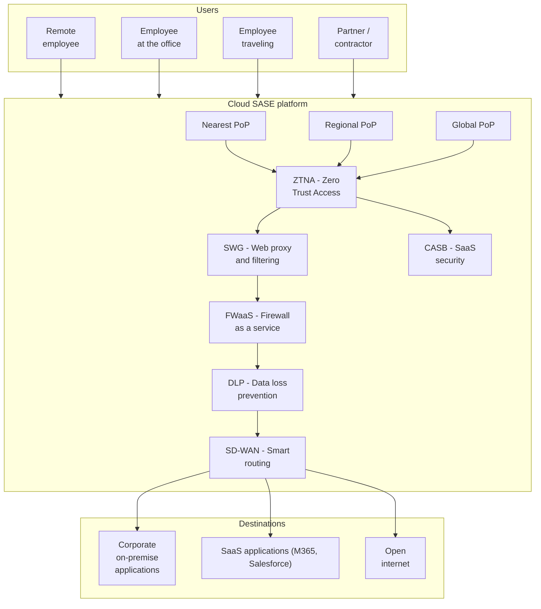
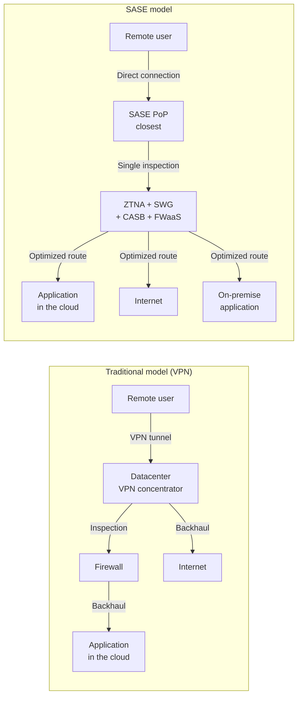
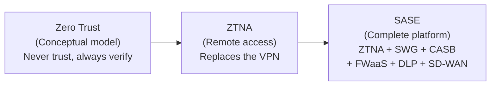
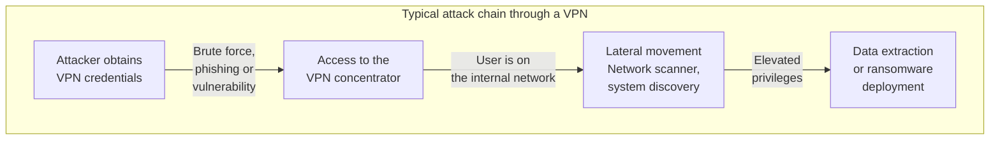

The way people work has changed. So have the applications they use. But the network security of many companies still works as if it were 2010: a fixed perimeter, a central datacenter, and every employee inside the same building.

That disconnect between how work happens and how the network is protected created a serious problem. Tools that used to work, such as corporate VPNs, are today one of the main entry points for attacks. In 2025, compromised VPN credentials were the initial vector in 48% of ransomware attacks, according to industry data.

Secure Access Service Edge, or SASE, was created to solve this problem. It redefines network security for a world where applications live in the cloud, people work from anywhere, and the perimeter no longer exists.

## Who created SASE and when

The term SASE was coined by Gartner in 2019. Analysts Neil MacDonald, Lawrence Orans, and Joe Skorupa published the report "The Future of Network Security Is in the Cloud" on August 30, 2019, defining the concept for the first time.

At the time, Gartner placed SASE at the beginning of the hype cycle, estimating 5 to 10 years for it to become mainstream. In 2026, that prediction looks accurate: the market matured, providers consolidated their offerings, and most medium and large organizations are evaluating or implementing SASE.

Gartner also defined in 2021 a subset called SSE (Secure Service Edge), which is the security components of SASE without the SD-WAN network layer. That lets companies adopt cloud security first and integrate the network layer later.

## What SASE is meant to achieve

SASE aims to solve three problems at once.

The first is the migration to the cloud. Most companies today run more than 80% of their applications on SaaS or cloud infrastructure. Routing them through a central datacenter makes no sense and adds unnecessary latency.

The second is hybrid and remote work. People access corporate resources from home, from the office, from coffee shops, from airports. The security model has to follow the user, not the building.

The third is tool consolidation. Most companies have accumulated over the years a stack of separate security solutions: firewall, VPN, web proxy, CASB, DLP, each with its own console, its own policies, and its own costs. SASE unifies these components into a single platform delivered as a cloud service.

Gartner's original definition is precise:

> "SASE is an emerging offering combining comprehensive WAN capabilities with comprehensive network security functions (such as SWG, CASB, FWaaS and ZTNA) to support the dynamic secure access needs of digital enterprises."

In other words: SASE is not a product. It is a network and security architecture delivered from the cloud, based on the identity of the user and the device, not on physical location.

## How SASE works in practice

The SASE architecture replaces the old "hub and spoke" model, where every user connects to the datacenter, with a distributed mesh of points of presence (PoPs) in the cloud.

The flow in practice:

The user connects to the nearest point of presence (PoP) of the SASE platform through a lightweight agent installed on the device. Everything is based on identity and policy, not on IP address.

The platform verifies who the user is, which device they are on, whether the device is compliant (system up to date, antivirus running, disk encrypted), and which application they are trying to reach. These checks happen continuously, not only at login.

Based on that information, the platform grants access to the specific application, not to the entire network. The user never receives a corporate IP address. The application stays invisible to anyone who is not authorized.

All traffic is inspected at the cloud edge, regardless of destination. Traffic to SaaS goes through the CASB. Traffic to the web goes through the SWG. Traffic to internal applications goes through ZTNA. Inspection happens once, at the point of presence, and every security policy is applied there.

In the traditional VPN model, traffic from a remote user to a SaaS application takes an unnecessary detour: it leaves the user, goes to the company datacenter, passes through the firewall, and only then heads to the cloud. This is the so-called backhaul or hairpin, which adds latency and congests the corporate link without bringing any security benefit.

In the SASE model, the user connects directly to the nearest PoP, inspection happens there, and the route to the destination is optimized by SD-WAN. SaaS traffic never passes through the company datacenter.

## The components of SASE

The SASE architecture is made of six main layers:

**SD-WAN (Software-Defined Wide Area Network).** The network layer. It optimizes traffic routing between points of presence and destinations, choosing the most efficient path for each session.

**ZTNA (Zero Trust Network Access).** Replaces the VPN for access to internal applications. It grants access to the specific application, not to the network. The user is never placed on the corporate network, which eliminates lateral movement.

**SWG (Secure Web Gateway).** Filters internet traffic, blocks malicious sites, enforces acceptable use policies, and inspects HTTPS traffic to detect threats.

**CASB (Cloud Access Security Broker).** Provides visibility and control over SaaS application usage. Detects shadow IT, controls data sharing, and enforces governance policies.

**FWaaS (Firewall as a Service).** Firewall delivered as a cloud service. Replaces physical firewalls in branches and offices, with centralized policies.

**DLP (Data Loss Prevention).** Prevents sensitive data from leaving the organization through any channel: web, email, SaaS upload, or transfer between applications.

## SASE and Zero Trust: how they relate

Zero Trust is the principle. SASE is the implementation.

Zero Trust starts from a simple premise: never trust, always verify. An authenticated user is not automatically trustworthy. Every access request is evaluated based on identity, device, context, and policy.

ZTNA (Zero Trust Network Access) is the practical application of Zero Trust to remote access. It replaces the VPN by ensuring the user reaches only the authorized application, without ever entering the network.

SASE encompasses ZTNA and adds all the other security layers into a single platform. The relationship is hierarchical: Zero Trust is the conceptual model. ZTNA replaces the VPN. SASE replaces the VPN plus the firewall plus the proxy plus the CASB plus DLP in a single service.

## VPN vs SASE: why the VPN is no longer enough

The VPN was designed for a world that no longer exists. It creates an encrypted tunnel between the user and the corporate network, and once authenticated, the user has broad access to the internal network.

This model has structural problems that get worse over time.

**The perimeter is exposed.** The VPN concentrator sits on a public IP, visible and scannable by any attacker on the internet. Critical VPN vulnerabilities have been actively exploited. CISA (the US cybersecurity agency) issued emergency directives ordering federal agencies to disconnect Ivanti and Fortinet devices due to active exploitation.

**The user has access to the entire network.** Once authenticated, the VPN puts the user inside the corporate network. If the user's device is compromised, the attacker inherits that user's entire network reach and can move laterally, scanning systems, discovering vulnerabilities, and accessing sensitive data. In 2025, 48% of ransomware attacks started with a compromised VPN credential.

**SaaS traffic takes an unnecessary detour.** Routing Microsoft 365 or Salesforce traffic through the company datacenter (backhaul) adds latency and brings no security, since the traffic is already encrypted end to end.

**The user experience is poor.** VPNs disconnect when the user switches networks (Wi-Fi to mobile), requiring manual reconnection. The added latency hurts real-time applications such as video calls.

**Maintenance costs are high.** VPN equipment needs constant patching, firmware updates, capacity monitoring, and eventual hardware replacement. Every branch needs its own appliance.

**Known vulnerabilities.** Some of the most critical vulnerabilities of recent years affected corporate VPNs:

- Ivanti Connect Secure / Pulse Secure (CVE-2023-46805, CVE-2024-21887): authentication bypass and command injection actively exploited before patches existed.
- Fortinet FortiOS SSL VPN (CVE-2024-21762): remote code execution without authentication.
- Cisco ASA / FTD (CVE-2023-20269): brute-force vulnerability exploited by the Akira and LockBit ransomware groups to gain unauthorized access.

On average, a critical VPN vulnerability takes 209 days to be fixed by organizations, while attackers exploit it within 5 days, according to industry reports.

## Practical use cases

**Company with branches and hybrid work.** A retail chain with 30 stores, a headquarters, and remote employees. Before, every store had a physical firewall and remote workers used VPN. With SASE, everyone connects to the platform's PoPs. Stores no longer need appliances. Remote workers no longer go through a VPN. The security policy is the same for everyone.

**Cloud migration with residual on-premise applications.** A manufacturing company moved 70% of its applications to the cloud but still keeps legacy systems in the datacenter. With SASE, ZTNA provides secure access to on-premise applications without exposing the network. SaaS traffic goes straight to the cloud without backhaul.

**Contractors and partners.** A company that needs to give suppliers and consultants access. In the VPN model, they gained access to the entire network. With SASE, each partner reaches only the specific application they need, with a time-limited policy and device posture checks.

**Regulated environments.** Financial and healthcare institutions that need to demonstrate granular access controls for audit. SASE offers complete audit trails, identity-based policies, and continuous verification, meeting requirements from standards such as PCI DSS, LGPD, and NIS2.

## How to get started

Migrating from VPN to SASE does not have to be abrupt. The recommended approach is gradual.

First, inventory the applications users reach over VPN and measure current latency, the number of incidents, and the time the IT team spends supporting VPN.

Then, deploy ZTNA for the group that suffers most with VPN: remote and traveling employees. Keep the VPN running as a fallback.

Next, expand to branches with SD-WAN, eliminating physical firewalls.

Finally, add the security layers (SWG, CASB, DLP) and decommission the VPN.

Organizations that follow this roadmap report lower operational costs, better user experience, and the elimination of VPN-related incidents.

## Who this article is for

A CISO at a mid-sized company can use this article to structure the technical justification for a VPN to SASE migration, with Gartner sources and industry data to back the decision.

A network administrator can understand how SASE differs from the model they know and which components will be replaced.

An IT manager can assess whether the time is right to start evaluating SASE providers.

A student or early-career security professional can understand the evolution of network and security architectures over the last few years.

## Sources

- Gartner, "The Future of Network Security Is in the Cloud" (August 30, 2019). Authors: Lawrence Orans, Joe Skorupa, Neil MacDonald. ID G00441737.
- Gartner, "Market Trends: How to Win as WAN Edge and Security Converge Into the Secure Access Service Edge" (2019).
- Wikipedia, "Secure Access Service Edge" (verified in August 2026).
- Always Beyond, "Your VPN Is Now One of Hackers' Favourite Entry Points" (Q3 2025 ransomware data).
- It-learn.io, "Secure Remote Access Architecture: VPN vs ZTNA vs SASE" (comparative analysis and documented vulnerabilities).
- Zscaler, "SASE vs. VPN: Which Is Better for Secure Remote Work?".
- Jimber.io, "VPN vs SASE: Performance & Security Guide 2026" (NIS2 compliance).

## Conclusion

SASE represents a paradigm shift, not just a technology upgrade. It replaces the fixed-perimeter model, where trust is granted by location, with an identity-based model, where every access is verified continuously and independently.

The VPN was the right tool for the corporate world of the 2000s. For today's world, with applications in the cloud, distributed teams, and threats that exploit exactly the weaknesses of the old model, SASE offers a safer, faster, and simpler alternative to manage.

Adoption does not have to be immediate or total. But ignoring the direction the market is taking is a risk no organization can afford.