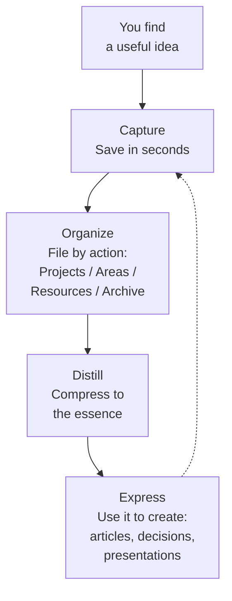
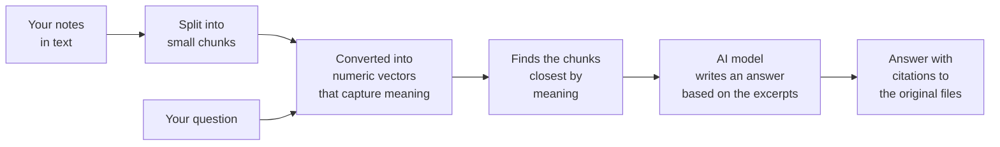

You have been through this: you read an important article, had a brilliant
idea, sat through a meeting with clear decisions. Days later, when you needed
that information, it was gone. You knew you had seen something about the
subject, but you could not remember where, nor what it said.

That is the most common problem of human knowledge. Our biological memory is
excellent at connecting ideas and producing insights, but terrible at storing
information precisely. Everything that is not within immediate reach simply
disappears.

The Second Brain concept was created to solve exactly that. And in 2026, with
artificial intelligence available to anyone, it has become more powerful than
ever.

## What a Second Brain is

The best known definition comes from Tiago Forte, who wrote the book "Building
a Second Brain". The core idea is simple: your mind is for having ideas, not
for storing them. You create a reliable external system where you deposit
everything you learn, and consult it when you need to.

The original method follows four steps, known by the acronym CODE:

**Capture.** You save what matters. An excerpt from an article, a meeting
decision, an insight that came to you in the shower. It takes seconds, and the
rule is simple: if there is any chance it will be useful later, capture it.

**Organize.** You file by actionability, not by subject. The PARA system
(Projects, Areas, Resources, Archives) splits everything into four categories:
active projects, ongoing responsibilities, reference material and archive.

**Distill.** You compress the notes to their essence. The next time you open
the note you do not need to reread everything. The highlights and summaries
tell you what matters.

**Express.** You use the accumulated knowledge to produce something: an
article, a decision, a presentation. The final goal is not to accumulate, it is
to create.

That flow works with any tool. You can do it with paper notebooks, with text
files, with note-taking apps. The magic is not in the tool, it is in the habit
of capturing, organizing and using what you learn.

## What changed with artificial intelligence

Before AI, retrieving information meant searching. You opened your notes,
remembered keywords, navigated folders, reread documents until you found what
you needed. It worked, but it was laborious.

AI changed the retrieval interface. Instead of "finding the note", you "ask the
question". You type "What have I already learned about this subject?" and the
system searches your notes, finds the relevant excerpts and returns a
synthesized answer with citations from the originals.

That does not remove the need to capture well. On the contrary, it increases
it. If your notes are vague, the AI returns vague answers. But organizing by
folders and tags, which used to be essential, becomes less important. Search by
meaning (semantic search) replaces search by keyword.

## Where Obsidian comes in

Obsidian is the most popular tool for anyone who takes the Second Brain
seriously. And there is a reason.

It stores your notes as plain text files in a folder on your computer. That
means you are not locked into the application. If Obsidian ceases to exist
tomorrow, your notes remain there, in files any editor can open.

On top of that, Obsidian lets you create links between notes, forming a web of
connections between ideas. When you are studying a topic you can jump to
another note you wrote months ago about a related subject. The system reveals
connections you did not even remember existed.

But Obsidian is only the substrate. It is where the knowledge lives. Artificial
intelligence comes in as an extra layer that turns that archive of notes into
something far more powerful.

## How AI connects to your note archive

There are three main ways to add an AI layer on top of your notes. All of them
follow the same technical principle, called RAG (Retrieval Augmented
Generation).

The diagram below shows how RAG works in practice:

First, your notes are split into small chunks and each chunk is converted into
a numeric vector, a mathematical representation of the meaning of that text.
Second, when you ask a question, it is also converted into a vector, and the
system finds the note chunks with the closest meaning. Third, those chunks are
handed to an AI model, which writes an answer based exclusively on them, with
references to the original files.

The result is that you can ask "Which articles helped me understand project
management?" and the system answers with the titles, excerpts and direct links,
even if you never used the word "management" in your files. Maybe you wrote
about "deadline tracking" or "agile methodologies".

### Way 1: Tools that do everything out of the box

Google's NotebookLM is the most accessible example. You create a notebook, add
your sources (articles, PDFs, web pages), and ask questions. The system answers
with numbered citations pointing to the original sources. Zero installation,
zero configuration. It works for anyone who wants to start without thinking
about the technical side.

### Way 2: Obsidian with local plugins and offline AI

This is the most balanced setup between power and simplicity. You install
Obsidian and add two free components:

Ollama, a program that runs AI models locally on your computer. It works in the
background and sends no data to the internet.

AI plugins for Obsidian, which connect to Ollama and transform your note
archive.

The step by step is simple. Install Ollama on your computer. Download two
models, one to convert notes into vectors and another to answer questions.
Install the Smart Connections plugin in Obsidian and point it at Ollama. After
a few minutes of indexing you start using it.

Everything works offline. Your notes never leave your computer.

### Way 3: A server over your files (for those already using AI agents)

This is the most flexible option. You create a server that exposes your notes
as tools any AI assistant can consult. The assistant searches your files
semantically, finds the related articles and posts and answers citing each
source, without you having to remember where you stored it or how you named it.

## Which way to choose

The choice depends on how you work and how much control you want.

If you want to start today, without installing anything, use NotebookLM. Add
your articles and PDFs as sources and start asking. In 10 minutes you
understand the value of the concept.

If you want a permanent, private, offline system, go with Obsidian plus local
plugins and Ollama. The initial setup takes an afternoon, and after that
everything runs without depending on the internet or external services.

If you already use AI assistants as a work tool, a server over your files is
the way. The search integrates into your existing flow without you changing
applications.

## The concrete benefits

A Second Brain with AI changes the way you work with knowledge in three ways.

You never lose an idea again. The habit of capturing becomes automatic. What
you read, learned or decided stays recorded and accessible.

You retrieve in seconds what would have taken hours to find. Instead of opening
folders and rereading documents, you ask and receive the answer with citations.

You discover connections you did not know existed. Semantic search finds
relationships between notes you wrote at different moments, about apparently
distinct topics, revealing patterns in your thinking you had not noticed.

## What AI does not replace

The entire literature on the subject in 2026 is consistent on one point: AI
does not replace the discipline of capturing. If your notes are thin, the AI
returns thin answers. What AI eliminates is the work of organizing. Folders,
tags and deep hierarchies matter less when retrieval is by meaning. But the
quality of what you saved remains the limiting factor.

A common mistake is letting AI rewrite or reorganize your notes automatically.
In that case you are not building memory. You are handing control to a system
that can make mistakes. The sequence that works is: you capture, the AI helps
you retrieve and connect, you decide what to do with it.

## A warning about the corporate Second Brain

The method that works for one person cannot be copied into a company without
adaptation. A company is not a bigger head. It is a network of people,
routines, conflicts and dependencies.

A corporate Second Brain needs defined sources (where each kind of information
is born), clear standards (the same names and categories for everyone), useful
history (decisions recorded with context and rationale), visible owners (who
updates, who validates) and integration with the workflow (the system has to be
part of the daily routine, not an extra task).

Ignoring those points is the fastest path to building a knowledge base nobody
consults.

## Who this article is useful for

If you are a person who reads, studies or makes decisions based on information,
the Second Brain with AI is relevant to you.

A project manager who accumulates meeting minutes, schedules and decisions over
the months can ask the system "What was the rationale for changing this
project's deadline?" and get the answer in seconds, without depending on
whoever was in the meeting.

An administrator who keeps records of processes, vendors and internal policies
can create a team knowledge base where anyone finds answers without having to
ask colleagues.

A student who compiles readings, classes and notes over the semester can ask
"Summarize what I have studied about this topic so far" and receive a synthesis
with direct references to the original material.

The tool changes with the profile, but the principle is the same: capture what
you learn, and AI helps you find it when you need it.

## Useful links to get started

- **Building a Second Brain** (Tiago Forte's book that popularized the method).
  Available in bookstores and libraries.
- **[Obsidian](https://obsidian.md)** (free Markdown note-taking app).
  Available for Windows, macOS, Linux, Android and iOS.
- **[Ollama](https://ollama.com)** (free program that runs AI models locally on
  your computer).
- **[NotebookLM](https://notebooklm.google.com)** (free Google tool that lets
  you ask questions about your documents without installing anything).

## Conclusion

The Second Brain with AI is not a tech fad. It is a practical answer to a real
problem: the knowledge you acquire is lost if it is not captured and organized
reliably.

AI makes retrieval dramatic and immediate. You ask, it answers. But the
foundation remains the same as always: the habit of saving what matters, the
discipline of distilling the essential and the conscious decision to use
accumulated knowledge to create something new.

Tools come and go. Obsidian may be replaced tomorrow. Ollama may give way to
another AI engine. But the flow of capturing, connecting and creating is
timeless. Invest in the habit, not in the tool.