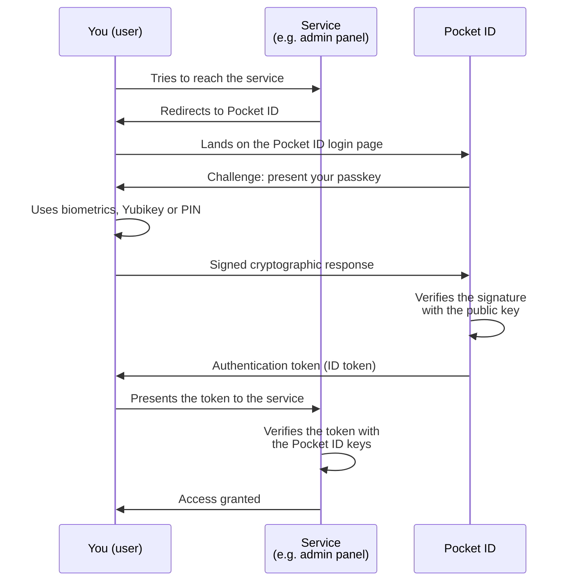

Picture a handful of services running at home or on a cloud server. An admin panel, a media server, a project management tool, a network monitor. Each one with its own login and password. Some you reach from home, some from outside, some only through a mobile app.

Managing that is a nightmare. You end up reusing passwords, writing them down somewhere unsafe, or simply giving up on protecting a few services.

Pocket ID was built to solve that problem. It is an authentication provider you install on your own server, and it lets you and other people reach every service with a single digital identity, without passwords.

## What Pocket ID is

Pocket ID is a certified OpenID Connect (OIDC) and OAuth 2.0 provider designed to be self-hosted. It was created by the developer known as stonith404 and released in August 2024 on GitHub under the BSD-2 license.

The official page is [pocket-id.org](https://pocket-id.org/). The source code lives at [github.com/pocket-id/pocket-id](https://github.com/pocket-id/pocket-id).

What sets Pocket ID apart from alternatives like Keycloak or ORY Hydra is simplicity. Those tools are powerful but complex, while Pocket ID was made for a home administrator or a small team to put into production in minutes.

And its most striking trait: it only accepts authentication through passkeys. No passwords.

## What passkeys are and why that matters

A passkey is an authentication standard that replaces passwords with cryptographic keys. Instead of typing a password, you use:

- The fingerprint or face recognition on your phone
- A physical security chip, such as a Yubikey
- The face or fingerprint reader on your laptop
- A PIN code tied to a trusted device

Technically, passkeys use the WebAuthn standard (Web Authentication), maintained by the FIDO Alliance and the W3C. When you register a passkey, your device generates a key pair: one public key that stays on the Pocket ID server, and one private key that never leaves your device.

When you log in, the server challenges your device to prove it holds the private key. Your device answers using biometrics or a PIN to authorize the use of that key. The password is never typed, never transmitted, and can never leak.

That removes the most common problems in digital security: weak passwords, password reuse, phishing, since nobody can trick you into typing a password on a fake site when there is no password to type, and credential database breaches.

## How Pocket ID works

Pocket ID implements two web standards you have probably used without knowing: OpenID Connect and OAuth 2.0.

**OpenID Connect (OIDC)** is the protocol that lets a service, such as your admin panel, delegate authentication to another service, Pocket ID. When you try to reach the panel, it redirects you to Pocket ID. You authenticate there with your passkey, and Pocket ID returns a token stating who you are. The panel trusts that token.

**OAuth 2.0** is the protocol that lets a service ask for permission to access resources on the user's behalf. A third-party application might ask only to see your profile, for instance, and Pocket ID issues a token scoped to exactly that permission.

The full flow is:



### What if you are on another device that does not have your passkey?

This point matters. A passkey is bound to the device where it was registered. If you are on a public computer and need to reach a service, Pocket ID lets you use passkeys from other devices through a QR code or a link. You scan the QR code with your phone, which holds the passkey, approve the login on the phone, and the computer gets access.

That works because WebAuthn supports a flow called cross-device authentication (CA), also known as the hybrid flow. Pocket ID implements that flow.

## Step by step installation

The simplest and recommended method is Docker. You need:

- A Linux server, or any machine with Docker installed
- A domain pointing to that server, for example auth.yourdomain.com
- HTTPS access through Cloudflare, Caddy, Nginx or Traefik
- A device with a passkey, such as a phone, a Yubikey or a laptop with biometrics

### Step 1: Prepare the environment

Create a folder for Pocket ID on your server:

```bash
mkdir ~/pocket-id
cd ~/pocket-id
```

Download the configuration files:

```bash
curl -o docker-compose.yml https://raw.githubusercontent.com/pocket-id/pocket-id/main/docker-compose.yml
curl -o .env https://raw.githubusercontent.com/pocket-id/pocket-id/main/.env.example
```

### Step 2: Configure the environment variables

Edit the `.env` file with a text editor. The most important variables are:

```
APP_URL=https://auth.yourdomain.com
ENCRYPTION_KEY=a-random-32-character-key
TRUST_PROXY=true
```

`APP_URL` is the address where Pocket ID will be reachable. It must be HTTPS.

`ENCRYPTION_KEY` is the key used to encrypt sensitive data, including the private keys that sign tokens. Generate one with:

```bash
openssl rand -base64 32
```

`TRUST_PROXY` should be `true` if you are behind a reverse proxy such as Caddy, Nginx or Cloudflare Tunnel. Only use `true` if Pocket ID cannot be reached directly without the proxy.

### Step 3: Start the container

```bash
docker compose up -d
```

Pocket ID runs on port 1411 inside the container.

### Step 4: Configure the reverse proxy

You need a reverse proxy to serve Pocket ID over HTTPS. Here are two options.

**With Caddy, recommended for simplicity:**

Create a `Caddyfile`:

```
auth.yourdomain.com {
    reverse_proxy localhost:1411
}
```

Start Caddy with `caddy run`.

**With Cloudflare Tunnel, if you already use Cloudflare:**

Create a tunnel in the Zero Trust Dashboard pointing to `localhost:1411`. See the Cloudflare integration section below.

### Step 5: Create the administrator account

Go to `https://auth.yourdomain.com/setup`. You will see a screen to create the first administrator account. Pocket ID will ask you to create your passkey. On a phone, use fingerprint or face recognition. On a computer, use the biometric reader or a Yubikey.

Done. You have an authentication provider running.

## Managing users

The Pocket ID admin panel lives at `https://auth.yourdomain.com/settings/admin`.

### Inviting users

To add a new user, go to "Users" and click "Invite User". Pocket ID generates an invite link. That link takes the user to a page where they create their own passkey. The invite can be configured to expire after a number of days or uses.

Each user manages their own passkey. If they lose the device, the administrator can revoke the old passkey and the user creates a new one.

### Groups

Groups are how you organize users and control access to applications. You create a group, such as "admin", "dev" or "viewer", add users to it, and then define which applications each group can reach.

For example, you might create:

- Group "admins" with access to every service
- Group "devs" with access only to GitLab and the monitor
- Group "viewers" with access only to the status page

### Audit logs

Pocket ID records every login attempt, token creation and configuration change. The log includes date, user, action, IP address and approximate geographic location, if configured with MaxMind's GeoLite2 database. That is useful for spotting suspicious access.

## Connecting applications to Pocket ID

For a service to use Pocket ID as its authenticator, it has to be registered as an OIDC client.

### Registering a client

In the admin panel, go to "OIDC Clients" and click "Add Client". You need:

- **Name:** a name to identify the client, for example "Admin Panel"
- **Callback URLs:** the URL Pocket ID redirects to after authentication, for example `https://mypanel.com/oauth2/callback`
- **Access type:** "Confidential" for services that can keep a secret, "Public" for client-side applications

After creating it, Pocket ID shows a Client ID and a Client Secret. Store the secret safely.

### Configuring the service

Every service has its own way of configuring OIDC, but the parameters are always the same:

- **Discovery URL / Issuer URL:** `https://auth.yourdomain.com`
- **Client ID:** the ID generated by Pocket ID
- **Client Secret:** the secret generated by Pocket ID
- **Scopes:** `openid profile email`
- **Authorization Endpoint:** `https://auth.yourdomain.com/authorize`
- **Token Endpoint:** `https://auth.yourdomain.com/api/oidc/token`
- **JWKS URL:** `https://auth.yourdomain.com/.well-known/jwks.json`

Many modern services support OIDC natively, among them Authelia, Grafana, Nextcloud, Home Assistant, authentik, Portainer and Traefik. Filling in those fields in the authentication settings is all it takes.

### Services that do not support OIDC

If a service does not support OIDC, you can put [OAuth2 Proxy](https://oauth2-proxy.github.io/oauth2-proxy/) in front of it. It works like a doorman: it stands in front of the service, intercepts unauthenticated requests, redirects to Pocket ID, and only lets the request through when the token is valid.

## Cloudflare Zero Trust integration

Cloudflare offers a product called Zero Trust, formerly Cloudflare for Teams, which includes Access, Gateway, Tunnel and other components. Pocket ID can serve as an identity provider inside that ecosystem.

### Why integrate

Cloudflare Zero Trust lets you publish internal services without exposing IP addresses. The user reaches a domain, Cloudflare verifies identity, and only then forwards traffic to your server through a Tunnel. The server is never directly exposed to the internet.

Cloudflare Access supports several identity providers: Google, GitHub, Okta, Azure AD, and also generic OIDC providers. Pocket ID joins as a generic OIDC provider.

### Configuring Pocket ID as a provider in Cloudflare Zero Trust

**Step 1:** In the Pocket ID admin panel, create a new OIDC client with:

- Name: "Cloudflare Zero Trust"
- Callback URL: `https://<your-team>.cloudflareaccess.com/cdn-cgi/access/callback`

Replace `<your-team>` with your team name in Cloudflare Zero Trust.

**Step 2:** In the Cloudflare Zero Trust Dashboard, go to Settings, then Authentication, then Add new, then OpenID Connect.

Fill in:

- Name: "Pocket ID"
- Issuer URL: `https://auth.yourdomain.com`
- Client ID copied from Pocket ID
- Client Secret copied from Pocket ID
- OIDC Scopes: `openid profile email`
- Claims: `email`, `sub`, `name`

**Step 3:** Save. Pocket ID now shows up as an identity provider option in Cloudflare access policies.

### Creating an access policy

In Cloudflare Zero Trust, go to Access, then Applications, then Add an application.

Choose the application type: Self-hosted for internal services, SaaS for external ones.

In the policy configuration, under "Identity provider", select "Pocket ID". Define the rules:

- The user belongs to the "admins" group in Pocket ID, so allow access
- The location is Brazil, so allow access
- The device is managed, so allow access

When a user tries to reach the service, Cloudflare redirects to Pocket ID, which asks for the passkey, and only then grants access.

### Using Cloudflare Tunnel instead of exposing a port

Instead of exposing port 1411 of Pocket ID directly, you can use Cloudflare Tunnel, through the cloudflared client:

```bash
cloudflared tunnel create pocket-id
cloudflared tunnel route dns pocket-id auth.yourdomain.com
```

And in the tunnel configuration file at `~/.cloudflared/config.yml`:

```yaml
tunnel: pocket-id
credentials-file: /home/user/.cloudflared/pocket-id.json
ingress:
  - hostname: auth.yourdomain.com
    service: http://localhost:1411
  - service: http_status:404
```

That way Pocket ID never exposes a port to the internet. All traffic arrives through Cloudflare.

## Practical use cases

### The homelab with multiple services

You have a server at home running Portainer, Grafana, Home Assistant, a media server and a GitLab. Each one used to have its own login and password. You installed Pocket ID and configured each service as an OIDC client. Now you reach any service with one click and your Yubikey. If a friend needs access to the network monitor, you create an invite, they register their passkey, and you define that they see only that service.

### The small company with third-party access

A software company has a server with GitLab, a deploy panel and an infrastructure monitor. Employees reach everything with the passkey on their phone. External consultants receive invites with access limited to GitLab and the monitor, but not to the deploy panel. When the contract ends, the administrator deactivates the user and every session is blocked immediately.

### Authentication for applications on Cloudflare

A startup uses Cloudflare Zero Trust to protect its staging environments. Pocket ID is the identity provider. Developers reach the staging environments with the passkey on their laptop. When a developer leaves the company, the administrator removes the user from Pocket ID and every Cloudflare policy immediately stops accepting tokens from that user.

## Comparison with alternatives

| Characteristic | Pocket ID | Keycloak | Authelia | ORY Hydra |
|---|---|---|---|---|
| Complexity | Very low | High | Medium | High |
| Authentication | Passkeys only | Password + MFA | Password + 2FA | Customizable |
| Certified OIDC | Yes | Yes | Partial | Yes |
| Docker | Native | Native | Native | Native |
| Database | SQLite / PostgreSQL | PostgreSQL | SQLite / MySQL | PostgreSQL |
| User management | Web UI | Web UI | Web UI | API |
| Best for | Homelab / small teams | Large organizations | Homelab | Developers |

## Limitations and considerations

Pocket ID is intentionally simple, and that means some features common in larger providers do not exist:

- **There is no fallback password.** If you lose every device holding the passkey, recovery depends on an administrator revoking the old passkey so you can register a new one.
- **There is no LDAP or Active Directory.** The user base is managed exclusively by Pocket ID.
- **There is no federation with other providers**, such as logging in with Google or GitHub. Pocket ID is the single source of identity.
- **There is no progressive MFA.** Since authentication already happens through a passkey, which is inherently multi-factor because it combines possession of the device with biometrics or a PIN, there is no separate second layer.

For many scenarios, especially homelabs and small teams, those limitations are acceptable in exchange for simplicity.

## Useful links

- **Official page:** [pocket-id.org](https://pocket-id.org/)
- **GitHub repository:** [github.com/pocket-id/pocket-id](https://github.com/pocket-id/pocket-id)
- **Official documentation:** [docs.pocket-id.org](https://docs.pocket-id.org/)
- **Interactive demo:** [demo.pocket-id.org](https://demo.pocket-id.org)
- **OAuth2 Proxy (for services without OIDC):** [oauth2-proxy.github.io](https://oauth2-proxy.github.io/oauth2-proxy/)
- **Cloudflare Zero Trust:** [cloudflare.com/products/zero-trust](https://www.cloudflare.com/products/zero-trust/)
- **Passkeys (official explanation):** [passkeys.io](https://www.passkeys.io/)
- **WebAuthn (W3C specification):** [w3.org/TR/webauthn](https://www.w3.org/TR/webauthn/)

## Conclusion

Pocket ID solves a real problem elegantly: centralized authentication without passwords. It does not try to be everything to everyone, and that is its greatest strength. For anyone running a few services who wants a unified, secure and modern login experience, it is hard to find an option that is simpler to configure and maintain.

With the Cloudflare Zero Trust integration, you gain an extra layer of security: traffic passes through Cloudflare, authentication happens with a passkey, and your server is never directly exposed to the internet.

The project is open source, OpenID Connect certified, and has an active community on GitHub. It is worth trying the demo before installing. Five minutes is enough to see the value.
