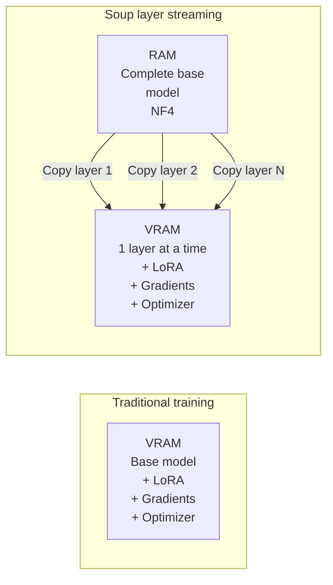

You have a video card with 4, 6 or 8 GB of VRAM. A gaming laptop, a desktop
with an RTX 2060 Super, or a Mac Mini M4 with 32 GB of unified memory. You want
to train or adjust a large language model, but you discover the model does not
fit in your GPU.

The usual answer to that problem has three options: quantize more (and lose
quality), rent a GPU in the cloud (and pay by the hour), or give up.

Soup CLI offers a fourth option: never load the whole model into VRAM.

## What Soup is

Soup is an open source toolkit for fine-tuning LLMs, built by the company
MePlay, Inc. and available under the Apache-2.0 license. The official site is
[trysoup.dev](https://trysoup.dev/) and the repository is at
[github.com/MakazhanAlpamys/Soup](https://github.com/MakazhanAlpamys/Soup).

Soup is not just another wrapper for fine-tuning. It has two distinct value
propositions:

The first is automating the post-training workflow. With a single YAML
configuration file you define the base model, the task (SFT, DPO, ORPO, KTO,
and 19 more methods), the data and the hyperparameters. Soup detects your GPU,
picks the ideal batch size, applies quantization and starts training. One
command.

The second, and more innovative, is **layer streaming**. A technique that lets
you train models that do not fit in your GPU by keeping the base model frozen
in the computer's RAM and copying only one layer at a time into VRAM.

The current version is v0.73.2, and layer streaming has been in BETA since
v0.72.0.

## What layer streaming is

Layer streaming solves the fundamental problem of fine-tuning on modest
hardware. When you train a model with LoRA (Low-Rank Adaptation), only the LoRA
adapters need gradients and optimizer state. The base model stays frozen. But
it still has to be in VRAM for the forward and backward calculations to happen.

Layer streaming says: if the base model is frozen, why keep it entirely in
VRAM?



What Soup does:

1. The base model is converted into one file per decoder layer (safetensors
   shards) and kept in system RAM or on NVMe disk
2. Only the LoRA adapters, the gradients and the optimizer state stay resident
   in VRAM (they are small)
3. During training, each decoder layer is copied from RAM into a small pool of
   pre-allocated VRAM buffers, one at a time
4. The next layer loads on a dedicated CUDA stream, overlapping with the
   calculation of the current layer (double-buffering)

The result is that the VRAM peak is limited by the size of **one layer**, not
of the whole model. With NF4 quantization (NormalFloat4), which reduces storage
by about 4x, a Llama-3.1-8B fits in 3.32 GB of VRAM.

## Real numbers for three hardware scenarios

Layer streaming was developed and measured on a 4 GB RTX 3050 Laptop. But your
hardware may be different, and what changes is how much headroom you have.
Below are three scenarios covering everything from the minimum hardware to more
comfortable machines.

### Scenario A: RTX 3050 Laptop 4 GB (the reference hardware)

This is the card used by the official Soup documentation. The benchmarks below
were measured on it, running Windows:

| Model | Quantization | Throughput | Peak VRAM | RAM |
|---|---|---|---|---|
| Llama-3.1-8B-Instruct | NF4 | 119.6 tok/s | 3.32 GB | 3.60 GB |
| Qwen2.5-3B | NF4 | 264.2 tok/s | 1.76 GB | 1.43 GB |
| Qwen2.5-3B | bf16 | 143.1 tok/s | 2.15 GB | 5.55 GB |
| Qwen2.5-1.5B | bf16 | 525.0 tok/s | 1.82 GB | — |
| Qwen2.5-0.5B | bf16 | 978.6 tok/s | 1.47 GB | — |

With 4 GB of VRAM and NF4 layer streaming you fine-tune a Llama-3.1-8B at 119.6
tokens per second. The model fits with room to spare (3.32 GB peak), and the
cost is being 1.43x slower than resident training.

### Scenario B: RTX 2060 Super 8 GB (your desktop)

The RTX 2060 Super has 8 GB of GDDR6 VRAM, 2176 CUDA cores and Turing
architecture (compute capability 7.5). It is a 2019 card, but perfectly capable
of fine-tuning with Soup.

With 8 GB you have two options:

**Without layer streaming (resident mode).** Models up to 3B fit entirely in
VRAM with NF4 quantization. A Qwen2.5-3B takes about 1.76 GB, so there is room
left for a larger batch size and longer sequences. Training runs at the card's
maximum speed.

**With layer streaming.** You can fine-tune 8B models (Llama-3.1, Qwen3,
Mistral) in NF4 with plenty of headroom. The measured peak of 3.32 GB for an 8B
leaves more than half the VRAM free, which lets you increase `batch_size`
without worrying. Throughput will be limited by the host-to-device transfer,
not by the GPU, so the RTX 2060 Super will not be significantly faster than the
RTX 3050 Laptop when streaming. The real gain is being able to use a larger
batch size.

| Load | VRAM used | Recommendation |
|---|---|---|
| Qwen2.5-3B resident NF4 | ~1.8 GB | No streaming, high batch |
| Llama-3.1-8B streaming NF4 | ~3.3 GB | Streaming with batch 8+ |
| Qwen3-14B streaming NF4 | ~4.5 GB | Streaming, controlled batch |
| DPO/ORPO on 8B streaming | ~3.7 GB | Streaming with preference |

### Scenario C: Mac Mini M4 32 GB (your second machine)

The Mac Mini M4 has 32 GB of unified memory and 120 GB/s of bandwidth. The big
advantage of Apple Silicon is that CPU and GPU share the same memory, so there
is no host-to-device copy cost for layer streaming to hide.

However, Soup has Apple Silicon support via the MPS backend (Metal Performance
Shaders), which is classified as experimental. The MLX backend (Apple native)
is also available via `pip install "soup-cli[mlx]"`, but layer streaming does
not work with MLX. It is a CUDA mechanism.

What that means in practice:

**If you use Soup on the Mac Mini M4 (no CUDA backend available), layer
streaming does not apply.** Soup runs via MPS or MLX, and models up to 8B fit
entirely in the 32 GB of unified memory without needing streaming. A
Llama-3.1-8B in bf16 takes about 16 GB, leaving 16 GB free for the system. With
NF4 it drops to roughly 5 GB.

**If you want the fine-tuning experience optimized for Apple Silicon**, MLX
(outside Soup) is the right tool. With `mlx-lm` you fine-tune 8B models in bf16
without streaming, taking advantage of unified memory. Inference throughput on
the M4 is about 30-40 tok/s for 8B models in bf16, and LoRA fine-tuning runs
comfortably within 32 GB.

| Approach | Maximum model | Notes |
|---|---|---|
| Soup + MPS (experimental) | 3B-8B NF4 | No streaming, no performance guarantee |
| Soup + MLX backend | 8B-14B NF4 | Streaming unavailable, but model fits |
| MLX direct (mlx-lm) | 8B bf16 | Native LoRA fine-tuning, 32 GB enough |
| Ollama + MLX preview | Inference 8B-30B | Runs Qwen3.6 35B-A3B in 22 GB (NF4) |

In August 2026 the technique was validated externally on an 8x H100 cluster,
confirming the accuracy of the forward pass up to 72B parameters and finding a
defect in the NF4 gradient above 165 MB per decoder layer, fixed in v0.73.0.

## What you can train with Soup

Soup supports 23 training methods:

| Task | Description |
|---|---|
| SFT | Supervised Fine-Tuning (instruction) |
| DPO | Direct Preference Optimization |
| ORPO | Odds Ratio Preference Optimization |
| SimPO | Simple Preference Optimization |
| KTO | Kahneman-Tversky Optimization |
| GRPO | Group Relative Policy Optimization (DeepSeek-R1) |
| PPO | Proximal Policy Optimization (RLHF) |
| IPO, BCO | Other preference variations |
| Reward Model | Reward model for RLHF |
| PRM | Process Reward Model |
| Pretrain | Continued pre-training |
| TTS | Text-to-Speech |
| ASR | Automatic Speech Recognition (Whisper) |
| Distill, Unlearn, MoE, and others | Advanced techniques |

Of these, the ones that work with layer streaming are: **SFT, DPO, ORPO, SimPO
and KTO**. GRPO and PPO are explicitly excluded because they need to generate
text during training (rollouts), which would require reading every layer for
each generated token, destroying the savings of streaming.

## Architectures supported in streaming

Nine model architectures are supported and verified as bit-exact against
resident execution:

- Llama (Llama 2, 3, 3.1)
- Qwen2, Qwen3
- Mistral
- Gemma, Gemma 2, Gemma 3 (text only)
- Phi, Phi-3

Each was verified in bf16 and NF4 with a maximum logits difference of 0.000.
In other words, streaming produces exactly the same result as loading the whole
model.

## Installation

Soup requires Python 3.10 to 3.12 and a CUDA GPU (recommended), Apple Silicon
(MPS, experimental) or CPU (experimental).

```bash
# Minimal installation to train
pip install "soup-cli[train]"

# With Unsloth (2-5x faster on compatible GPUs)
pip install "soup-cli[fast]"

# For Apple Silicon (M1-M4)
pip install "soup-cli[mlx]"

# To serve the trained model (OpenAI-compatible API)
pip install "soup-cli[serve]"
pip install "soup-cli[serve-fast]"   # vLLM backend
```

## Configuring training with layer streaming

Soup uses a single YAML file. Here is a working example for fine-tuning a
Llama-3.1-8B on a 4 GB GPU:

```yaml
# soup.yaml
base: meta-llama/Llama-3.1-8B-Instruct
task: sft
backend: transformers

data:
  train: ./dados.jsonl
  format: alpaca
  max_length: 512

training:
  epochs: 3
  lr: 2e-5
  batch_size: 4
  gradient_accumulation_steps: 2
  quantization: 4bit
  gradient_checkpointing: true
  stream_layers: true
  stream_source: auto
  stream_buffers: 2

lora:
  r: 64
  alpha: 16

output: ./output
```

The layer streaming specific parameters:

- **`stream_layers: true`** activates streaming. Only use it if the model does
  not fit resident.
- **`stream_source: auto`** uses RAM if the model fits, falls back to NVMe if
  not. `ram` forces RAM and refuses if it does not fit. `disk` forces NVMe.
- **`stream_buffers: 2`** number of VRAM buffers in the pool. 2 is
  double-buffering. Values from 2 to 8.
- **`quantization: 4bit`** NF4. Reduces storage by ~4x. Essential to fit 8B in
  4 GB.

Batch size has to be a concrete number. The value `auto` is refused because
batch size probing needs a resident model, which never exists in streaming.

### About batch size vs gradient accumulation

Soup has an important finding: in layer streaming, increasing the real batch
size is about **2.52x faster** than increasing the gradient accumulation steps,
for the same effective batch. That happens because a real batch amortizes the
reading of each layer over more tokens, while accumulation re-reads the whole
model on every micro-batch.

The practical rule: increase `batch_size` while VRAM allows, and only then use
`gradient_accumulation_steps` for the rest.

## Data format

The Alpaca format is the simplest for SFT. Each line of the JSONL:

```json
{
  "instruction": "Explain what layer streaming is.",
  "output": "Layer streaming is a technique that keeps..."
}
```

For DPO the format includes a chosen and a rejected answer:

```json
{
  "instruction": "Explain what layer streaming is.",
  "chosen": "Layer streaming is a technique that keeps the base model in RAM...",
  "rejected": "Layer streaming is when you buy more GPUs."
}
```

## Running the training

```bash
soup train --config soup.yaml
```

Soup does the following automatically:

1. Downloads the base model from Hugging Face (if not cached)
2. Converts the checkpoint into shards per decoder layer (once only, cached)
3. Applies NF4 quantization offline
4. Runs the VRAM pre-flight and refuses if it does not fit
5. Trains with LoRA + layer streaming
6. Saves the LoRA adapters to the output directory

### Hardware prerequisites

To stream a Llama-3.1-8B in NF4 you need:

- **GPU:** at least 4 GB of VRAM (the measured peak is 3.32 GB)
- **RAM:** at least 5.1 GB free (the NF4 store of the 8B is ~3.6 GB, and
  pre-flight refuses below store/0.7)
- **Pageable RAM:** ideally the system can page-lock the store (pinned memory).
  If it cannot, throughput drops because the host-to-device copy becomes
  synchronous. Closing other programs helps.
- **NVMe (optional):** if the model does not fit in RAM, Soup can stream from
  NVMe disk. SATA SSD and HDD are refused because the number of seeks per step
  makes training impractical.

Soup has a diagnostic command:

```bash
soup doctor --disk
```

That reports whether the detected disk is NVMe, SATA SSD, HDD or unknown.

### The VRAM pre-flight

Before training starts, Soup calculates the expected VRAM peak and refuses if
it does not fit. This matters because layer streaming limits the weights, but
not the activations and the logits tensor, which scale with `batch_size` times
`max_length`. On models with a large vocabulary (151,936 tokens in Qwen), the
logits tensor alone can reach 8.71 GB at batch 8.

If the pre-flight refuses, you reduce `batch_size` or `max_length`.

## After training

Soup offers several commands to use the trained model:

```bash
# Chat with the model
soup chat --model ./output

# Serve as an OpenAI-compatible API
soup serve --model ./output --backend vllm

# Merge the LoRA adapter into the base model
soup merge --adapter ./output

# Export to GGUF (for Ollama / llama.cpp)
soup export --model ./output --format gguf --quant q4_k_m

# Push to Hugging Face
soup push --model ./output --repo your-user/your-model
```

## Honest limitations

Layer streaming is BETA and has clear limits:

- **It is slower than resident training.** 1.43x slower in the best case. Only
  activate it when the model really does not fit.
- **It only works with `backend: transformers`, `modality: text`, plain LoRA.**
  No Unsloth backend in streaming, no multimodal, no DoRA.
- **GRPO and PPO do not work with streaming.** Generation rollouts require
  every layer for each token.
- **The VRAM peak still depends on batch size and sequence length.** Streaming
  limits the weights, but not the activations and logits. Models with a large
  vocabulary require a low batch size.
- **NVMe is mandatory if RAM is not enough.** SATA SSD and HDD are refused.
- **Nothing above 8B was measured on 4 GB GPUs.** The 14B, 32B and 72B tests
  were done on server hardware (8x H100). A 4 GB machine does not have enough
  host RAM for the 32B store (14.99 GB pinned).

## The preprint

Layer streaming has an academic preprint available on Zenodo:

> "Exact Layer Streaming: LoRA Fine-Tuning of an 8B Model on a 4 GB Laptop GPU"
> (v3). Makazhan, A. (2026). DOI:
> [10.5281/zenodo.21918325](https://doi.org/10.5281/zenodo.21918325).

The preprint documents the correctness protocol that verifies streamed
execution against resident execution, including the discovery of a gradient
defect that only the bit-exact comparison revealed.

## Useful links

- **Official site:** [trysoup.dev](https://trysoup.dev/)
- **Documentation:** [trysoup.dev/docs](https://trysoup.dev/docs)
- **GitHub repository:**
  [github.com/MakazhanAlpamys/Soup](https://github.com/MakazhanAlpamys/Soup)
- **Preprint (Zenodo):**
  [10.5281/zenodo.21918325](https://doi.org/10.5281/zenodo.21918325)
- **Installation documentation:**
  [trysoup.dev/docs/getting-started](https://trysoup.dev/docs/getting-started)
- **Layer streaming documentation:**
  [trysoup.dev/docs/layer-streaming](https://trysoup.dev/docs/layer-streaming)
- **External validation (8x H100):**
  [trysoup.dev/docs/external-validation](https://trysoup.dev/docs/external-validation)

## Conclusion

Soup is not the first fine-tuning toolkit, but it is the first that makes it
practical to train 8B parameter models on 4 GB GPUs without sacrificing
gradient accuracy. The layer streaming technique is ingenious, the preprint is
transparent about limitations and findings, and the tool is usable with a
single YAML file.

For anyone with modest hardware who wants to fine-tune real models without
depending on the cloud, Soup deserves an afternoon of testing.