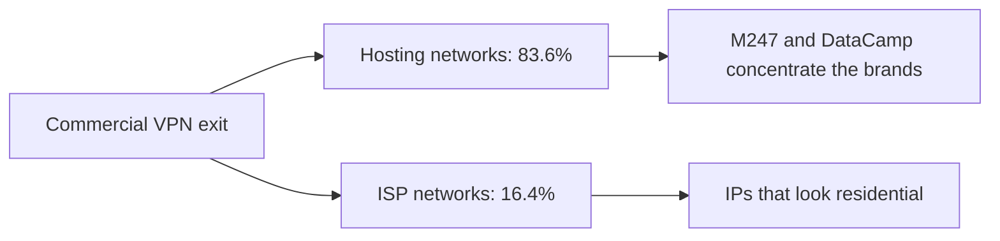
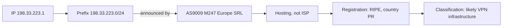

In [part 1](/en/articles/2026-10-09-ip-pais-asn-bgp/) we assembled the chain: an IP falls into a prefix, the prefix is announced by an ASN, the ASN is associated with an organization, and the registry holds the country. "Ownership" became three separate questions, registration, route and location.

Now for the question that closes the loop: how does a website, a bank or a streaming platform know that **you** are on a VPN? Honest spoiler: nobody has a silver bullet. But the whole industry rests on an empirical finding that is worth understanding with numbers.

## Where VPN infrastructure really lives

IPinfo's analysis of 370,616 commercial VPN IPs produced the number that organizes everything else: 83.6% of commercial VPN traffic runs on hosting networks, data centers. The remaining 16.4% uses ISP infrastructure, and that minority is the classic blind spot: IPs that look residential but are VPNs.

Within the 83.6%, the concentration is striking. Independent studies that mapped 50 consumer VPN brands found M247 and DataCamp/CDN77 hosting servers for 41 of them, with the Netify directory confirming M247 as the most prevalent provider among the top 50. The brands' ownership structure is another story: the investigation behind that data attributes PacketHub S.A. (AS136787, Panama) as the in-house infrastructure of the Nord Security group, and CyberZone S.A. (AS209854) to Surfshark. In other words, the brand you install has a name; the network your traffic uses usually has another.



## Why the ASN is never your VPN's name

Almost no consumer VPN runs its own global network. The economic model is rental: the brand buys capacity from hosting providers spread around the world and routes your packets out through them. The result is that the ASN announcing your exit prefix is the ASN of the data center owner, not the brand of the app.

Our part 1 lab, applied to a real M247 IP, shows the full discrepancy:

```bash
whois -h whois.cymru.com " -v 198.33.223.1"
```

```
9009    | 198.33.223.1     | 198.33.223.0/24     | PR | ripencc  | 1992-12-23 | M247 - M247 Europe SRL, RO
```

Three layers of identity, three different answers. The ASN is 9009, M247 Europe SRL, a Romanian name. The allocation country code is PR, Puerto Rico, a 1992 legacy that survived every change of hands. And the network operates data centers in dozens of countries. None of these three layers is the brand on your phone; and the brand, in turn, is invisible in BGP.

## The signals detection systems actually use

Detection stacks independent evidence, each with its own cost and quality:

1. **Registry and route.** Whois and RDAP show the block's organization; RIPEstat shows who originates it. Hosting providers are recognizable: AS9009 is M247, AS212238 is CDNEXT, operated by DataCamp, AS24940 is Hetzner, AS16276 is OVH. The internet has a handful of ASNs that are, statistically, VPN exit infrastructure.

2. **Hosting lists.** Public and commercial databases catalog data center ranges, like X4BNet's datacenter list, with 42,291 IPv4 ranges. Flagging an IP as "hosting" is the first and cheapest step.

3. **Direct attribution.** IP intelligence companies connect to commercial VPNs' infrastructure, map the exit pools and maintain per-brand lists. It is manual work at scale, covers a fraction of the universe, but it is the only source that answers "which VPN?".

4. **Reverse DNS.** Names like `dns.google.` or hosting patterns (`static`, `dedicated`, rack codes) provide cheap context. Sometimes reverse comes back empty, and the absence is information too.

5. **The official Tor list.** The Tor Project publishes exit addresses in real time, a public and verifiable file. On the day this article was written there were 2,726 active addresses:

```bash
curl -s "https://check.torproject.org/exit-addresses" | head -4
```

```
ExitNode 64D74AAA74F30DC2CFB36343CE5D4451B9A4DBA8
Published 2026-10-09 04:05:00
LastStatus 2026-10-09 17:00:00
ExitAddress 171.25.193.25 2026-10-09 17:29:09
```

Tor is the easy case: the infrastructure declares itself. Commercial VPN is the hard case, because the brand's whole business is looking ordinary.

## The blind spot no ASN solves

Remember the 16.4%? Those are VPN IPs running on residential ISP networks, including volunteer nodes of projects like VPNGate. For detection, this traffic is indistinguishable from a home user, by design. IPinfo's analysis identified 129 commercial VPN providers using this camouflage, with VPNGate alone accounting for 23,810 IPs.

On the other side of the balance, false positives: employees behind corporate proxies, users behind mobile carrier CGNAT, CDNs. The datacenter lists include Cloudflare and Akamai among the largest networks, but those are CDNs, not VPNs. A system that blocks everything "hosting" blocks half of the corporate web along with it.



## Lab: the classification in three commands

The complete example above comes from these three commands, all native or free:

```bash
# 1. Observed routing: which ASN originates this prefix?
curl -s "https://stat.ripe.net/data/network-info/data.json?resource=198.33.223.1"

# 2. Who is the ASN and how does the industry recognize it?
curl -s "https://stat.ripe.net/data/as-overview/data.json?resource=AS9009"

# 3. The block's record, with the legacy date and country
whois -h whois.cymru.com " -v 198.33.223.1"
```

Command 1 returns `{"asns":["9009"],"prefix":"198.33.223.0/24"}`. Command 2 returns the holder `M247 M247 Europe SRL`. Command 3 returns the line we saw earlier: block registered at RIPE, country PR, 1992. The detection machinery is exactly the part 1 chain: registration, route, context, reputation. The difference is that instead of asking "where is it?", detection asks "is this ordinary or infrastructure?".

## What detection can and cannot do

Can, with good margins: separate hosting from residential, point out known VPN exit ASNs, list Tor exit nodes, attribute directly-mapped brands.

Cannot, ever: guarantee that a hosting IP is a VPN, promise full coverage (the 16.4% escape by design), or survive alone against the residential proxy industry, which rents IPs from real homes precisely to look like you. VPN detection is a continuous information-asymmetry contest, not a database that, once installed, stays ready.

And the part 1 chain remains the map for all of it: when a system classifies an IP, it consults the registry, the route and the reputation, in that order, exactly like you just learned to do by hand.

## Official links

- IPinfo study on VPN infrastructure on ISPs: [IPinfo blog](https://ipinfo.io/blog/vpns-isp-based-ip-infrastructure)
- Directory of VPN hosts with the top 50 providers: [Netify](https://www.netify.ai/resources/vpns)
- Official, up-to-date list of Tor exit nodes: [Tor Project](https://check.torproject.org/exit-addresses)
- Public lists of VPN and datacenter ranges: [X4BNet](https://github.com/X4BNet/lists_vpn)
- Independent study mapping 50 VPN brands to their networks: [Codamail](https://www.codamail.com/articles/vpn_exposed.html)
- Public RIPEstat API: [stat.ripe.net](https://stat.ripe.net)
- Part 1 of the series, the registration → route → location chain: [kb.alicino.me](/en/articles/2026-10-09-ip-pais-asn-bgp/)
