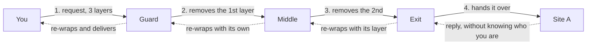
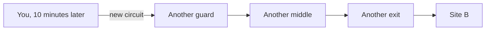
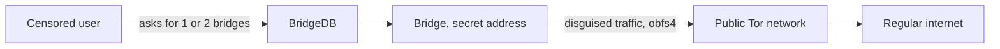

You press "connect" in Tor Browser and, within seconds, your connection exits on the other side of the world after crossing three computers run by volunteer strangers. No company controls those computers, no government registers them, and yet thousands of them have been running as a network for two decades.

The Tor network is one of the internet's most elegant pieces of engineering, and also one of the most misunderstood. This article takes the clock apart: how the onion works, who knows what at each hop, why secret bridges exist, and what happens at the single point where identity is exposed.

In one sentence: Tor hides from whom you are speaking, hides from the others who you are, and does it by splitting trust among three strangers who never meet.

## The idea of the onion

The name is literal. The proposal in the original paper, "Tor: The Second-Generation Onion Router", by Dingledine, Mathewson and Syverson, from 2004, is to stack layers of encryption like the layers of an onion: every node on the route receives the message wrapped in layers that only it can remove, one at a time.

In practice, Tor Browser wraps your traffic in three layers of encryption and hands it to three successive nodes. The first strips the outer layer and learns where to forward, but cannot open the rest. The second repeats the process. The third strips the final layer and hands the request to the destination. Each node sees only its slice: where it came from and where it goes, never both ends at the same time.

That separation produces the system's central property. No individual node knows the sender's identity and the destination together; only the full path knows both ends, and it never exists complete inside a single machine.

## The three-hop circuit

Your Tor Browser picks three relays, computers running the Tor protocol, the set of rules that makes machines with different owners speak the same language, and builds what is called a circuit:



The roles are asymmetric and each has its own name:

1. **The entry node, or guard.** The first to see your real IP. The network keeps one guard fixed for long periods, weeks to months, because rotating guards on every connection would make statistical tracking easier. It is the only node that knows you.
2. **The middle node.** Exists purely to break the link. It knows the entry and the exit, but never you nor the destination.
3. **The exit node.** The only one that talks to the destination. It sees the site you access and, if the traffic has no encryption of its own, the content in plain text. It is the most sensitive point in the architecture, and I return to it later.

And the way back? The same path, in reverse. The site replies to the exit without knowing who you are, and each relay re-wraps the reply with its own layer of encryption, until it reaches your browser covered by the three layers again, ready to be opened only by you.

A question the diagram usually provokes: fine, the return uses the same three nodes, but what about the middle node? It comes back too. The circuit is fixed for its lifetime: the three relays are chosen once and serve both directions. What changes is the key. When the circuit is built, your browser negotiates with each relay two keys, one for the way out and one for the way back. Each relay becomes a gatekeeper with two locks: on the way out, it opens its layer; on the way back, it closes its layer around the passing packet. The middle node repeats the role in both directions: it knows the neighbor relay on each side, but never your origin nor your destination. And that is why the reply never returns along another path: the return keys exist only on those three relays.

Circuits are not forever: by default the browser rotates circuits every ten minutes of activity, with the guard persisting across circuits. Each site tends to get a different circuit, so your bank visit and your forum visit do not share a path. Ten minutes later, the same trip happens with a brand new cast:



## The Tor dictionary

Five words cover almost the entire conversation about the network. Come back here whenever one of them reappears:

1. **Relay.** A computer running Tor and forwarding traffic. The public relays form the skeleton of the network.
2. **Circuit.** The path of three relays your browser builds for a browsing session.
3. **Guard.** The first relay of the circuit, the only one that knows your real IP.
4. **Bridge.** An entry relay that appears on no list, built for places where access to Tor is blocked.
5. **Exit.** The last relay of the circuit, the one that hands the request to the destination site.

## Who runs the nodes: an auditable volunteer network

Tor is not a company and not rented infrastructure. Relays are computers run by volunteers, institutions, libraries, universities and enthusiasts, spread around the world. And everything is public: every hour, the network publishes a consensus document listing the active relays. It works like the network's phone book, revised hourly and signed by a set of independent directory authorities; if one of them tries to lie about the list, the others' signatures expose the fraud.

The live numbers on the day this article was written, straight from [Onionoo](https://onionoo.torproject.org), the Tor Project's data service:

```text
Active relays:   10,130
Active bridges:    3,434
```

The whole inventory is queryable by anyone, with IP address, name, capacity and country of every relay. That transparency is a security choice: the easier it is to audit the network, the harder it becomes for an attacker to hide their presence in it.

## Bridges: when listing everything is a problem

Here transparency turns into vulnerability. If a government blocks every IP on the relay list, Tor dies nationwide. For authoritarian operators, the consensus document is a ready-made target list.

The project's answer was a second kind of node, the bridge, which is not listed anywhere. Bridges do not publish an address in the consensus; they serve as a secret entrance for people living under censorship. The data protocol itself reflects the distinction: in Onionoo responses, a relay's fingerprint appears in full (the fingerprint is the node's cryptographic identifier, the thumbprint that tells one relay from another), while a bridge's appears hashed, because bridge addresses must remain secret by design.

How does a censored user find a bridge if nobody can list bridges? The [BridgeDB](https://bridges.torproject.org) hands them out in small batches, by email, on a website, or inside Tor Browser, and nobody receives the whole set. So the traffic is not even recognized as Tor on the way to the bridge, there are pluggable transports that disguise it: obfs4 turns it into indistinguishable noise, Snowflake relays it through volunteers over the same technology behind video calls (WebRTC), and meek disguises it as traffic from CDNs, the companies that deliver websites around the world.



## Onion services: when the destination hides too

The onion works both ways. In an onion service, the destination, that address ending in `.onion`, also reveals no location: the connection is built through volunteer rendezvous points inside the network, and the service's address is, in fact, its public key. You do not query a server at position X; you prove a cryptographic secret that only that service holds.

That is why an `.onion` address cannot be forged and does not depend on DNS, the internet's phone book of names: the name and the identity are the same thing. And that is why journalists and mainstream platforms alike keep onion mirrors: the service stays reachable in censored places without revealing where its servers are.

## The exit node: the point where you appear

Everything before this protects your anonymity right up to the exit door. There, the request leaves for the regular internet carrying the exit relay's IP, and what happens depends on the protocol you used:

1. **TLS traffic, the browser's padlock HTTPS, today the overwhelming majority of the web:** the exit node carries the end-to-end encrypted session between you and the destination. It sees the domain, not the content.
2. **Plain-text traffic:** the exit node sees everything, including passwords. That is why current browsers warn about it and Tor Browser itself blocks legacy insecure protocols.

This is where the network trades anonymity for responsibility: to whoever receives the connection, the visitor is the exit relay. If someone misuses someone else's circuit, the IP that gets blamed belongs to the node operator. Running an exit node carries real legal consequences, documented in lawsuits and equipment seizures over the years, and the Tor Project keeps a community and legal resource guide for candidates.

## What Tor protects and what it does not

For beginners, this list is worth more than any diagram.

What Tor protects well:

1. **Your location and your IP**, invisible to the sites you visit
2. **What you browse from local observers**, like your ISP: they see that you use Tor, but not what you do with it
3. **Confidentiality on HTTPS sites**, which stays encrypted end to end

What Tor does not protect:

1. **Accounts with your real name.** If you log in with your real identity inside Tor, the site knows exactly who you are
2. **Files.** Opening a downloaded document hands your computer to whatever program opens it, outside the browser's protection
3. **Malware and scams.** Tor anonymizes the connection, it does not vaccinate against dangerous content
4. **What you reveal about yourself.** Writing who you are in a forum undoes the most perfect circuit

## Tor is not a VPN

An honest expectation: Tor is not a VPN. A VPN encrypts your path to the provider and swaps your IP; the Tor network adds anonymity through separation of trust, no single part knows the full picture. The price is latency, the delay your connection feels: three hops and three layers cost response time, and speed rarely competes with a direct connection. Tor Browser also imposes discipline, blocking scripts and resources that could deanonymize, and anti-fraud sites often treat it with suspicion, a topic we covered in [part 2 of the series](/en/articles/2026-10-10-deteccao-vpn-hosting-asn/).

For detection, Tor is the transparent case: exits sit on an official, public list, updated in real time. On the day of writing there were 2,743 active exit addresses, rising and falling as operators turn their relays on and off.

## Lab: the network live, without installing anything

Three commands, all with official Tor Project sources:

```bash
# 1. How many relays and bridges exist right now?
curl -s "https://onionoo.torproject.org/summary?type=relay" | grep -c '"f"'
curl -s "https://onionoo.torproject.org/summary?type=bridge" | grep -c '"h"'

# 2. Which addresses are exiting to the internet right now?
curl -s "https://check.torproject.org/exit-addresses" | head -4

# 3. How many active exits at this moment?
curl -s "https://check.torproject.org/exit-addresses" | grep -c "^ExitAddress"
```

Note the detail in command 1: the relay field is `"f"`, for full fingerprint, and the bridge field is `"h"`, a hash, an irreversible mathematical summary that confirms identity without revealing the address. The difference shows up in the API response because it shows up in the architecture: relays get listed, bridges stay hidden.

## Official links

- Documentation and overview: [Tor Project](https://www.torproject.org)
- Protocol specifications: [spec.torproject.org](https://spec.torproject.org)
- Statistics and relay numbers: [metrics.torproject.org](https://metrics.torproject.org)
- Network data API: [onionoo.torproject.org](https://onionoo.torproject.org)
- Real-time exit list: [check.torproject.org/exit-addresses](https://check.torproject.org/exit-addresses)
- Request bridges: [bridges.torproject.org](https://bridges.torproject.org)
- Resources for relay operators, including legal: [community.torproject.org](https://community.torproject.org/relay/community-resources/)
- VPN and exit infrastructure detection, part 2 of the series: [kb.alicino.me](/en/articles/2026-10-10-deteccao-vpn-hosting-asn/)

## Conclusion

The Tor network solves a problem a VPN does not: anonymity by design, with distributed trust instead of transferred trust. No node knows the full picture, the inventory is public and auditable, and even the censorship-survival mechanism, the bridges, is a design lesson: the most valuable part of the system is the part it refuses to list.

The natural next step for the series is the question part 2 left open: when routing and announcements are cryptographically signed, what changes in detection? That is the territory of RPKI, a subject for a future article.
