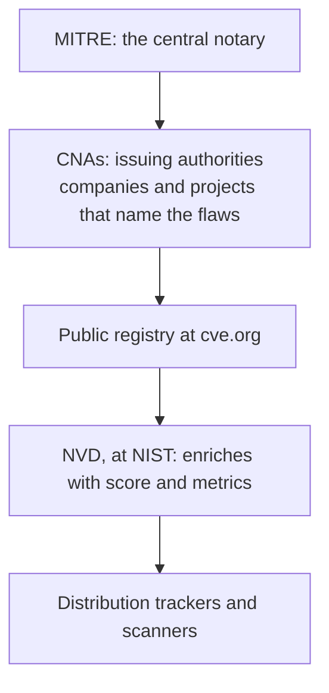
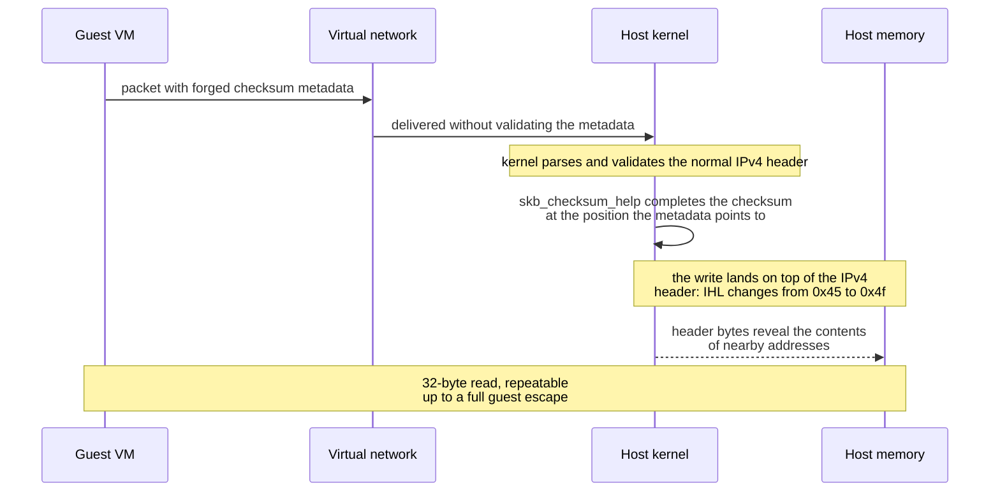

In August 2026, Vercel offered up to one million dollars to whoever escaped its sandbox, the isolated environment that runs customer code in the cloud. Within three days, a researcher found what would become the challenge's single critical flaw. And the most interesting part: the flaw was not in Vercel. It was in the Linux kernel, in the networking code the whole world runs. Its record got the name CVE-2026-99999 and the nickname PwnEscape.

This article starts with the word CVE, which shows up in every security news story and is almost never explained. Then it dives into the case itself: what the flaw causes, how it was discovered, what the fix does, how to apply it, and how to track the fix on your distribution.

## What is a CVE: the ID card of vulnerabilities

CVE stands for Common Vulnerabilities and Exposures. It is a unique number assigned to each security flaw that has been identified and confirmed in some software somewhere in the world. The format is simple: the letters CVE, the year of discovery, and a serial number, as in CVE-2026-99999.

The analogy that sticks: a CVE is the ID card of a flaw. Before it exists, the same vulnerability can get different names in every company, blog, and security tool, and nobody can tell whether they are talking about the same thing. With the number, the global conversation fits on one line: patches, databases, scanners, and news all use the same identifier.

One common misunderstanding is worth clearing up: the number does not measure severity and does not say you are in danger. It only identifies the flaw. Severity is a separate number, the CVSS score, which we will get to.

## Who manages the system

Three pieces share the work:



1. **MITRE**, an American research organization, has run the CVE program since 1999, sponsored by the United States government through CISA, the country's cybersecurity agency
2. **CNAs**, the CVE Numbering Authorities, are the issuing authorities: more than 400 companies and projects authorized to number the flaws they discover, within their own territory. The Linux kernel has its own, the kernel.org CNA, which since 2024 is the body that registers kernel vulnerabilities, including the one in this article
3. **NVD**, the National Vulnerability Database, operated by NIST, receives each record and enriches it: it analyzes the details, classifies the impact, and publishes the CVSS score, from 0 to 10, standardized by the organization FIRST

The final end of the chain is the distribution trackers, which record, for each CVE, the state of the package in every release branch: affected, fixed, or pending. That is where this article points at the end.

## The one million dollar challenge

Vercel, the cloud company that hosts web applications, ran a public challenge of two weeks in August 2026: whoever escaped their sandbox would take up to one million dollars in combined prizes. The sandbox is the layer that runs one customer's code separated from everyone else's, like apartments in a shared building.

The official tally: 1,285 reports, 242 thousand dollars paid, a top prize of 50 thousand per report, and a single finding classified as critical. It was the work of Paulos Yibelo, from PWNAI Research, published under the title PwnEscape. The research question, in the author's words: how much can an untrusted guest influence the host kernel without ever exploiting KVM itself?

The answer was scary in its elegance: the flaw was not in the hypervisor, the software that manages virtual machines, but in the Linux networking stack. That means the problem reaches far beyond Vercel: any cloud platform, sandbox, or VM hosting running a vulnerable kernel was exposed. Vercel, by the researcher's account, acted fast: protected its customers, ran its own research, notified other hypervisor providers, and coordinated the fix with the kernel community.

## The flaw: what CVE-2026-99999 causes

The heart of the problem is an old networking concept: the checksum, the verification sum every packet carries to allow integrity checking. In the Linux kernel, every packet lives inside a structure called sk_buff, the envelope that travels through the networking stack, and the envelope stores metadata about where the packet's checksum is, the csum_start.

The decisive detail: when the packet comes from a virtual machine, that metadata is controlled by the guest. And the routine that completes the checksum, skb_checksum_help, writes the result wherever the metadata points. If the guest lies about the location, the write lands where it should not: on top of the IPv4 header the kernel had already parsed and validated.

The complete attack sequence, from guest to host memory:



The byte that gives the leak its shape is the IHL, the IPv4 field that states the header length. In a normal packet it is 0x45, meaning five words of 32 bits, or 20 bytes. With the misplaced write, it becomes 0x4f: fifteen words, 60 bytes. The kernel starts reading 40 extra bytes the packet does not have, and those bytes are host memory, handed to the guest as a gift. The read is repeatable and tunable, and the researchers turned it into a complete escape, from guest to host, on KVM and many other virtualization environments.

The severity table of the CVE, in the CVSS 3.1 standard, gives it 9.3, critical: local attack, low complexity, requiring no prior privileges and no user interaction, and with changed scope, the S:C that indicates the flaw crosses a system boundary. C, I, and A, confidentiality, integrity, and availability, all high.

## Why a local attack is scary

The score says the attacker must already be running code inside a virtual machine. Nobody can exploit this by sending packets across the open internet. It may sound like comfort, and it is not.

The reason is multi-tenancy, the separation of customers on the same physical machine that underpins modern cloud. When you rent a VPS or run a container in a platform sandbox, your hardware neighbor can be anyone. An escape flaw is precisely the tool that turns an attack against the neighbor into an attack against the host sheltering them all. It is the scenario [the QEMU/KVM article](/en/articles/2026-09-25-qemu-kvm-vms-linux/) describes from the architecture point of view, and PwnEscape shows the practical face of that risk.

Two honest reliefs: on the day of writing, there is no sign of the flaw being used in real attacks, and it does not appear in CISA's catalog of actively exploited vulnerabilities. The fix is already in the mainline kernel, and disclosure was coordinated.

## The fix

The patch has reasoning that fits in one line, written by Michael S. Tsirkin, from Red Hat: before completing the checksum, verify that the write position lies past the already validated IPv4 header. The code added to include/net/ip.h defines the guard:

```c
static inline int ip_check_csum_start(const struct sk_buff *skb)
{
	if (unlikely(skb->csum_start < skb->network_header + ip_hdrlen(skb)))
		return -EINVAL;
	return 0;
}
```

The condition says: the checksum start must begin after the end of the IP header. If the metadata points inside the header, the routine refuses and the path fails in a controlled way, instead of writing over data the kernel already trusts.

Commit 6785011f8b16 was accepted in the kernel's networking branch on October 8, 2026, and entered Linus's mainline tree on October 14. It applies the check at five points of the IPv4 stack, across six files, and the commit message is honest about the scope: it is a defense in depth measure, and full validation at packet input is still to come, with more work. The engineering lesson: trust in metadata should be proportional to its origin, and a metadata field that crosses a trust boundary, like the guest to host one, must be revalidated on the other side.

## How to fix it

The golden rule: it is the **host kernel** that gets fixed. Updating your virtual machine's kernel changes nothing, because the flaw lives outside it. The step by step:

1. **Find your host kernel version** with `uname -r`
2. **Compare against the fixed versions** in the record: 5.10.272, 5.15.223, 6.1.190, 6.6.159, 6.12.113, 6.18.57, and 7.2.11 are the first fixed versions of each stable branch
3. **Update through the host's distribution**, which ships the patch in equivalent versions, and reboot into the new kernel
4. **If you are a cloud customer**, the fix belongs to the provider: the right question for support is which host kernel version they run, and whether it already includes commit 6785011

For those running their own hypervisors, with [QEMU/KVM](/en/articles/2026-09-25-qemu-kvm-vms-linux/) or any other platform, the order is the same: host first, reboot, and only then consider the matter closed.

## How to track it

The official trackers of each distribution record the package state branch by branch, and all of them were verified on the day of writing:

1. **Debian**: [security-tracker.debian.org/tracker/CVE-2026-99999](https://security-tracker.debian.org/tracker/CVE-2026-99999), with the state of bookworm, trixie, and sid. In this week's query, some branches already showed fixed while others were still vulnerable, a live portrait of a patching week
2. **Ubuntu**: [ubuntu.com/security/CVE-2026-99999](https://ubuntu.com/security/CVE-2026-99999), with affected versions and published updates
3. **Red Hat**: [access.redhat.com/security/cve/CVE-2026-99999](https://access.redhat.com/security/cve/CVE-2026-99999), with the security advisories and fixed packages
4. **SUSE**: [suse.com/support/security/cve/CVE-2026-99999.html](https://www.suse.com/support/security/cve/CVE-2026-99999.html)
5. **NVD**: [nvd.nist.gov/vuln/detail/CVE-2026-99999](https://nvd.nist.gov/vuln/detail/CVE-2026-99999), the record enriched by NIST
6. **The original record**: [cve.org/CVERecord?id=CVE-2026-99999](https://www.cve.org/CVERecord?id=CVE-2026-99999)
7. **The fix in the kernel**: [commit 6785011f8b16](https://git.kernel.org/pub/scm/linux/kernel/git/torvalds/linux.git/commit/?id=6785011f8b16abf40b1e9d8b2e332232b3e68822), in Linus's tree
8. **The kernel's official announcements**: [lore.kernel.org/linux-cve-announce](https://lore.kernel.org/linux-cve-announce/), the list where every kernel CVE is announced
9. **The full technical disclosure**: [oss-security](https://www.openwall.com/lists/oss-security/2026/10/15/5), with the researcher's analysis and the patch

## Conclusion

The CVE system is security's shared vocabulary: a number that turns a finding in a cloud sandbox into a global advisory, a patch in every distribution, and an update decision on every host on the planet, all within a week. PwnEscape shows that machine working end to end: the discovery in Vercel's challenge, the registration by the kernel CNA, the fix in the mainline tree, and the backport to every stable branch.

And it leaves the engineering lesson: the isolation between virtual machine and host is made of software, and software has defects. A trust boundary is not a line in a diagram; it is a promise the kernel must keep for every metadata field arriving from the other side. This time, it was a checksum. Next time, it may be another field nobody revalidated.
