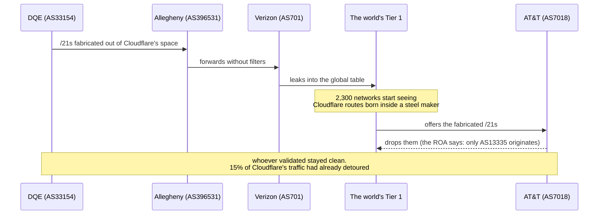
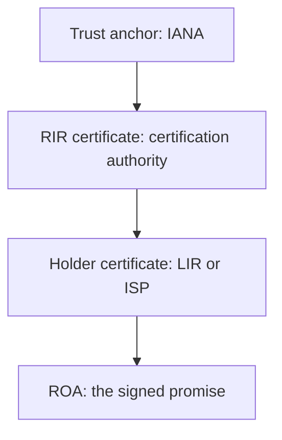
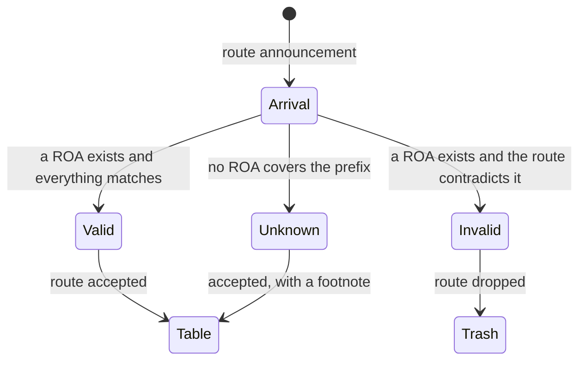
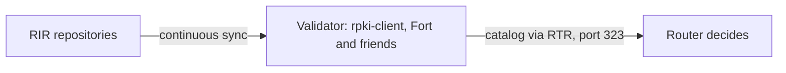

On the morning of June 24, 2019, traffic to thousands of sites, including Cloudflare's, started taking a detour through a metals manufacturer in Pennsylvania. Nobody hacked anything. No malware, no attack. The internet did exactly what its routing protocol tells it to do: believe the most specific announcement it found.

The problem was not a machine defect. It was a trust defect: BGP, the system that moves traffic between the world's networks, accepts anyone's word. The technical community's answer to that weakness is called RPKI, and it is the subject of this article, the next step of the series that already covered [registration](/en/articles/2026-10-09-ip-pais-asn-bgp/), [detection](/en/articles/2026-10-10-deteccao-vpn-hosting-asn/) and [Tor](/en/articles/2026-10-16-como-funciona-a-rede-tor/).

## The problem: BGP believes everyone

Recapping [part 1 of the series](/en/articles/2026-10-09-ip-pais-asn-bgp/): networks announce themselves to each other via BGP, and every ASN declares the prefixes it knows how to reach. The protocol's original design has no verification of anything. Any ASN can announce any prefix, including ranges that belong to someone else.

When that happens on purpose, it is called a route hijack. When it happens by accident, it is called a misconfiguration, and the effect for the user is the same: traffic goes to the wrong place. Worse, the longest-match rule, the more specific prefix wins, turns a small fake announcement into everyone's preferred path. Announcing a fake /24 inside someone else's /20 is the cheapest way to steal traffic from an address.

## The case of June 24, 2019

The complete sequence of the incident, with the real roles, fits on a timeline:



The traffic optimizer at DQE, a regional ISP in Pennsylvania, fabricated more-specific prefixes out of Cloudflare's space to "optimize" its own routes. They flowed to the neighboring customer, Allegheny, which is not even an ISP: it is a steel manufacturer. From Allegheny to Verizon, and from Verizon, in a classic leak, to the world's big transit providers.

One detail saved part of the internet: AT&T rejects routes that fail origin validation. Since Cloudflare had ROAs published for its blocks, the fabricated /21s arrived at AT&T already labeled invalid and died there, automatically, with no late-night phone call. The networks that did not validate accepted everything. Cloudflare's post-mortem documented the full path, ASN by ASN.

## The answer: RPKI, the internet's notary office

BGP's weakness is the absence of a notary: nobody asks for papers at the door. RPKI (Resource Public Key Infrastructure) builds exactly that notary, reusing the structure we already know from [part 1](/en/articles/2026-10-09-ip-pais-asn-bgp/).

The idea uses the same certificate standard as secure websites, X.509, the format behind the browser's padlock. The difference is the content: instead of proving that a site belongs to a company, an RPKI certificate proves that an organization has the right to use an IP range. And the certificate hierarchy mirrors the numbering hierarchy:



Each of the five RIRs runs its own certification authority, deriving trust from the IANA anchor. A Brazilian ISP gets its certificates from LACNIC, which derive from the same root. Anyone can inspect the whole chain, because everything is public and verifiable, in the same spirit as Tor.

## ROA: the signed promise

Inside this infrastructure lives the document that changes the game: the ROA (Route Origin Authorization). A ROA is a digitally signed statement with three fields, and all three deserve attention:

1. **The prefix.** The IP range being protected, such as `1.1.1.0/24`
2. **The authorized ASN.** The only autonomous system allowed to originate that prefix
3. **The maxLength.** The maximum prefix length that ASN may announce inside the range

The analogy that sticks: a ROA is a notarized transport permit saying "only truck 13335 may deliver to address 1.1.1.0/24, and no shipment smaller than /24". If a truck from another company shows up with a smaller shipment, like the /21s DQE fabricated in 2019, the document exposes it on the spot.

Every valid prefix and ASN combination, once validated, becomes a line in a global catalog: the VRP (Validated ROA Payload). On the day this article was written, the world's notary held exactly 1,037,816 of these signed promises, and the full registry can be downloaded for free, as we will see in the lab.

## The three verdicts

When a route announcement arrives at a router that performs origin validation, comparing the announcement against the ROA catalog ends in one of three verdicts, defined in RFC 6811:



The third verdict is the subtlety that trips up beginners the most. Unknown is not invalid: it is the announcement of a prefix that simply has no ROA. The internet cannot punish whoever did not sign, because half the world is still learning. Invalid is a route that **contradicts** an existing document: the wrong ASN originating, or a length beyond what was authorized. Unknown is just missing paperwork. Validating routers drop the invalid and keep the unknown, and that prudent choice is what allows gradual adoption without splitting the internet.

## How the router finds all this out

No router talks to the notary directly. Between the public repositories and the forwarding decision there is a three-step conveyor belt:



The validator, dedicated software such as rpki-client or Fort, collects and verifies all the certificates and ROAs from the five RIRs, checks the signatures across the whole chain, and hands the router only the clean result, the VRP catalog, over a dedicated protocol called RTR. The router consults the local catalog on every announcement and applies the verdict. The cycle repeats every few minutes, because promises expire and new ones appear.

## Why it works: the invalid route dies alone

Adoption without effect would be bureaucracy. The numbers prove the effect. In IPinfo's September 2026 survey, 70.3% of the IPv4 routes announced in the global table were valid, up from 54% in just one year. The memorable detail is visibility: a typical valid route appears in the 596 measurement points that feed the global tables; an invalid route appears in 2. It is born and dies practically alone, because the big networks reject at the border.

The historic milestone came on May 1, 2024, when a majority of the IPv4 routes in the global table had ROAs for the first time, according to the NIST monitor. IPv6, always ahead in this race, leads: 79% versus 68% of IPv4 routes. And a single country moved the world in the last year: China went from 3.7% to 83% of its routes signed, accounting for almost 60% of the global gain.

## LACNIC: the pioneer

Latin America entered before everybody. LACNIC put its RPKI into production on January 1, 2011, the first region on the planet to offer resource certification to its members, with the system later adopted by the other RIRs. Today the region keeps 69% of its IPv4 routes under ROAs, according to the Hurricane Electric report, in the leading group, behind only APNIC and RIPE NCC.

For readers in the region, the detail matters: your ISP's ROAs most likely come from LACNIC, and checking the signature of the routes that reach you is a seconds-long query, like the one in the lab below.

## What RPKI does not solve

Technical honesty prevents disappointment. RPKI protects exactly one thing: **the origin of the announcement**, the binding between prefix and ASN. Everything else stays exposed:

1. **Path manipulation.** A malicious router in the middle can alter the list of ASNs without breaking origin validation
2. **The hijack by the owner itself.** If the ROA holder decides to announce in bad faith, the document is on their side
3. **The maxLength trap.** Configuring the wrong length kills legitimate announcements: if the ROA authorizes up to /24 and the owner needs to announce a /23, the world treats the owner's own announcement as fake
4. **Forgotten promises.** Expired or outdated ROAs become silent traps that switch off legitimate traffic

The next step after signing the origin is signing the whole path, and the community is already working on it with proposals like ASPA. For now, a signed origin has already broken the cheapest hijack model.

## Lab: one million signed promises

The world's complete notary is public and downloads in one command. It is about a hundred megabytes of JSON with every live VRP:

```bash
# 1. Download the worldwide registry (roughly 100 MB)
curl -s "https://console.rpki-client.org/vrps.json" -o vrps.json

# 2. Look up the ROA of the 1.1.1.1 resolver, met in part 1
grep '"prefix": "1.1.1.0/24"' vrps.json

# 3. How many promises exist at this moment?
grep -c '"prefix"' vrps.json
```

Command 2 returns the real line from the notary, captured on the day of writing:

```json
{ "asn": 13335, "prefix": "1.1.1.0/24", "maxLength": 24, "ta": "apnic", "expires": 1792937860 }
```

Read it as: APNIC, the authority of the block's region, attests that ASN 13335 is the only one authorized to originate 1.1.1.0/24, with an expiry date attached. It is the very promise AT&T enforced at the door in 2019. To check the verdict of any prefix on the internet, [bgp.tools](https://bgp.tools) shows the validation status on each route's page, alongside who originates it.

## Official links

- RPKI architecture: [RFC 6480](https://www.rfc-editor.org/rfc/rfc6480)
- The ROA format: [RFC 6482](https://www.rfc-editor.org/rfc/rfc6482)
- The three validation verdicts: [RFC 6811](https://www.rfc-editor.org/rfc/rfc6811)
- Worldwide VRP registry, continuously updated: [console.rpki-client.org](https://console.rpki-client.org)
- NIST global monitor: [rpki-monitor.antd.nist.gov](https://rpki-monitor.antd.nist.gov)
- Cloudflare's adoption dashboard: [RPKI Radar](https://rpki.cloudflare.com)
- The adoption milestone analysis: [APNIC Blog](https://blog.apnic.net/2024/05/08/rpki-rov-deployment-reaches-major-milestone/)
- Current survey of valid routes: [IPinfo](https://ipinfo.io/blog/rpki-protects-70-internet-routes)
- The 2019 case post-mortem: [Cloudflare Blog](https://blog.cloudflare.com/the-deep-dive-into-how-verizon-and-a-bgp-optimizer-knocked-large-parts-of-the-internet-offline-monday/)
- The idea's pioneer: [LACNIC Blog](https://blog.lacnic.net/en/lacnic-has-started-providing-resource-certification-services-rpki/)

## Conclusion

The series has reached the point where the registry becomes a commitment. Part 1 showed who registers the numbers; part 2 showed how detection reads those records; the Tor article showed anonymity through separation of trust; and RPKI closes the loop elegantly: turning the public registry into a signed promise that routers enforce at the door.

The 2019 case is the article's best argument: the same internet, with the same trust flaw, behaved two different ways, and the difference was a signed document half the networks did not even know existed. The internet is learning to sign its routes, one million promises at a time.
