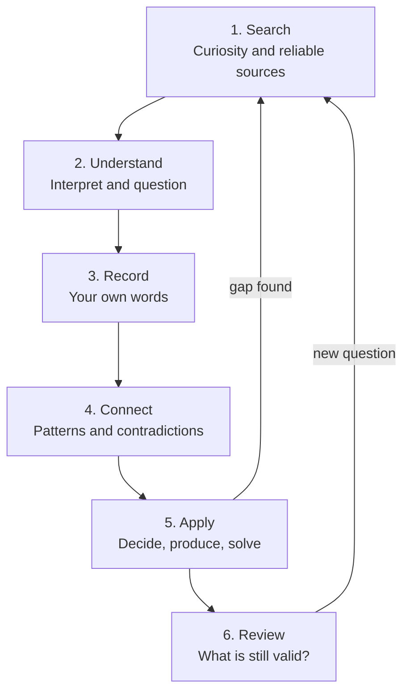
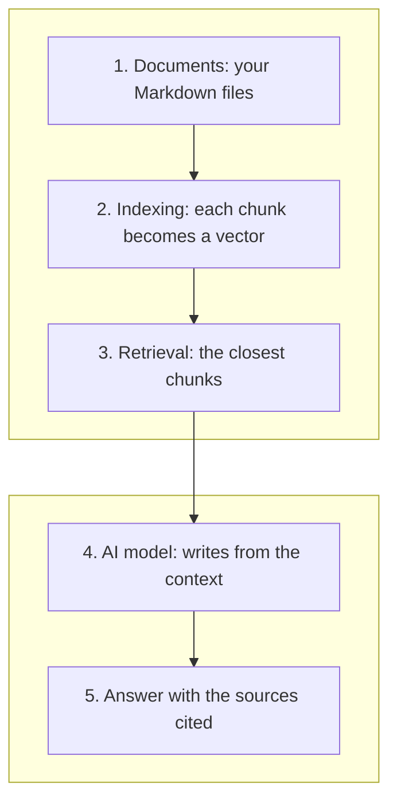

In [Part 1](/en/articles/2026-08-31-second-brain-ai-complete-guide/) of this guide, the question was practical: how to build a second brain and which tools to use. We covered Tiago Forte's CODE method, PARA's organization by actionability, Obsidian as a durable substrate, and the three ways to put an AI layer over your notes.

Now suppose you already have all of that working. The repository exists, semantic search answers, the system is set up. A less technical and much harder question shows up:

**What keeps a second brain genuinely useful over the years?**

That is the question this article is about. And the answer is not in any tool.

## Having information is not the same as possessing knowledge

There is an old distinction that haste tends to erase. It is worth rebuilding carefully, because most of the confusion around personal productivity starts exactly there.

**Information** is raw data. A saved article, a snippet of documentation, a video bookmarked "watch later". Information is external to you: it exists in the file, not in your head.

**Knowledge** is information that went through you. You understood the concept, you can explain it in your own words, you recognize when it applies and when it does not. Knowledge is internal: it lives in your ability to reason, not on your disk.

**Wisdom** is one step further. It is knowing when to use what you know, when to distrust what looks correct, and when to admit you still do not know. Wisdom involves judgment, and judgment cannot be stored.

The difference between the three is the difference between owning a library and knowing how to think.

Consider someone who saved hundreds of articles, books, and videos about project management. Every file is there, catalogued, impeccably tagged. Semantic search finds anything in two seconds. If someone asks about risk management, the system returns ten relevant excerpts.

Now ask whether that person knows how to manage risk.

Did they build a second brain? Or did they build a sophisticated digital library with a very good search interface?

I am not going to answer that yet. The answer depends on what that person did after saving, and that "after" is what the next sections are about.

## The second brain as a living organism

The most useful analogy for a knowledge repository is not an archive. It is an organism.

An archive is passive. It loses nothing over time, and for that very reason it gains nothing. A folder of files from 2019 has exactly the same value in 2026, as long as the files still make sense.

An organism is different. It needs to be fed, but also digested, exercised, and rested. An organism that only eats and never moves gets sick, even when well nourished.

A second brain works the same way. It needs to receive information, yes, but it also needs to be organized, reviewed, and used. And here an important caveat applies, because biological analogies tend to be pushed too far:

**A repository that stops receiving new information does not automatically lose its value.** Consolidated knowledge stays useful for many years. A good article about the TCP protocol written in 1990 is still correct today, because the protocol has not changed in the part that text explains. Nobody needs to review the foundations of mathematics every semester.

The problem is not the absence of new input. The problem is when outdated, contradictory, or disconnected information starts being treated as permanent truth, with nobody having looked at it.

Compare three concrete situations.

**1. A repository that grows in quantity but not in understanding.**

Here the repository gains hundreds of notes a month and the owner could not explain any of them without opening the file. Each note is a copy of something read, not an elaboration of it. The system looks healthy when measured by volume, and that is exactly the metric that makes it useless: searching across 3,000 copied excerpts returns 3,000 copied excerpts, with no hierarchy and no opinion.

**2. A repository that is organized but abandoned, with no review.**

Here the repository is small, well structured, and nobody has opened it in two years. Organization became a task in itself: renaming files, adjusting tags, reorganizing folders. None of that produces understanding. It is the elegant version of the previous problem, and more dangerous, because maintenance work gives the feeling of progress.

**3. A system used continuously to study, reflect, decide, and produce.**

Here the repository can be modest. What sets it apart is that it is consulted and modified all the time: a note from two years ago feeds a decision today, today's decision generates a new question, the new question goes back into the repository as an incomplete note. Nothing is filed as final.

The third case is the goal. And it does not depend on any specific tool, which is both good news and bad news.

## The continuous knowledge cycle

If the goal is the third case, the next question is operational: what do you actually do, in practice, to get there?

The answer is a seven-step cycle. It is not a rigid sequence you run once and complete, and that is the most important part: the cycle does not end, it feeds itself.



**Search.** Everything starts with curiosity, and curiosity is a skill you train. It is not about reading everything on a subject, but about asking good questions and identifying who answers them credibly. A reliable source has a name, a date, and a trail: you can verify who wrote it, when, and based on what. Official documentation, technical standards, peer-reviewed papers, and citable reference works are the natural starting point. That does not mean discarding blogs and videos, but it does mean knowing what they are: an entry point to a subject, not the final authority on it.

**Understand.** Understanding is harder than it looks, because the feeling of understanding arrives before the understanding does. Reading a clear text produces an impression of mastery that falls apart on the first attempt to explain it to someone else. The practical test is this: close the source and write the concept in your own words. Where you get stuck, that is the gap. Understanding also includes questioning the argument: who wrote this, based on what, what was left out, what would happen if the premise were wrong.

**Record.** Only after understanding is it worth recording, and the record has to be yours. Copy and paste does not record knowledge, it archives someone else's text. What you record is your explanation of the concept, your doubts, your objection, and next to it the reference it came from. Preserving the source is not bureaucracy: it is what lets you come back six months later and check whether you understood correctly or made something up.

**Connect.** Isolated ideas are fragile. Connecting means relating the new note to what already exists: does this contradict what I read in March? Confirm it? Complement it? Is there a pattern between two subjects I thought were separate? The most valuable connection is usually the contradiction, because contradiction is where prior understanding has to be corrected. This is where the second brain gains something biological memory cannot give you: you can compare what you thought a year ago with what you think today, side by side, in the same file.

**Apply.** Knowledge that is never used rots without you noticing, because the only real proof of understanding is use. Applying means using what you recorded to solve a concrete problem, make a decision, or produce something: a text, a presentation, a script, a conversation with your team. Application is also the best gap detector there is. The moment you use it, what you did not understand shows up.

**Review.** Reviewing is not rereading. Reviewing is checking whether conclusions are still valid: did the tool change version? Was the standard updated? Does my conclusion from May still hold given what I learned in September? Reviewing also includes correcting recorded errors and explicitly marking what is outdated instead of deleting it, because the old error has value: it shows where your reasoning was failing.

**And then search again.** Two things happen here. Application reveals a gap you did not know you had, and the gap becomes a new question. Or review invalidates an old conclusion, and the invalidated conclusion becomes a new question. Either way, you go back to step 1 with a better question than the one you started with.

That return is what separates the cycle from a checklist. A task list ends; a knowledge cycle becomes more precise with each turn, because the questions improve.

## The role of artificial intelligence: assistant, not substitute

With the cycle established, it becomes possible to say exactly where AI helps and where it gets in the way.

AI is good at doing the work that takes effort and requires little understanding. It is bad at doing the work that requires judgment. Almost every misuse of AI in a second brain comes from confusing the two.

**What AI does well, step by step:**

- **In Search:** suggest questions you had not thought to ask, point to authors and technical terms you did not know, and indicate where to start on a new subject. That expands curiosity instead of replacing it.
- **In Understand:** explain a difficult passage in a different way, offer an analogy, or point out what an argument assumes without saying so. The gain is seeing the same concept from another angle.
- **In Record:** organize references, standardize the format of notes, and turn a confusing draft into something readable. This is mechanical work, and it is the category where AI is most reliable.
- **In Connect:** find relationships between notes written months apart and flag possible contradictions between them. This is where AI produces the biggest gain, because comparing hundreds of notes manually is not feasible.
- **In Apply:** retrieve past decisions and the context in which they were made, which avoids redoing an analysis you already did.
- **In Review:** generate review questions from your own notes and point out gaps: "you recorded the conclusion, but you never recorded how you got there".

**What AI does not do:** know what you failed to understand. It has no access to your comprehension, only to your files. It can write a flawless explanation of a topic you still do not understand, and the flawless explanation will look like it solved the problem.

### The difference between two kinds of use

There is a use that strengthens and a use that weakens, and the difference is not in the tool.

The weakening use asks for the ready answer: "summarize this article for me", "what are the main points of this book", "write a note about application security". The answer arrives good, gets pasted into the note, and nothing passed through the head of the person who asked. The repository grows and understanding does not. This is the risk Part 1 already flagged as a common mistake: handing control to a system that can be wrong.

The strengthening use asks for questioning: "what premises does this text assume without justifying?", "ask me questions about this concept so I can test whether I understood it", "compare what I wrote in March with what I wrote in September and point out where I changed my mind and whether it makes sense", "where are the gaps in my notes on this subject?". The result is not an answer to keep, it is a question to chase.

The practical rule is simple: **if the result of the interaction can be pasted straight into the repository, that is a sign you were not part of it.** Good use of AI ends with you writing something it did not write.

### The risk of cognitive dependency

The problem with cognitive dependency is subtle because the short-term result is excellent. You produce faster, with less effort, and apparently with more quality. What gets lost is not productivity, it is the training.

Understanding something difficult is an exercise, and exercise has a cost. When you outsource all the work of interpretation, the muscle does not develop, and the ability to evaluate the answer does not develop either, because evaluating requires having walked the path at least once. Someone who has never interpreted a text on their own has no way to judge whether the AI's interpretation is correct. They can only trust it.

And trusting is not a good policy, because language models make mistakes. They do not make them in an obvious way, with an error message: they make them in a convincing way. They produce false statements with the same fluency and the same confident tone with which they produce true ones. This is a property of how they work, not a defect some update will fix.

In practice, the most common errors are: attributing an idea to the wrong author, blending two similar concepts, citing a source that does not say what it was cited for, inventing a number or a standard, and reading a technical document with built-in obsolescence, because the model's knowledge has a cutoff date.

None of that makes AI useless. It makes one habit mandatory: **every factual claim that will drive a decision has to be checked against the source.** It is not paranoid distrust, it is the same rule that applies to any secondary source. And it is worth recording that inside the note itself, in the source field, so that the next person to read the file is you, six months older and with no memory of what you verified.

## Turning information into personal knowledge

Let's make this concrete with a common scenario: a technology professional who decided to study application security.

**Initial stage: accumulate.** They save articles about OWASP, the documentation for the language they use, three conference videos, and a 200-page PDF about threat modeling. The folder is called `security/`. There is nothing wrong with this, it is the natural start, but the repository is not knowledge yet: it is other people's files.

**Intermediate stage: study and record.** They stop saving and start reading. After reading about SQL injection, they write in their own words what the attack does and why parameterized queries solve it, and they note the references. This is where the folder stops being a pile and starts having value.

**Advanced stage: connect and apply.** They tie the concepts to their own experience: "the production bug in March was this", "the code review in July discussed exactly that decision", "here I disagreed with the team's standard and here is why". They record solved problems, not just concepts. And they review old decisions in light of what they learned: is that 2023 choice to use string concatenation still defensible?

**Continuous stage: talk to the repository.** They use AI to retrieve old decisions, compare alternatives they already evaluated, and point out what stayed shallow: "which of my records on application security never left the conceptual level and never became a practical decision?"

### What the notes actually look like

Recording works best with simple fields, and it is worth repeating: they serve learning, not the other way around. A note template that becomes an administrative obligation gets abandoned within three weeks.

```markdown
---
title: "SQL injection and parameterized queries"
created: 2026-10-21
subject: Application security
source: "OWASP — SQL Injection Prevention Cheat Sheet"
review: 2027-04-21
---

## Personal summary

The attack happens when user input is concatenated into
the query string and the database cannot tell data from
command. Parameterized queries solve it because the command
is fixed first and the value enters as data, never as syntax.

## Concepts learned

- Separation of code and data is the mechanism, not the filter
- Escaping characters is a patch: it covers known cases
- An ORM is no guarantee if raw queries are used directly

## Open questions

- What is the real cost of prepared statements under high load?
- How does this apply to the database we use internally?

## Relations

- [[2026-07-14-code-review-access-decisions]]
- [[2026-03-02-production-bug-slow-query]]

## Why review in April

The project standard may change by then; check whether the
internal pattern is still aligned with what I recorded here.
```

Three observations about that format.

First, the open questions field is the most valuable and the most neglected. A note without questions is a finished note, and finished notes stop generating questions. Doubts are the fuel for the next turn of the cycle.

Second, the review condition is more useful than the date. "Review in April" is arbitrary; "review when the internal standard changes" has a trigger. When the date works, use a date. When there is an event that invalidates the note, record the event.

Third, the relations field is what turns files into a network. A note linked to three others is worth far more than the same note in isolation, because the link is what makes it retrievable by context instead of by keyword.

## Building a sustainable learning routine

There is a common temptation in personal knowledge projects: wait for the weekend to do a long session and make up for the whole week. That works poorly, and not because of the discipline of the person trying.

Consolidated knowledge is the result of spaced repetition over time, not concentrated volume. The classic reference here is Hermann Ebbinghaus's forgetting curve, published in 1885 and experimentally replicated in 2015 by Jaap Murre and Joeri Dros at the University of Amsterdam. In the original experiment, retention measured by time saved on relearning falls from 58% (after 20 minutes) to 34% (after 1 day) and 21% (after 31 days). In the replication, the values were 47%, 32%, and 9%.

Two important points about that data, because it is widely cited incorrectly. It measures retention of nonsense syllables, learned to perfect recall, in a single subject: it is not a law about your memory for concepts, and the "50% in 24 hours" that circulates is not what the study shows. And what the curve suggests is what is already known: without later contact, material degrades quickly in the first hours and more slowly afterwards. What interrupts the degradation is returning to the material, not studying more the first time.

That is why consistency beats intensity. Twenty minutes a day for a week produces more consolidation than three hours on Saturday, because the brain needs the intervals.

### A 15-to-20-minute routine

The distribution below is an adaptable suggestion, based on the cycle from the previous section, not a rule with experimental backing. Adjust the proportions to your case.

- **5 minutes to retrieve and review one note.** Not rereading: close the note and try to reconstruct what it says. Then open it and compare. The difference between what you remembered and what is written is your gap.
- **10 minutes to study or reflect on a subject.** Read a section of a text, or think about a real problem using what is already in the repository. Both count.
- **5 minutes to record a conclusion, a doubt, or a connection.** A short note, written by you, with the source. If the doubt is the only product of the day, the day was worth it.

**A 30-minute weekly review**, in a simple format: go through the week's notes and flag the incomplete ones, identify doubts that appeared more than once (these are priority, because repetition indicates the subject matters), and pick one topic that deserves deeper study.

### Capturing with purpose

The difference between capturing and collecting is the criterion. Indiscriminate capture has a seductive logic: "might be useful someday". The problem is that every saved file creates a future obligation to evaluate it, and the repository grows faster than the capacity to evaluate it. The result is case 1 from section 2, with efficient semantic search over a pile of material nobody read.

One question handles most cases: **does this answer a question I already have, or help solve something in front of me?** If yes, capture it and record why. If not, let it go. You will find it again when you need it, and you will find it with a better question.

And it is worth repeating what the organism analogy already said: **you do not need to feed the system every day for it to stay valuable.** A repository of solid foundations survives weeks without new input without losing anything. What it does not survive is being treated as a dead archive, full of information nobody ever questioned.

## When AI starts talking to accumulated knowledge

So far we have discussed AI as an assistant for isolated steps. The leap happens when it starts operating over the whole repository, and that is done with RAG (Retrieval-Augmented Generation), which Part 1 explained in detail. The point here is different: what changes in your work when the repository enters the conversation.

Consider a question no single file can answer:

> "What decisions about application security have I made in the last six months, and which of them need to be reviewed?"

No note contains that answer. The answer exists in the relationship between fifteen notes written on different dates: decision notes, code review notes, one production bug note, two doubt notes that were never closed. A good system locates those documents, builds a synthesis and, most importantly, **indicates which file each claim came from**. Without source attribution the synthesis is useless: you have no way to know whether it reflects what you recorded or what the model found plausible.

And there is a third requirement, the rarest one: when the information is not in the repository, the system has to say so. "I found no recorded decision about authentication between April and June" is a valuable answer, because it reveals a gap. A system that fills that silence with a plausible guess is worse than useless, because the guess will look like a memory of yours.

### The architecture underneath

The path from question to answer has five steps:



The point that causes the most confusion is the difference between documents and the index.

The **documents** are your Markdown files. They are the source of truth: readable by any editor, versionable, yours. The **index** is a derived structure, made of numerical vectors representing the meaning of chunks, and it exists only to enable search by sense instead of by keyword. The index does not replace the documents and can be rebuilt from them at any time.

This has an important practical consequence: when the index and the document disagree, the document is right. An outdated index returns chunks from a version you already corrected. If you edited an important note and the system keeps answering with the old content, the problem is not the model, it is the indexing that did not run again.

That is why the source of truth must remain the content you recorded, in a format you control. AI operates on the repository; it is not the repository. It is a distinction that seems obvious in theory and gets lost in practice once the convenience of the ready answer starts replacing the look at the original.

## The risks of a poorly cultivated second brain

None of these risks is a reason not to build one. They are reasons to build carefully.

**1. Excessive accumulation without understanding.** The repository grows, search returns more results, and each result is less reliable, because the system does not distinguish what you elaborated from what you merely copied. The end effect is a knowledge base nobody consults, because consulting takes more work than asking again. *Prevention:* record in your own words and keep the habit of leaving explicit doubts in notes. If you cannot summarize the note from memory, it is not yours.

**2. Outdated knowledge or knowledge without context.** A 2022 note about an old version of a tool keeps being read as if it were current, and today's decision rests on a world that no longer exists. *Prevention:* record the date and the version the note refers to, and use review triggers tied to events ("review when the standard changes") in addition to dates.

**3. Excessive trust in AI answers.** The error arrives with the same fluency as the correct answer, and the synthesis over fifteen notes is convincing even when it cites a note that says the opposite. *Prevention:* require sources in every answer that becomes a decision, open the cited file and check before acting. No AI answer enters the repository without going through you.

**4. Loss of intellectual autonomy.** The symptom is not using AI, it is no longer being able to interpret a difficult text without it. The ability to evaluate answers atrophies along with the ability to produce them, because the two are the same ability. *Prevention:* keep a regular practice of reading and writing without assistance. If you never write anything without asking for help, the muscle is idle.

**5. Dependency on proprietary tools or platforms.** The repository lives inside an application that decides the format, the price, and the access, and leaving the platform takes years of notes with it. *Prevention:* keep everything in plain text (Markdown) in files any editor can open. That was exactly the argument that made Obsidian popular, and it remains valid regardless of which application you use today.

### Privacy, backup, and portability

Three precautions worth more than any advanced configuration.

**Privacy.** A personal second brain accumulates what you read, decided, got wrong, and doubted. That is more sensitive than it looks. Before dumping the whole repository into a cloud service, decide consciously what may leave your computer. Local models, like the Ollama presented in Part 1, exist precisely for the case where nothing should leave. In corporate environments the rule is usually stricter: notes with client or internal system data do not belong in an external index.

**Backup.** A single point of failure is the most concrete risk on the list and the easiest to fix. A private Git repository handles backup, history, and synchronization between machines at once, because every change gets recorded. The question to answer is simple: if this computer died right now, how much of the repository would I lose?

**Portability.** It is worth testing once: manage to export the whole repository into a folder of text files and open a random note in a common editor. If that works, no vendor decision can lock up what you built.

None of this is alarmism. The point is that a second brain is a multi-year investment, and the decision about where it lives is more structural than the decision about which application you write in.

## A practical seven-day exercise

If you want to start or restart, this is one possible path. It works without paid tools and without infrastructure: a text editor, a folder, and accessible AI are enough. Each day asks for 15 to 30 minutes.

**Day 1 — Pick a subject you want to understand better.** Not an interesting subject in general, but one in front of you right now: something you need to decide, solve, or explain to someone. Write the central question in one sentence. That sentence will be the criterion for everything that follows.

**Day 2 — Select two or three reliable sources.** Not ten. Official documentation, a technical standard, a peer-reviewed paper, or a reference book. For each one, note: who wrote it, when, and why you trust it.

**Day 3 — Record what you understood in your own words.** Close the sources before writing. What you can explain without consulting is what you actually understood; the rest is your list of gaps. Record the references next to what you wrote.

**Day 4 — Formulate three questions you still cannot answer.** Write them down and leave them explicit in the note. Do not rush to answer them yet. Well-formed questions are worth more than quick answers, and they are the fuel for the coming weeks.

**Day 5 — Connect it to previous knowledge or experience.** A problem you already solved, a decision you already made, a mistake you already made. Record the link and write what the connection reveals: what would you do differently today?

**Day 6 — Use AI to question your conclusions.** Ask it to point out premises you did not justify, gaps in the reasoning, and points that deserve deeper study. Then **verify every suggestion against the sources from day 2.** The ones that hold up go into the note; the ones that do not are just as interesting, because they show where your text was ambiguous or where the AI was wrong.

**Day 7 — Review and record what changed.** Reread the question from day 1 and the whole note. What changed in your understanding? Is the initial question still the right question, or was it the wrong question from the start? Write the answer in one paragraph. That paragraph is the product of the week, more than any individual note.

By the end of the seven days you have: a better-formulated question, a note written by you, three open doubts, one recorded connection, and an honest record of what changed. Little in volume, plenty in substance. One week like that per month, over a year, changes what you are capable of doing.

## Knowledge cannot be outsourced

Let's go back to the person from the beginning, the one who saved hundreds of articles and never studied them.

Did they build a second brain? It depends on one thing only, and it is not the tool, nor the size of the repository, nor the quality of the tags. It depends on whether they went through that information or merely went near it.

Storing millions of pieces of information is cheap. A disk of a few terabytes does that, and does it better than any person. Understanding a fraction of them is expensive, it demands time, attention, and the uncomfortable willingness to discover you were wrong.

That is where the real contribution of a second brain lies, and it is not the one usually advertised. The gain is not in remembering more. It is in **preserving the context of learning**: what you thought, when, based on what, and what has changed since. That layer of context is what allows old knowledge to contribute to a new reflection, instead of being just an older file. Without context you have files. With context you have an interlocutor who is you, years ago.

AI has a role in this, and it is a good role, as long as it is clearly bounded. It organizes, retrieves, compares, and questions. It does the mechanical work that used to consume your hours and gives those hours back for what only you can do: judge, decide, and understand. What it does not do, and no model update will do, is take intellectual responsibility for what you know.

That is why curiosity, discipline, and intellectual humility are worth treating as the three core competencies of this subject. Curiosity to keep asking when a reasonable answer already exists. Discipline to record and review even when there is no visible result that day. Humility to write "I still do not understand this" in a note and leave it that way, open, instead of filling it with an answer you did not examine.

The sentence that sums it up is this:

**The second brain should not think in our place. It should help us think better.**

In Part 3, that idea becomes implementation. We leave methodology and enter technique: how to connect a repository of notes to AI agents that work over it, how to build a RAG pipeline over Markdown files, how to run it with local models without depending on the cloud, and how to automate the mechanical part of the review routine. If Part 2 was about cultivating, Part 3 is about irrigation.

Until then, pick a subject in front of you right now and write the question in one sentence. That is the only step no tool does for you.