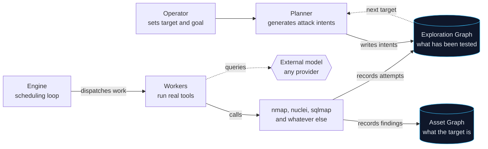
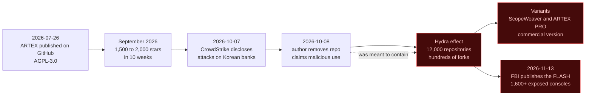
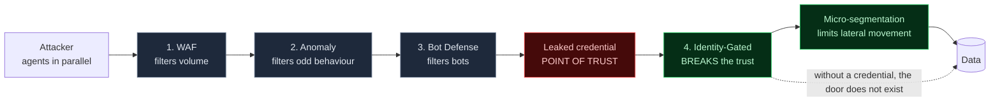

On November 13, 2026, Cloudflare published a post worth reading slowly: [Adapting to AI penetration testing orchestrators](https://blog.cloudflare.com/adapting-to-ai-penetration-testing-orchestrators). The opening number is the kind of thing you read twice.

In three days, **more than 50 families** of LLM pentest frameworks attempted to scan Cloudflare customers. The number of IP addresses running these frameworks grew into the thousands and kept climbing daily. Daily requests from these tools rose **30 times** since October 1.

And there is one sentence in the middle of the text that sums up the problem better than any number:

> defenders are struggling to keep up with the volumetric nature of these autonomously guided attacks

This piece is my reading of the case. It is not a summary of the Cloudflare post: where I disagree, I say so, and where other sources add something Cloudflare does not cover, I bring it in. All seven sources are at the end.

## What ARTEX actually is

First things first, because the name circulates without explanation.

**ARTEX** is an autonomous pentesting system: you give it a target and an objective in natural language, and it plans and executes the attack steps on its own, with almost no human intervention.

**It is not malware.** It is a legitimate security testing tool, used to find flaws before someone exploits them, that ended up being used for real attacks. That distinction matters, because it is exactly the path Metasploit and Cobalt Strike already walked.

The technical profile, as Google Threat Intelligence Group described it:

1. **Author**: the Chinese developer "Autumn-27"
2. **Release**: July 26, 2026, on GitHub, under the AGPL-3.0 licence
3. **Build**: Go backend with a Next.js web console, packaged as a **single binary**
4. **Storage**: PostgreSQL
5. **Its own model**: none, and this is the central point

The **single binary** explains the fast adoption: it installs with one command, with no infrastructure to assemble. Anyone with a server and a model API key has an attack orchestrator running.

### How it thinks

The architecture has three parts:

1. **Planner**: breaks the objective into tasks
2. **Workers**: claim tasks and execute them by calling real security tools
3. **Engine**: the loop that keeps everything moving until the objective is reached

The idea that makes the rest work is the **dual graph**. Two separate records:

1. **Asset Graph**: what the target *is*. Machines, services, credentials
2. **Exploration Graph**: what has already been *tested*. Attempts, findings, dead ends

That separation is the missing trick, and it is worth understanding why. A human pentester keeps all of this in their head, which is exactly why they do not scale: at some point they no longer remember what they already tried where. With state persisted in a graph, **dozens of agents work in parallel without colliding** and the system knows precisely what it has not tested yet.

The result is a loop that closes on itself: explore, decide, execute, write back.

The detail that changes the conversation: **ARTEX has no model of its own.** It orchestrates external models. Which model to use is the operator's choice, and that leads to the part almost nobody discusses.

## The model is not the barrier

Here I have to point out a gap in the Cloudflare post. It talks about "LLM" throughout and **never names a single model**. Zero mentions of DeepSeek, GLM, Kimi or Grok. And what the other sources show is that the model choice is decisive, for a reason that goes against intuition.

The FBI advisory, [FLASH-20261113-001](https://www.ic3.gov/CSA/2026/261113.pdf), is blunt about it:

> Analysis of attacker-controlled ARTEX instances shows Chinese models are most prevalent, with DeepSeek Flash family models dominating usage due to their balance of capabilities, relatively low cost, and lack of observable guardrails when framed for penetration testing.

Three reasons, and the third is the one that should bother you. It is not that the model has no safeguards. It is that they **do not fire when the request looks like legitimate security work**. Framing a request as "authorised pentest" is enough to walk through a defence that depends on the model's own judgement.

And one clarification, because the wrong conclusion is easy to draw: this is not a defect exclusive to Chinese models. ARTEX supports frontier models too, and the FBI lists Claude and GPT as available integrations. What the FBI reports is **prevalence of use**, not superiority of one country. A guardrail that depends on the model judging intent is bypassable anywhere.

### The arithmetic that changes everything

Check Point documented a real operator, from October 14 to 29, 2026, with the full accounting. The numbers side by side are worth seeing:

1. **Models**: DeepSeek v4.1 Flash and Kimi K3.1 Pro
2. **Setup**: two ARTEX consoles running in parallel, for about two weeks
3. **Tokens**: 36 billion in total, of which 2.13 bn input without cache, 33.79 bn input with cache, and 473.9 million output
4. **Total cost**: between US$ 700 and US$ 1,500
5. **Targets**: 10 code-signing shops, with the goal of stealing `.p12` certificates and their passwords for resale

Two weeks of organised operations against 10 targets, for under a thousand dollars. Also note the token ratio: **33.79 of 36 billion were cache hits**. The agent resends the same context at every step, and the cache slashes the cost of each repeat. It is serious use of cheap models, with engineering around it.

The implication is what matters: if running an autonomous attack costs on the order of **a few hundred dollars**, money stopped being the bottleneck. Neither is technical skill, because the framework delivers the reasoning already assembled and the model does the planning.

What remains as a barrier is **your posture**. A credential that leaked, a system without patches, an exposed admin port. ARTEX does not exploit any new flaw, and that bears repeating: it uses compromised credentials and outdated systems, exactly what already existed. What is new is the **automation of the reasoning**, not the technique.

An example from Google illustrates the difference well. In one operation, ARTEX generated **27 events in 23 seconds** probing AWS permissions across different security groups. In another, while preparing exfiltration scripts, it failed with "script too large", **trimmed the script and relaunched on its own**, finishing in about 10 seconds. That is the real change: it corrects itself without calling anyone.

## The hydra effect, or how killing the project multiplied it

This is the part of the case I find most instructive, and it starts with an honest attempt to do the right thing.

After CrowdStrike disclosed, on October 7, 2026, that ARTEX had been used against South Korean financial institutions, the author took the repository down on October 8. His statement was clear about the original intent, and the widely circulated translation is this:

> the malicious exploitation of this tool runs entirely counter to its original intent

What happened next is what deserves attention:

1. **October 1**: traffic baseline
2. **October 8**: original repository removed
3. **After that**: traffic **ten times higher** than before the removal, and **30 times higher** than on October 1
4. **Early November**: more than **1,600** publicly exposed ARTEX console instances
5. **November 13**: the FBI publishes its official advisory, and the framework already exists across **12,000 repositories**, with hundreds of forks carrying lineage from the original

Cloudflare gave this a name: the **hydra effect**. Cut off one head, and others grow. In Greek myth, the Lernaean Hydra grew two heads for every one cut, and the only way to win was to cauterise the stump before the new one grew. The analogy works precisely because the solution was not to cut faster: it was to stop the regrowth.

There is a lesson here worth more than the episode, and it is uncomfortable: **removing the obstacle does not remove the capability.** The knowledge was already distributed, the code was already free software, and hundreds of people already had a copy. The takedown changed the download address, not the ability to attack.

For defenders, the practical consequence is direct: if your security strategy depended on *one* thing being hard for the attacker to do, the world where that thing disappears has already arrived. The barrier has to be something that still holds when every tool is available to everyone.

## Why defence in depth gave way

Cloudflare claims that speed "effectively vaporizes legacy cyber security models". I think the sentence is right about the outcome and wrong about the cause. Speed is not the problem. Speed **exposed** the problem.

My reading is this: **defence in depth never validated anything.** Each layer trusted that the previous layer had done its job.

1. The firewall trusted that the application was patched
2. The application trusted that the identity presented was legitimate
3. The identity trusted that the credential had not leaked
4. The network trusted that nobody was already inside

While the attacker was human and time-limited, the layers appeared to work. They knocked on the door, gave up, tried again tomorrow. The implicit trust was never tested at the point where it breaks.

An autonomous agent does not give up at that point. It walks the same stack in bursts of **2 to 25 seconds**, without tiring, without losing patience, without switching to another task. And because it records what it already tried in the graph, it does not repeat: it exhaustively tests what remains.

Add the numbers up and the picture is clear:

1. Under **3 hours** from initial targeting to privileged access, according to the FBI
2. Around **23 hours** per project to reach the objective, according to Elastic
3. In one case tracked by Wiz, from first compromised account to deep system access in **4 hours**, and in one specific case in **15 minutes**

None of this depends on a new flaw. It depends on the layer above having trusted the one below.

## The six pillars, and where each one fails alone

Cloudflare proposes what it calls the **Modern Security Model**, with six pillars. They are good, and I will keep her order, but with a caveat the original post does not make: each pillar alone does not solve anything, and the value is in breaking the chain of implicit trust.

1. **Fortify the front gate**: WAF with advanced rules, including rate limits. The defence targets Layer 3/4 volumetric floods and direct IP probing
2. **A security station in the foyer**: anomaly detection across every web application your customers reach
3. **Identify phony visitors**: Bot Defense. Autonomous agents and reconnaissance tools do not behave like people: mechanical cadence, no pauses, no "blinking"
4. **Remove the back door**: Identity-Gated Access for every high-risk external and internal web application
5. **Inspect deliveries**: enforce validated schemas and explicit controls. The pillar cites OpenAPI schema validation, mTLS and a default-deny posture
6. **Neighborhood watch**: threat intelligence, to see the attack before it reaches your street

Here is my criticism of the six, and it is why I wanted to write about this rather than just republish it. Pillar 4 is the only one that **breaks** the implicit trust. It makes the back door cease to exist for anyone looking from outside, and micro-segmentation stops a stolen credential from crossing from production into development. The other five **filter**. And filtering is exactly the kind of defence the hydra effect showed to be bypassable.

The ConnectWise case is the proof. The compromise did not come from an exotic attack tool: it came from **static, non-expiring tokens** running inside CI/CD pipelines, with broad access across environments. The FBI says ARTEX was used afterwards, but initial access was handed over by credential hygiene.

An example Cloudflare documented from its own investigation reinforces the same point: an account API token, used by CI/CD, **with no IP restrictions and no rate limiting**. On top of that, ARTEX created dozens of Worker scripts named `artex-*`, `artex-pgrecon-*` and `artex-do-*`, and generated activity above **69 requests per minute** with **400 database dump requests in one hour**.

## What I would do first

If you read this and need to decide where to start, my order does not follow Cloudflare's.

**First, credential and identity.** Inventory what does not expire: static tokens in CI/CD, API keys with no IP restriction, service accounts with broad access. This shows up in the ConnectWise case, in the Cloudflare case and in the Cairn case. That is not a coincidence: it is where all three investigations ended up.

**Second, take the admin panel off the internet.** That is pillar 4, and it reduces surface area fastest. The FBI points out explicitly that ARTEX excels against peripheral targets: partner portals, mobile backends, employee applications, legacy services. Nobody is watching those.

**Third, micro-segment, with the goal of making lateral movement noisy.** The aim is not to stop everything, it is to generate events you can correlate.

**Fourth, detect by behaviour, not signature.** Elastic was precise about this and it bears repeating: nothing anchored on source address, User-Agent or framework fingerprint survives, because they change faster than signatures. What does not change is what the attack **does** in your environment: new processes, API calls, sign-ins. Anchor there.

**And the question I would ask myself, before any tool:** which of my layers is implicitly trusting the one before it? Until that answer is clear, adding the seventh pillar will not fix the first one.

## Sources and links

1. [Adapting to AI penetration testing orchestrators: The Modern Security Model](https://blog.cloudflare.com/adapting-to-ai-penetration-testing-orchestrators), Cloudflare Blog, November 13, 2026. The starting text: the framework numbers, the hydra effect and the six pillars of the Modern Security Model
2. [Threat Overview of ARTEX Autonomous Penetration Testing Framework](https://www.ic3.gov/CSA/2026/261113.pdf), FBI, FLASH-20261113-001, November 13, 2026. The heaviest source: TTPs, IOCs, the sectors affected, the under-three-hours figure and the analysis of which model attackers use
3. [ARTEX and Friends: Enter Agentic Offensive Frameworks](https://cloud.google.com/blog/topics/threat-intelligence/artex-and-friends-enter-agentic-offensive-frameworks), Google Threat Intelligence Group, October 30, 2026. The technical description of ARTEX: the six sub-agents, the dual graph and the 2-to-25-second bursts
4. [Hacking on Autopilot: Inside ARTEX Cybercrime Campaigns](https://research.checkpoint.com/2026/hacking-on-autopilot-inside-artex-cybercrime-campaigns/), Check Point Research. The real operator's accounting: 36 billion tokens, two cheap models and a cost between US$ 700 and US$ 1,500
5. [Attackers Use Autonomous AI to Target Semiconductor, Defense and Civil Society Sectors](https://unit42.paloaltonetworks.com/cairn-framework-ai-autonomous-attacks/), Unit 42, Palo Alto Networks. Campaign CL-STA-1238 with the Cairn framework: 25 operations against at least 19 organisations
6. [Inside the loop: Five AI attack frameworks that never ask permission](https://www.elastic.co/security-labs/threat-command/agentic-offensive-frameworks-detection-artex), Elastic Security Labs, November 13, 2026. What reaches your telemetry and why detecting by behaviour outlasts detecting by signature
7. [ARTEX AI Pentesting Tool Used in Data Theft Attacks on South Korean Financial Firms](https://thehackernews.com/2026/10/artex-ai-pentesting-tool-used-in-data.html), The Hacker News, October 8, 2026. The case that starts the timeline: the South Korean bank attacks and the author's decision to close the source
