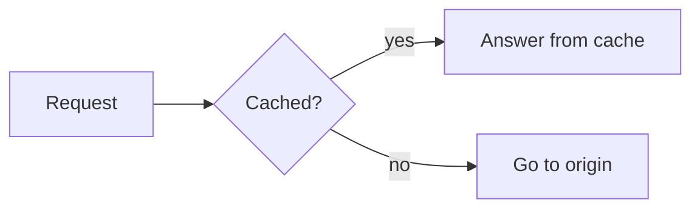

## Two Cloudflare decisions, nine months apart

In February 2026 Cloudflare announced **Markdown for Agents**. The name says the essentials: if a program requests a page with the `Accept: text/markdown` header, Cloudflare's network fetches the HTML from the origin, converts it on the spot and returns Markdown.

Nine months later, in November, came **Search for Agents**. That one is more ambitious and admits a problem the first did not solve: converting page by page still forces the agent to crawl the whole site to find what it needs.

The first delivers the document. The second delivers how to find the document. **The format common to both is Markdown.**

This is not a matter of taste. It is an architecture decision, with numbers behind it.

## Why Markdown, and not HTML

The cost argument is easy to grasp if you have ever paid to have a document read.

An agent reading your site pays per token, the same way you pay per minute on a phone call. And here is what happens: **the page you publish was made for a browser to draw, not for a machine to understand.** It carries a navigation menu, a footer, a cookie notice, a banner, an analytics script. None of that is your text. All of it is billed.

Cloudflare summed it up in a line worth keeping: feeding raw HTML to an AI is like paying by the word to read the packaging instead of the letter.

And they measured their own post: **16,180 tokens as HTML against 3,150 as Markdown.** Eighty percent of what they were paying for was packaging.

### The numbers from people who do not sell the conversion

That figure comes from a company selling the service, so it is worth finding measurements made without an interest. There are at least three such independent measurements:

| Who measured | What they measured | Result |
|---|---|---|
| skryp.dev | 170 public pages | HTML **65,378** tokens against Markdown **1,800** at the median. On documentation pages, **68 times** smaller |
| getmarkforge | 11 pages, published method | Savings from **25% to 98%**, median **91%** |
| Cloudflare | the announcement post itself | **80%** reduction |

All three point the same way, and the number that matters is not the percentage: it is that **the saving tracks the markup, not the content**.

### The caveat almost nobody shows

Here is the detail that separates an honest argument from a sales number.

getmarkforge published the cases where Markdown barely helps:

- Paul Graham's *How to Do Great Work*: **25.5%** saving
- A Simon Willison post about LLMs: **32.6%**

Those two pages are **almost nothing but text**. They have no shop menu, no infobox, no cart. If there is no packaging to cut, there is no saving to make.

The contrast with the opposite end of the same study is wide: a GitHub repository page yielded **98.4%** savings, because almost everything there was repository interface and the real content was a 2,500-token README.

**The rule is this:** the more interface your page has, the more Markdown helps. A clean essay saves a quarter. A shop page saves nearly everything.

## Markdown is not a file type. It is a contract

It is worth pausing on one idea that organises the rest of the post.

There is a difference between **how you store** a text and **how you deliver** a text. Markdown lives on both sides, and that is what makes it interesting.

As a file format it is just text: it opens in any editor, it lasts for decades, it appears in full in a Git diff. As a delivery format it preserves the **structure** of what you wrote. And structure, to a reader, is information.

Compare two versions of the same content:

```html
<div class="section">
  <h2 id="installation">Installation</h2>
  <p>Run the command <code>npm install</code>.</p>
</div>
```

```markdown
## Installation

Run the command `npm install`.
```

The Markdown carries the same information with one important difference: **the reader does not have to guess what is structure and what is decoration.** The `class="section"` and the `id="installation"` tell an agent nothing. The `##` says exactly one thing: this is a second-level heading.

That is why Cloudflare calls Markdown the *lingua franca* of agents. Not because it is pretty, but because it is the only popular form of text with structure that both machines and humans read well.

## Writing: what makes your Markdown get read

So far the post has explained the why. From here on it is the how, and that is the part that matters in practice.

There is a detail of Markdown that usually goes unnoticed: **the same syntax can be written in ways that look alike and behave differently.** What follows is what separates a document that survives from one that breaks.

### Headings: the hierarchy is the document's index

The most common mistake is using `##` for visual size instead of for meaning. It happens like this: you want that subheading to look smaller, so you use `###` even though it is a new subject.

That looks cosmetic and is not. The heading hierarchy is what an agent uses to build the index of your text. If it lies, the index lies along with it.

**Use a single `#` for the document title**, and step down one level at a time. Never jump from `##` to `####`, because the level you skipped is information you are denying the reader.

### A code block has to be closed, and the language matters

Code blocks are where syntax breaks most silently. Look at both:

````
```python
def add(a, b):
    return a + b
```
````

Without the language declared on the fence the block still works, but it loses its colouring and it loses the information about which language it is. For someone reading your material looking for an example, the difference between a generic block and a `python` block is large.

And the mistake that does the most damage: **an unclosed fence**. Everything after it becomes code. The symptom is obvious, but it confuses because the text that vanished is right there in the file.

### A warning about four-space indentation

In Markdown, **four spaces at the start of a line create a code block.** That is a rule of the specification, not a choice by whoever wrote the renderer.

The side effect is that a paragraph indented four spaces "to look nice" turns into a grey box. And a nested list with the wrong indentation comes out flat.

If you align code or text inside a list, the indentation becomes **relative to the item**, not to the page margin. That is the reason behind the classic "my sublist lost its indent".

### The rule almost nobody knows, and which explains half the bugs

There is a precedence rule in Markdown that is technical, but it resolves a lot:

**Inside an HTML block, Markdown content is ignored.**

If you open a `<div>` and write Markdown directly underneath without a blank line first, that content is not processed as Markdown. It comes out literal, or it is removed by sanitisation.

This is why many people write `<div class="notice">` in a README and the text shows up with raw `**` in the middle. **Markdown is not broken: it was not processed.**

The fix is simple: leave a completely empty line between HTML and Markdown, and prefer Markdown syntax whenever one exists.

### Tables are not part of Markdown

This is the most common source of confusion, and it is worth understanding why.

The original Markdown, released in 2004, **had no tables**. Every site implemented its own. That produced a mess that took nearly a decade to resolve with **CommonMark**, a specification with a test suite for the basic syntax.

The problem is that CommonMark settled the base and **deliberately stopped there**: no tables, no task lists, no strikethrough. Those came later, in **GFM** (GitHub Flavored Markdown), which is CommonMark plus five extensions.

In practice this means **the table that works on GitHub may not work on your blog, in your editor or in your site generator.** It is not a bug: they are different dialects.

Two concrete consequences:

1. If you write documentation that will live in more than one tool, test the table in both before trusting it
2. The GFM specification **does not require three dashes** per column. `---` is convention; `-` already renders a table in several renderers. Trusting the minimum is what makes the table break when it changes tools

### Numbered lists are not an aesthetic detail

In ordinary writing, choosing "1." or "-" is a style decision. In technical documentation it stops being one.

Numbered lists carry **order**, and order is often the content. A procedure where step 3 must happen before step 5 cannot become a bulleted list: you erase the information that makes the procedure work.

The guidance is to use a number when order matters and a bullet when it does not. And to be consistent within the same document.

## Diagrams: the diagram is the text

Now the first of your practical questions, and the answer is more direct than it looks: **a diagram in Markdown should be text, not an image.**

Mermaid is a language that describes diagrams with syntax close to Markdown. Instead of exporting a PNG from your editor, you write:



The gain is not only that the drawing appears. It is that **the diagram becomes text like everything else**:

- it appears in full in the **Git diff**, so you review a change in flow the way you review a sentence
- it **does not go stale in silence**, because whoever edits the text is looking at the diagram
- it is **accessible**, in the sense that a screen reader and an agent read the same structure
- it does **not weigh** on the repository or turn into a binary nobody can compare

A diagram PNG is a black box that ages on its own. A Mermaid diagram ages along with the text.

### What Mermaid does not solve

Not everything is favourable, and it is worth knowing where it hurts.

**Nothing guarantees the reader will render it.** GitHub renders Mermaid, but it does so in the browser, with the JavaScript library. An API request or a raw file link receives the **diagram code**, not the drawing. Cloudflare itself describes this progressive behaviour: whoever does not execute JavaScript sees the original syntax.

That has a practical consequence: **if your diagram needs to appear for an agent**, the text inside the fence is what it will see. Which means **a readable diagram is worth more than a pretty one.** Name nodes with real words, not abbreviations that only make sense once drawn.

**And inside a table it usually does not work.** Putting Mermaid in a table cell is among the cases that show up most in forum questions and least in working setups, because every renderer handles it differently. If you need a diagram next to tabular data, the route is the diagram **after** the table, not inside it.

**Too many ideas in one fence break as well.** A flowchart with thirty nodes is still valid text and becomes an unreadable drawing on a small screen. The useful limit is roughly the same as a good diagram in any tool.

## Workflows: write for whoever will slice it

This section looks technical and has a simple conclusion: **the more you respect the document's structure, the better it gets found.**

When an agent or a search system reads your documentation, it does not read all of it. It **slices** the text into pieces and looks for the piece that answers the question. That slicing is called chunking.

There is a measurement that shows the size of the difference. recallrun tested five ways of slicing across 151 files of real FastAPI documentation, with 773 questions:

| How the text was sliced | Finds the right section on the first try |
|---|---|
| Fixed-size pieces | **39%** |
| Fixed size, adjusted | 48% |
| Paragraphs packed together | 38% |
| **Respecting the headings** | **71%** |
| Respecting the headings and citing the path | **79%** |

The number that explains everything is in another column of the same measurement: **fixed-size pieces cross the boundary between two sections in 59% of cases.**

Think about what that means. A piece that is half "Installation" and half "Configuration" **is good at neither**. It exists because the cut was made by counting characters, not by subject.

A piece that answers well is a piece that starts and ends on one subject.

### What that changes in how you write

Three practical decisions come out of that measurement:

1. **One idea per section, and headings that describe the idea.** The heading is not decoration: it is literally what makes the system find your section when someone asks about it.
2. **Headings that stand on their own.** The hierarchical path (`Manual > Security > Access keys`) is what took the hit rate from 71% to 79%. If a heading only makes sense read together with the previous ones, it loses force when sliced.
3. **A procedure is a numbered list, not flowing prose.** One step per item, in order. A step hidden in the middle of a long paragraph is a step that disappears in the slicing.

## Tables: when to use them and when not to

A table is the right tool when **the information is compared along two dimensions**. Comparing plans, limits, versions, options: all of that is a table.

A table is the wrong tool when:

- **the information is a sequence.** Step by step in a table is a list in disguise, and it usually gets read out of order
- **the content of a cell is long.** A cell with three sentences breaks the alignment and reads badly on a small screen
- **you need something inside it.** Mermaid, code blocks and long lists inside a cell are the cases that break most between dialects

One alternative is worth knowing for content that needs room: **a definition list by bold**, which is only text and therefore works everywhere.

**Minimum version:** 16 GB of RAM and 4 vCPU

**Recommended version:** 32 GB of RAM and 8 vCPU

It lacks the elegance of a table, and it never breaks.

## Organisation: the type of document comes before the subject

You can write the best Markdown in the world and still be useless, if you are answering the wrong question. This happens a lot because **"documentation" is one name for four different things.**

The best way I know to separate those four things comes from **Diátaxis**, a method for technical documentation. It starts from a simple idea: there are four different needs a reader can have, and each one calls for a type of text.

| Type | Answers | Way of reading |
|---|---|---|
| **Tutorial** | "I want to learn this from scratch" | end to end, without skipping |
| **How-to guide** | "I know what I want, tell me how" | looking for a passage |
| **Reference** | "what is the exact syntax of the parameter?" | consulting |
| **Explanation** | "why does this work this way?" | reading calmly |

The reason this improves the Markdown is not organisational, it is practical: **each type has a natural structure**, and structure is what the slicing respects.

A tutorial is sequence: numbered list, one step per item, no detours. A reference is symmetry: every item in the same format, predictable, because whoever consults it is comparing. An explanation is prose with headings that divide the reasoning.

Mixing the four in one document is the most common cause of documentation that exists and helps nobody.

### And the file hierarchy is part of the answer

Choosing the title is half the work. The other half is deciding where the file lives, because **the path helps people find the material** as much as the text does.

A convention that works well:

```
docs/
├── start-here/      ← tutorials
├── how-to/          ← practical guides
├── reference/       ← consulting
└── explanation/     ← the why
```

If you keep a notebook instead of a site, the same logic holds with names that describe the content rather than dates: `home-network.md` ages better than `notes-2026-03.md`.

## How to check whether your Markdown survives

Closing the practical part, three checks that catch nearly every problem, in order of ease.

**1. Read the raw file.** Open the `.md` in your editor without rendering it. If the text is still understandable, you wrote a document that survives conversion. That is the property the specification cites as Markdown's design goal, and it is the cheapest test there is.

**2. Check the heading hierarchy.** A single `#`, with no level skipped. If you need `####` for a new subject, the structure is lying and the navigation goes with it.

**3. Test in the two tools where the file will live.** If it appears on GitHub and on your site, check it in both. Tables, Mermaid and embedded HTML are exactly the constructs that diverge between dialects, and the only way to know is to look.

These three checks do not replace knowing the syntax. They catch the mistakes that slip through because **broken Markdown still looks like valid text.** It is the one characteristic of the format that works against you, and that is why it is worth checking instead of assuming.

## What changes after this

The part that matters in this post is not Cloudflare.

It is understanding that the text you write has two possible readers, and that structure serves both at the same time. A human understands because the hierarchy is clear. A program understands **for the same reasons.**

Writing Markdown well stopped being about looking organised. It became about being findable. And the decisions that make the difference are small: one `#` instead of two, a numbered list where order matters, a diagram that is text, a heading that stands when read alone.

None of them requires a new tool. They require deciding who will read.

## Sources

- [Introducing Markdown for Agents](https://blog.cloudflare.com/markdown-for-agents/) — the announcement of HTML-to-Markdown conversion on the network, with the 16,180 against 3,150 token measurement
- [Introducing Search for Agents](https://blog.cloudflare.com/search-for-agents/) — a search index exposed to agents, discovery through metadata and support for the HTTP QUERY method
- [Markdown for Agents, developer documentation](https://developers.cloudflare.com/fundamentals/reference/markdown-for-agents/) — header behaviour, `Vary: Accept` and what is removed during conversion
- [How many tokens is a web page? 170 pages measured](https://skryp.dev/benchmarks/tokens-per-web-page) — independent measurement by page type
- [HTML vs Markdown for LLMs: token counts on 11 real pages](https://www.getmarkforge.com/guides/html-vs-markdown-tokens) — open method, including the low-saving cases
- [RAG chunking, measured: heading-aware chunks doubled hit@1](https://recallrun.dev/posts/rag-chunking-strategies-measured/) — 151 files, 773 questions, five slicing strategies
- [CommonMark Spec](https://spec.commonmark.org/spec.html) — the specification that resolves the ambiguity of original Markdown
- [GitHub Flavored Markdown Spec](https://github.github.io/gfm/) — the five extensions on top of CommonMark, including tables
- [Diátaxis](https://diataxis.fr/) — the method that separates tutorial, how-to guide, reference and explanation
- [Include diagrams in your Markdown files with Mermaid](https://github.blog/developer-skills/github/include-diagrams-markdown-files-mermaid/) — how GitHub renders Mermaid and why the raw syntax arrives in API requests
