## A 2014 bug that only surfaced now

On 19 November 2026, **CVE-2026-99362** was published, nicknamed **NFS2ROOT**. It gives **remote root, without a password and without interaction**, on any Linux server sharing files over NFS.

The part that tends to become the headline is the age: the defect has been there since **Linux 3.16, from March 2014**. Twelve years.

I have to admit that part bothers me a little, because it pulls attention away from what actually matters. A 12-year-old bug is not a mystery about old code. It is a question about **a forgotten service left running**. And that is the question this post wants to help you answer in your own environment.

## What happens, in one sentence

The NFS server runs **inside the kernel**, and it has to parse what arrives over the network **before** it knows who you are. The flaw lives exactly in that gap: a malicious client can shrink the reply buffer to zero bytes and then make the server copy a full reply into it.

What spills over lands on the kernel heap, and **the attacker chooses a good part of those bytes**.

```mermaid
flowchart LR
    A[Client with no credentials] -->|"tcp/2049<br/>NFSv4.1"| B["nfsd in the kernel<br/>parses before authenticating"]
    B --> C["Client negotiates<br/>ca_maxresponsesize_cached<br/>down to the minimum"]
    C --> D["Slot buffer<br/>becomes 0 bytes"]
    D --> E["Crafted COMPOUND<br/>fills up to the opcode<br/>but not the status"]
    E --> F["Server thinks it worked<br/>and copies the whole reply"]
    F --> G["80 bytes copied<br/>61 past the end<br/>40 chosen by the attacker"]
    G --> H["KASLR inferred<br/>function pointers overwritten"]
    H --> I["When the connection closes<br/>the kernel runs the command<br/>as root"]
```



The exact figures from the kernel report: **80 bytes copied, 61 past the end of the heap object, 40 of them controlled by the client**.

The most interesting detail is that **the protocol hands the decision to the client**. It is the client that tells the server how large a reply cache it expects. It asks for the minimum, and then sends a reply too large to fit. It is a class of failure you can understand without knowing C: you convince the other side to reserve a tiny space, then hand over something bigger.

## How the bug was found

This part is worth knowing, because it shows how old flaws tend to surface.

The path started on **17 August 2026**, when **Jeremy Jean of ANSSI**, the French cybersecurity agency, submitted the fix upstream. It did not arrive through normal code review. It arrived alongside a **KASAN** report, the kernel's out-of-bounds detector. KASAN pointed at the heap write, and from there the defect became visible.

On **21 September**, independently, the security firm **OpenSec** reached the same point using an AI system of its own, called Antara. It scored the flaw 9.8 and turned it into a root shell. In late September, OpenSec sent both the exploit and a patch to the nfsd maintainers.

The CVE was published on **19 November**, three months after the fix existed. Along the way, OpenSec nicknamed the flaw NFS2ROOT.

The lesson here is not about AI or about detection tooling. It is about **why code from 2014 was only looked at in 2026**. It took an automatic detector pointing at one specific line, because no human review found the problem in twelve years.

## Who is exposed

The condition is narrower than the scare suggests, and it is worth knowing exactly what it is:

- a kernel **older than the fixed version** in your series;
- **`nfsd` loaded and running** (the kernel's own NFS server);
- NFS **v4.1 or v4.2**, which is the default when the service is active;
- **TCP port 2049 reachable** by someone you do not control.

If `nfsd` is not running, you are not exposed, even on an old kernel. **Red Hat says this plainly.** In default RHEL configurations, the kernel NFS server does not run. The attack surface is limited to systems configured to export NFSv4.1 or v4.2 shares on purpose.

That works as method rather than comfort. The first question should be **"am I an NFS server?"**, not "is my kernel old?".

## Step 1: find out whether you are exposed

Three commands, in order. None of them change anything.

```bash
# 1. Is the nfsd module loaded?
lsmod | grep nfsd

# 2. Is there an nfsd process running?
pgrep -a nfsd

# 3. Is anything listening on 2049?
ss -tlnp | grep 2049
```

If all three come back empty, **you are not exposed over the network**, and you can skip straight to the version check, more out of hygiene than urgency.

If the third one shows something, look at **which address** it is listening on. `0.0.0.0:2049` or `*:2049` means **every interface**, including the one facing outwards. `127.0.0.1:2049` is local and not reachable from another host.

One extra command that helps on a file server is listing what is exported:

```bash
showmount -e localhost
cat /etc/exports
```

It is worth looking carefully at whether any export uses `*` or a wide client range. An export opened to the whole network turns any compromised machine on that network into a starting point.

### What if it is a NAS or an appliance

Here the answer changes shape. On a NAS or appliance, **you do not update the kernel**: you wait for the vendor. The route is the administration interface, looking for a firmware update.

In the meantime, what is in your hands is **segmentation**: NFS should not be reachable outside the network where the clients actually live. If a NAS exposes NFS to the internet, that is the problem, and it can be solved today without depending on firmware.

## Step 2: check your kernel version

The landmark is the fixed version in **your** series. There is no single number.

| Series | Fixed in |
|---|---|
| 5.10 | 5.10.275 |
| 5.15 | 5.15.226 |
| 6.1 | 6.1.193 |
| 6.6 | 6.6.163 |
| 6.12 | 6.12.117 |
| 6.18 | 6.18.61 |
| 7.3 | 7.3.2 |
| 7.4 | 7.4-rc1 |

Check what you have:

```bash
uname -r
```

And compare it with your series. A `6.12.110` is vulnerable; a `6.12.117` is not. **Watch out:** you cannot just look for the bigger number. A `6.6.163` is fixed and is older than a `6.12.100`, which is not.

### Full version table

For quick reference. If your `uname -r` is **lower** than the fixed version in your series, you are vulnerable.

| Kernel series | Fixed in | Note |
|---|---|---|
| 5.10 | 5.10.275 | older LTS, common on Debian 11 and derivatives |
| 5.15 | 5.15.226 | LTS, common on Ubuntu 22.04 |
| 6.1 | 6.1.193 | LTS, base for Debian 12 (bookworm) |
| 6.6 | 6.6.163 | LTS, base for Debian 13 and Ubuntu 24.04 |
| 6.12 | 6.12.117 | LTS, also used on Debian bookworm via backport |
| 6.18 | 6.18.61 | intermediate series |
| 7.3 | 7.3.2 | current series |
| 7.4 | 7.4-rc1 | mainline |

**How to read this table.** The bigger number is not automatically the safer one. A `6.6.163` is fixed and is lower than a `6.12.100`, which is not. Always compare within **your** series.

### What each distribution calls fixed

The package number is rarely the same as the kernel.org one, because distributions apply the fix on top of the version they already ship. The columns show the fixed package and the matching advisory.

| Distribution | Fixed version | Advisory |
|---|---|---|
| Debian 12 (bookworm) | `linux-image` 6.1.192-3 | DLA-4942-1 |
| Debian 13 (trixie) | `linux-image` 6.12.117-1 | |
| Debian bookworm (6.12 backport) | 6.12.117-1~deb12u1 | DLA-4927-1 |
| Proxmox VE (7.0 series) | `proxmox-kernel-7.0.14-30-pve` | PSA-2026-00103-1 |
| Proxmox VE (7.3 series) | `proxmox-kernel-7.3.3-1-pve` | opt-in series |

**Red Hat and Ubuntu** publish per-release status on their own CVE pages. Check your exact version before assuming you are fixed, because the situation changes between releases and between derived products.

The most reliable route is not to memorise any of this: **look up the CVE on your distribution's security page** and check the status for your release. The sources are at the end of the post.

## Step 3: update and reboot

Here is the mistake I see most often with this kind of fix, and it is a silent one:

**Updating the kernel package does not fix the running kernel.** The old kernel stays in memory until the next boot. You update, the package manager reports success, and the machine remains vulnerable until someone reboots, which on a file server can take months.

So the procedure has two parts:

```bash
# Debian / Ubuntu
sudo apt update && sudo apt upgrade
sudo reboot
```

```bash
# Red Hat / derivatives
sudo dnf upgrade --refresh
sudo reboot
```

```bash
# Proxmox VE
apt update && apt full-upgrade
# note: reboot each VM and container too if they use the host kernel
reboot
```

After the reboot, **confirm the new kernel is running**:

```bash
uname -r
```

Comparing before and after is what closes the loop. Without that step you are left with the feeling of having fixed it, which is worse than knowing you have not.

### On Proxmox, and on any virtualisation host

One specific care is worth taking: on machines running VMs and containers, the kernel is shared. Updating the host fixes the host, but **the kernel inside each VM depends on the guest system**. A VM with an old kernel stays vulnerable even with the host updated.

The route is: update the host, reboot the host, then **go into each VM and container and repeat the check**. It is the kind of task nobody finishes in a hurry, which is exactly why virtualised environments tend to keep loose ends.

## If you cannot update right now

Not everyone can reboot today. There are two risk reductions that do not need a reboot, and that are worth keeping even after you update.

### Do not need NFS? Turn it off

```bash
systemctl stop nfs-server
systemctl disable nfs-server
```

Red Hat is direct about it: if NFS sharing is not required, stop and disable the service.

**Warning:** this **drops active NFS sessions**. On a file server with mounted clients, clients will see I/O errors and processes may hang. Do this knowing the window, not as a reflex.

### Need NFS? Restrict 2049

The second option is to keep the service up and reduce who can talk to it. With `firewalld` (Red Hat family):

```bash
# remove the generic nfs service allowance
sudo firewall-cmd --permanent --remove-service=nfs

# allow 2049 only from your trusted network
sudo firewall-cmd --permanent --add-rich-rule='rule family="ipv4" source address="192.168.1.0/24" service name="nfs" accept'
sudo firewall-cmd --reload
```

With `ufw` (Debian/Ubuntu):

```bash
sudo ufw deny 2049/tcp
sudo ufw allow from 192.168.1.0/24 to any port 2049 proto tcp
```

**Warning:** the `--reload` applies the rule immediately and **cuts off clients that are not on the allowed list**. If you have a legitimate client you forgot about, it goes down now.

Two notes that prevent surprises:

- NFS also uses **rpcbind on 111**. Restricting only 2049 leaves discovery working, which is enough to keep the attack away from the service;
- **restricting is not fixing.** If someone is already inside your network, the port stays reachable. This is exposure reduction, not a remedy.

### A third route, for specific cases

Disabling NFS v4.1 and v4.2, accepting only v3, also closes the attack path, because the flaw depends on v4.1 sessions. It is workable in environments already using v3 for compatibility, but it loses protocol features and I would not recommend it as the default choice.

## Where to look if you think you were already compromised

The sources agree that **there are no reports of exploitation in the wild so far**. Even so, it is worth knowing what to look for, because the attack has no simple network signature.

Signs worth investigating:

- **kernel warnings from `nfsd4_check_resp_size`** in `dmesg` or the journal;
- **shells spawned by kernel workers** on a file server, which is not normal in any scenario;
- **bursts of short NFSv4.1 sessions** from a single source;
- **kernel oopses** with `nfsd4_*`, `svc_*` or `call_usermodehelper*` frames.

There is an irony in the first item worth understanding: **the kernel warns, but it warns late.** The check that produces that warning runs **after** the out-of-bounds copy has already happened. The log confirms the attack; it does not prevent it.

## What this case teaches beyond itself

Coming back to the point from the opening, because this is where the post stops being about one specific CVE.

What made this bug last 12 years was not the subtlety of the code. It was the combination of three things that reinforce each other:

**Nobody switches off a service that works.** NFS was configured once, years ago, and nobody has had a reason to touch it since. A working service does not draw attention, and what does not draw attention does not get reviewed.

**The port was open to people who did not need it.** The case is uncomfortable because 2049 tends to be open to the whole internal network. It should be restricted to the real clients. A `*` in `/etc/exports` is convenient on installation day and a problem for a decade.

**The kernel does not ask who you are before reading the packet.** Authentication comes after parsing, which is why a flaw at that stage is pre-auth by construction. That is not carelessness. It is how the protocol works, and it explains why flaws in that layer are so severe.

None of that is solved by a tool. It is solved by a question nobody enjoys asking: **how many services do I have running that nobody uses any more?**

NFS2ROOT is a good reminder that the question has an expiry date.

## Practical summary

- **Find out whether you are an NFS server:** `lsmod | grep nfsd`, `pgrep -a nfsd`, `ss -tlnp | grep 2049`
- **Check your version:** `uname -r`, compared against the fixed version in your series
- **Fix it:** update **and reboot**, then confirm with `uname -r` that the new kernel came up
- **On Proxmox:** update the host **and** every VM and container
- **If you cannot right now:** stop `nfs-server` if you do not use it, or restrict 2049 to your network
- **Updating is not enough:** restrict 2049 even after fixing

## Sources

- [CVE Record: CVE-2026-99362](https://www.cve.org/CVERecord?id=CVE-2026-99362) — official record, with the fix commit text and the KASAN report
- [linux-cve-announce](https://www.openwall.com/lists/linux-cve-announce/2026/11/19/36) — Greg Kroah-Hartman's announcement with the full technical description
- [Red Hat: CVE-2026-99362](https://access.redhat.com/security/cve/cve-2026-99362) — analysis, CVSS 9.4 from Red Hat, and the mitigation commands with `firewalld`
- [Debian Security Tracker](https://security-tracker.debian.org/tracker/CVE-2026-99362) — fixed versions per release: `6.1.192-3` on bookworm, `6.12.117-1` on trixie
- [Ubuntu: CVE-2026-99362](https://ubuntu.com/security/cve-2026-99362) — status per Ubuntu release
- [SUSE: CVE-2026-99362](https://www.suse.com/security/cve/CVE-2026-99362.html) — CVSS 9.8 from the CNA and 9.0 under CVSS v4
- [Proxmox: PSA-2026-00103-1](https://proxmoxcve.com/en/psa/PSA-2026-00103-1) — Proxmox VE specific advisory, with the `proxmox-kernel` versions
- [OpenSec: NFS2ROOT](https://opensec.in/blog/nfs2root-cve-2026-99362) — writeup with the timeline and the root shell demonstration
- [heise online](https://www.heise.de/en/news/Critical-vulnerability-in-Linux-s-NFS-server-11540633.html) — the list of fixed versions and the KASLR detail
- [Microsoft MSRC](https://msrc.microsoft.com/update-guide/en-US/vulnerability/CVE-2026-99362) — Microsoft's update guide
